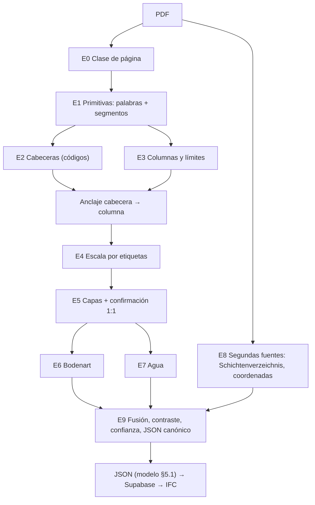

# Algoritmo de extracción v4 (especificación)

**Para qué sirve esta nota:** describir el algoritmo con la precisión suficiente para
reimplementarlo en `geo_agent/` sin leer el prototipo. Cada etapa dice qué recibe, qué entrega,
qué parámetros usa y **por qué** (lección de [16](16_lecciones_aprendidas.md)). Implementación de
referencia: [`prototyp_v4.py`](../spikes/extraktion_v2/prototyp_v4.py). Las reglas se pueden
apagar una a una (`RULES`) para medir su efecto.

**Principio rector (objetivo):** cada dato que sale va al Baugrundmodell con **procedencia**
(página, bbox, método) y **confianza**. Si algo no se puede confirmar, se marca; no se inventa.

## Vista general

Todas las coordenadas están en el sistema de la **vista** de la página (rotación aplicada) y en
puntos PDF; la profundidad es en m bajo el inicio (GOK).

## E0. Clase de página

| Clase | Condición | Consecuencia |
|---|---|---|
| `raster` | imágenes cubren > 45 % y < 10 palabras dentro de ellas | segmentos desde la imagen + **OCR** |
| `raster_ocr` | imágenes > 80 % (escaneo con capa OCR, aunque traiga ruido vectorial, E2) | segmentos de imagen **y** vectoriales; texto de la capa **+ OCR propio** donde la capa no tiene palabras (L18b) |
| `vektor_ohne_text` | ≥ 150 dibujos y < 25 palabras (AutoCAD SHX) | segmentos vectoriales + **OCR** |
| `vektor` | resto | todo nativo |

Lecciones E1, E2, L11, L17, L18. OCR: RapidOCR (ONNX, Apache-2.0); resolución adaptativa
(≈ 3300 px de lado largo, entre 200 y 300 dpi, para páginas reducidas); se descartan cajas con
confianza < 0,5 y las que se solapan > 30 % con palabras nativas; caché por imagen de página.

## E1. Primitivas

- **Palabras:** `(rect, texto, bloque, línea)`. Las cajas OCR son una línea; sus palabras reciben
  un rango x proporcional a su posición en la cadena.
- **Segmentos:** todo path (línea, rectángulo, quad) se descompone en segmentos con ancho, trazo y
  discontinuidad (L1). En raster, apertura morfológica horizontal/vertical con núcleo de ~3 mm;
  líneas de ≤ 10 px de grosor (L11).
- **Rotación:** palabras y paths × `page.rotation_matrix` (L2).

## E2. Cabeceras

Se aceptan, en este orden:
1. Línea `^<PREFIJO> <n>[a-z][/aa]( - texto)?$` con prefijos `B BK KB KRB RKS BS GWM SCH`
   (L13: el sufijo `- Betonweg 0+050` se ignora).
2. Archivo: `^S <n>[a-z]$` (`S 2a`).
3. Genérico: `Bohrung`, `<Palabra>bohrung` (`Sondierbohrung`, `Rotationskernbohrung`),
   `Bohrprofil`, `Aufschluss`, `Rammkernsondierung`, seguido del código en la misma línea
   (`Sondierbohrung : SST KB 5`) o en la fila de debajo (≤ 14 pt), uniendo los bloques de esa fila
   (`RB` + `2 / I`). Código: mayúsculas/cifras/`./-`, ≤ 16 caracteres, con al menos una cifra, que no
   sea una fecha ni una profundidad (T1).

Los códigos se comparan sin espacios (`B1` = `B 1`), porque el OCR los pierde.

## E3. Columnas y límites

- **Bordes:** verticales con trazo, colineales fusionadas (hueco ≤ 1,5 pt), largo ≥ 30 pt.
- **Columna:** par de bordes con 8 ≤ ancho ≤ 80 pt, alto ≥ 2,5 × ancho y solape ≥ 90 % (G1).
- **Límites:** horizontales continuas (no discontinuas, G2) que cubren la columna de borde a borde
  con tolerancia 0,6 pt; líneas a < 0,8 pt se fusionan (1,6 pt en raster).
- **Anidadas:** se queda la de bordes más gruesos (G3).
- **Anclaje:** cada cabecera toma la columna con centro a < 70 pt en x y **por debajo** de ella,
  sin límite vertical (L4); preferencia: grosor de borde, nº de límites, cercanía.
- **Tabla:** una columna con > 2 palabras con cifras dentro es una tabla (G4); se ignoran tokens
  `000` que el OCR lee en la Schraffur de Kies (E4). Una columna con ≥ 3 profundidades dentro es la
  columna de profundidades del formulario y no se ancla (T5).
- **Hoja con una sola cabecera** sin anclaje: se ancla a la columna con más etiquetas (o con la
  mejor recta de etiquetas, T4), aunque la cabecera esté lejos (T3); la GOK se busca entonces en el
  cajetín de toda la página, uniendo bloques de la misma fila (S7).

## E4. Escala vertical (profundidad = a·y + b)

1. **Grupos de etiquetas:** números `\d{1,3}[.,]\d{1,2}( ?m)?` ≤ 150, dentro de la franja vertical
   de la columna (−8 / +150 pt) y a ≤ 110 pt; cada número va a su columna más cercana. Se agrupan
   por x (pasos de 4 pt) y se ordenan; se queda la subsecuencia no decreciente más larga.
2. **Filtros de grupo:** progresión aritmética (≥ 5 valores, mismo paso ± 0,011) = **eje**, no
   etiquetas (L14); ≥ 6 valores con ≤ 70 % distintos = **pares Von/Bis** de muestras (L15).
3. **Candidatos:**
   - *directo*: la etiqueta se apoya en un límite (base o centro a ≤ 4,5 pt) en ≥ 60 % de los casos;
     regresión con (techo, 0) añadido.
   - *por orden*: k-ésima etiqueta ↔ k-ésimo límite, quitando hasta 3 límites; residuo máx. < 3 cm
     (acepta < 6 cm). Si la primera etiqueta es > 0, se añade el techo = 0.
   - *texto de escala*: `M 1:50`, `Höhenmaßstab 1:30` → a = escala · 0,3528 mm, b desde el techo.
4. **Admisibilidad:** escala normalizada (±4 %) o, si no, ≥ 80 % de ≥ 3 etiquetas confirmadas (L9).
5. **Elección:** máximo nº de etiquetas confirmadas (tolerancia 3 cm); desempate directo > orden >
   texto (L3).
6. **Columna sin etiquetas:** si otra columna de la página sí tiene, se descarta (ejecución de GWM,
   L15b); si ninguna tiene (OCR perdido), se acepta la escala del cajetín y se marca.
7. **Etiqueta primero (T4):** si < 50 % de ≥ 5 etiquetas se confirman con líneas, se ajusta una
   recta valor ↔ posición de las etiquetas; se recortan atípicos (hasta 25 %) hasta residuo ≤ 0,2 m
   y la escala debe ser normalizada. Los límites son los **valores impresos** (los atípicos con
   residuo ≤ 1 m siguen siendo datos, p. ej. etiquetas apiladas; > 1 m, como una cota `52,35`, no);
   cada uno se confirma si hay una línea a ≤ 0,3 m. Entre duplicados, este modo pierde frente a uno
   donde líneas y etiquetas coinciden. Con ≥ 8 etiquetas en recta se acepta también una escala no
   normalizada (PDF impreso reducido).
8. **Contradicción (E5):** si sólo queda la escala del cajetín y < 30 % de ≥ 3 etiquetas la
   confirman, el sondeo se emite **sin capas** y con el aviso "Massstabstext und Tiefenlabels
   widersprechen sich" (PDF reducido o recompuesto). Entre duplicados gana una versión con capas.

## E5. Capas

- Cada límite se confirma **1:1** con la etiqueta más cercana a ≤ 3 cm (G5). Si está confirmado,
  la profundidad que sale es **el valor impreso** (no la geometría, que tiene ±1 pt de error).
- Límite no confirmado → capa con issue `Grenze ohne bestaetigendes Label`.
- **Líneas de Schraffur** (sólo con apoyo de etiquetas ≥ 60 %), L6:
  - *línea acompañante*: no confirmada a ≤ 2,5 pt de una confirmada → se elimina;
  - *doble línea*: dos no confirmadas a ≤ 8 pt sin Schraffur entre ellas (Schwarzdecke) → se eliminan.
  Lo eliminado queda en `issues` del sondeo.

## E6. Bodenart

Para el texto asignado a la capa (por intervalo y, si las etiquetas son de techo con 0,00, por
etiqueta, L3):
1. Primer **sustantivo** (mayúscula, no adjetivo `-ig/-haltig/-lich`): `Oberboden/Mutterboden` →
   Mutterboden; antrópicos (`Beton`, `Asphalt`, `Schwarzdecke`, `Pflaster`, `Auffüllung`,
   `Anschüttung`, `Schotter`); roca `-stein`/`-fels` → `Fels (…)`; si no, tabla de `soil.classify` (L7).
2. Si no hay sustantivo: **abreviatura** inicial DIN 4023 / EN ISO 14688 (`U`, `fS`, `G`, `A`,
   `Mu`, `Sa`, `Gr`, `Si`, `Cl`, …) (L16).
3. Se guarda el texto original (`description_raw`).

## E7. Agua

1. **Símbolo:** triángulo de 3 segmentos (3–16 pt) con vértice abajo, dentro del rango vertical de
   la columna; el sondeo lo decide el extremo de la **línea de agua** (W1). No son agua: series de
   ≥ 3 triángulos en la misma x (regla), triángulos con una cota `741,00` a la derecha, y
   profundidad ≤ 5 cm (GOK) (L10).
2. **Texto:** `GW 2.53m`, `… m u. GOK` cerca del sondeo; `Wasseranschnitt 3.8`, `Wasserstand`,
   `Wasserspiegel` en la descripción de la capa (L10b).
3. **Sin agua:** `kein (Grund)wasser`, `GW nicht angetroffen`, `trocken` → `gw_status` (W2).

## E8. Segundas fuentes

- **Schichtenverzeichnis** (formulario DIN 4022): página con el título (también espaciado) y
  `Ansatz`; código en la cabecera; profundidades = números a la izquierda del primer `a)`;
  denominación = palabras del renglón `a)` hasta la columna 3 (`Wasserführung`); agua por texto de
  la página. Texto duplicado se deduplica por (x, y, texto) (S1, S3). Usa las **mismas primitivas**
  de E1 (giro, OCR), así que también lee formularios escaneados; acepta el marcador pegado al texto
  (`a)Auffullung`) y palabras sin diéresis (S8).
- **Códigos:** todos los cruces (páginas, duplicados, SV, coordenadas) comparan el código
  normalizado sin espacios (`B 1` = `B1`), porque el OCR no conserva los espacios.
- **Tabla de capas (S6):** si la página tiene una sola cabecera y ninguna columna anclada, se busca
  una columna de profundidades estrictamente crecientes desde 0,00 (≥ 4, alineadas a la derecha) con
  texto a su derecha; se acepta si ≥ 60 % de los intervalos dan una Bodenart.
- **Coordenadas:** tabla de Aufschlüsse leída por celda (S2) o texto
  `Rechtswert/Ostwert … 394774,3` + `Hochwert/Nordwert … 5818338,1` (se quitan espacios para el
  OCR); se asignan a la cabecera más cercana en x. CRS: `UTM 33` → EPSG:25833, `UTM 32` → 25832;
  Este de 7 cifras 2–5 millones → Gauß-Krüger (EPSG:31466–31469) (S5). Suiza:
  `Koordinaten: 607 562 / 187 087.50` → LV03 (EPSG:21781) o LV95 (EPSG:2056) por rango.
- **Cota de inicio (GOK):** `NHN 45,20 m`, `+59,17 m NHN`, `36,25mNHN` entre la cabecera y la
  columna (≤ 90 pt en x).

## E9. Fusión, contraste y confianza

- **Duplicados** (hoja propia y corte): se prefiere GOK presente > hoja titulada `Bohrung X` >
  hoja con un solo sondeo > líneas y etiquetas de acuerdo (no sólo etiquetas) > apoyo de
  etiquetas (≥ 50 %) > escala mayor (L12).
- **Contraste con el Schichtenverzeichnis:** `SV ok` si los límites coinciden 1:1 (±3 cm);
  si no, `SV abweichend: fehlt …, nur im Profil …`. Rellena Bodenart, texto y agua vacíos.
  Sondeos que sólo están en el SV se emiten con `mode = schichtenverzeichnis` (L17).
- **Confianza por capa** (0–1): 0,4 base + 0,3 límite confirmado por etiqueta + 0,2 SV coincide
  (− 0,2 si contradice) + 0,1 Bodenart encontrada − 0,2 si la escala salió sólo del cajetín sin
  etiquetas. Interpretación: ≥ 0,8 dos fuentes independientes de acuerdo; ≤ 0,5 revisar.
- **Salida canónica** (`to_canonical`): documento (`sha256`, versión), sondeos con `kind`,
  `gok_nhn`, `end_depth`, `x/y/crs_epsg/coord_source`, capas (`top_depth`, `bottom_depth`,
  `description_raw`, `soil_class`, `hatch_class`, `confidence`, `issues`, `provenance` con página,
  bbox y método), agua (`depth`, `nhn`), `checks` e `issues`. Es el `result` de
  `extraction_runs` en Supabase ([Arquitectura §5.2](ARQUITECTURA_BAUGRUNDMODELL.md#52-esquema-supabase-borrador-de-migración)).

## Parámetros y de dónde salen

| Parámetro | Valor | Origen |
|---|---|---|
| Ancho de columna | 8–80 pt, alto ≥ 2,5 × ancho | Todas las oficinas vistas (G1) |
| Tolerancia de borde para límites | 0,6 pt (raster 1,6) | Schraffur cerca del borde (L6) |
| Confirmación etiqueta ↔ límite | 3 cm | Precisión de dibujo ±1 pt a 1:100 |
| Eje aritmético | ≥ 5 valores, paso ± 0,011 | Regla 0,30 m (Triefenstein), eje DPH 1,00 m (Marl) |
| Pares de muestras | ≥ 6 valores, ≤ 70 % distintos | Columna Von/Bis (Marl) |
| Escala no normalizada | ≥ 80 % de ≥ 3 etiquetas | DC-Software 1:35, Badel 1:30 |
| Línea acompañante / doble | 2,5 pt / 8 pt | Talheim BK5 (1,1 pt), Schwarzdecke |
| OCR | 200 dpi, confianza ≥ 0,5 | Berlín: etiquetas con 0,6–0,9 |

## Cómo se prueba

[`regression.py`](../spikes/korpus/regression.py) corre el conjunto completo: 9 Gutachten
reales con verdad, 13 casos de estrés (uno por lección,
[`stress_cases.py`](../spikes/extraktion_v2/stress_cases.py)) y 6 layouts sintéticos, y compara
con una línea base (`baseline_v4.json`); [`ablation.py`](../spikes/korpus/ablation.py) apaga cada
regla y lista qué casos empeoran. Resultados: [15 §8](15_resultados_pdfs_reales.md).

## Límites conocidos

- Sondeos de archivo escaneados con baja resolución (Berlín S 1, S 2, B 7/16, B 4/17).
- "trocken" sólo en el texto del informe (Triefenstein RKS 3–5): requiere leer frases del
  informe; candidato para un LLM acotado ([Arquitectura §6.9](ARQUITECTURA_BAUGRUNDMODELL.md#69-dónde-sí-y-dónde-no-usar-un-llm)).
- Descripciones con líneas de referencia oblicuas (Marl BS 10): Bodenart incompleta (B1).
- Símbolos de agua específicos de la leyenda (W3).

Up: [Índice](README.md)

Related: [16 Lecciones](16_lecciones_aprendidas.md) · [02 Bohrprofil](02_bohrprofil_generalizacion.md) · [15 Resultados](15_resultados_pdfs_reales.md) · [Arquitectura](ARQUITECTURA_BAUGRUNDMODELL.md)
