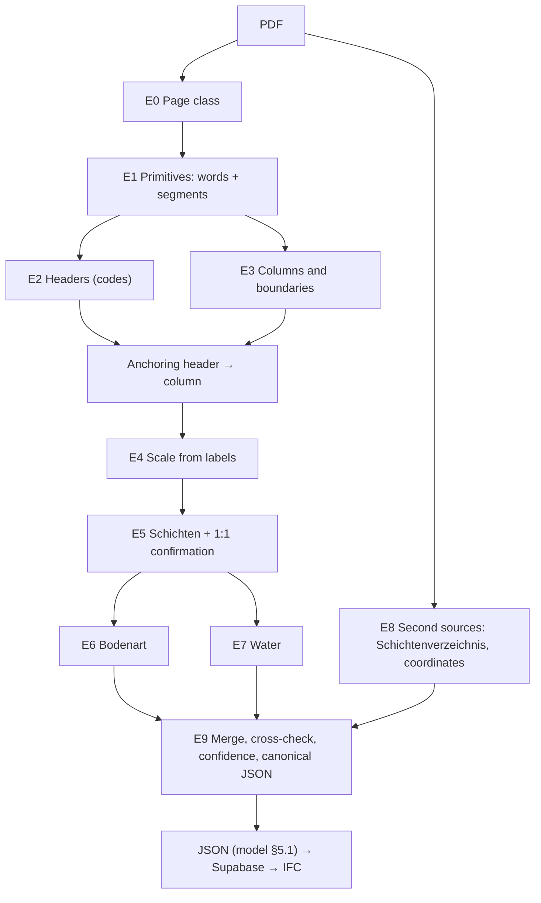

# Extraction algorithm v4 (specification)

**What this note is for:** describe the algorithm precisely enough to reimplement it in
`geo_agent/` without reading the prototype. Each stage says what it receives, what it delivers,
which parameters it uses and **why** (lesson from [16](16_lessons_learned.md)). Reference
implementation: [`prototyp_v4.py`](../spikes/extraktion_v2/prototyp_v4.py). The rules can be
switched off one by one (`RULES`) to measure their effect.

**Guiding principle (goal):** every value that comes out goes to the Baugrundmodell with
**provenance** (page, bbox, method) and **confidence**. If something cannot be confirmed, it is
marked; it is not invented.

## Overview

All coordinates are in the system of the page's **view** (rotation applied) and in PDF points; depth
is in m below the start (GOK).

## E0. Page class

| Class | Condition | Consequence |
|---|---|---|
| `raster` | images cover > 45 % and < 10 words inside them | segments from the image + **OCR** |
| `raster_ocr` | images > 80 % (scan with an OCR layer, even if it carries vector noise, E2) | image **and** vector segments; text from the layer **+ our own OCR** where the layer has no words (L18b) |
| `vektor_ohne_text` | ≥ 150 drawings and < 25 words (AutoCAD SHX) | vector segments + **OCR** |
| `vektor` | everything else | all native |

Lessons E1, E2, L11, L17, L18. OCR: RapidOCR (ONNX, Apache-2.0); adaptive resolution (≈ 3300 px on
the long side, between 200 and 300 dpi, for reduced pages); boxes with confidence < 0.5 and those
overlapping native words by > 30 % are discarded; cache per page image.

## E1. Primitives

- **Words:** `(rect, text, block, line)`. OCR boxes are one line; their words get an x range
  proportional to their position in the string.
- **Segments:** every path (line, rectangle, quad) is broken into segments with width, stroke and
  dash pattern (L1). In raster, horizontal/vertical morphological opening with a kernel of ~3 mm;
  lines ≤ 10 px thick (L11).
- **Rotation:** words and paths × `page.rotation_matrix` (L2).

## E2. Headers

Accepted, in this order:
1. Line `^<PREFIX> <n>[a-z][/yy]( - text)?$` with the prefixes `B BK KB KRB RKS BS GWM SCH` (L13: the
   suffix `- Betonweg 0+050` is ignored).
2. Archive: `^S <n>[a-z]$` (`S 2a`).
3. Generic: `Bohrung`, `<Word>bohrung` (`Sondierbohrung`, `Rotationskernbohrung`), `Bohrprofil`,
   `Aufschluss`, `Rammkernsondierung`, followed by the code on the same line
   (`Sondierbohrung : SST KB 5`) or on the row below (≤ 14 pt), joining the blocks of that row
   (`RB` + `2 / I`). Code: capitals/digits/`./-`, ≤ 16 characters, with at least one digit, and not a
   date or a depth (T1).

Codes are compared without spaces (`B1` = `B 1`), because OCR loses them.

## E3. Columns and boundaries

- **Edges:** stroked verticals, collinear ones merged (gap ≤ 1.5 pt), length ≥ 30 pt.
- **Column:** pair of edges with 8 ≤ width ≤ 80 pt, height ≥ 2.5 × width and overlap ≥ 90 % (G1).
- **Boundaries:** continuous horizontals (not dashed, G2) that cover the column from edge to edge
  with a tolerance of 0.6 pt; lines less than 0.8 pt apart are merged (1.6 pt in raster).
- **Nested:** the one with the thickest edges is kept (G3).
- **Anchoring:** each header takes the column whose centre is less than 70 pt away in x and that
  lies **below** it, without a vertical limit (L4); preference: edge thickness, number of
  boundaries, closeness.
- **Table:** a column with > 2 words with digits inside is a table (G4); `000` tokens that OCR reads
  in the Schraffur of Kies are ignored (E4). A column with ≥ 3 depths inside is the depth column of
  the form and is not anchored (T5).
- **Sheet with a single header** and no anchoring: it is anchored to the column with the most
  labels (or the best straight line of labels, T4), even if the header is far away (T3); the GOK is
  then searched in the title block of the whole page, joining blocks on the same row (S7).

## E4. Vertical scale (depth = a·y + b)

1. **Label groups:** numbers `\d{1,3}[.,]\d{1,2}( ?m)?` ≤ 150, inside the vertical band of the column
   (−8 / +150 pt) and ≤ 110 pt away; each number goes to its nearest column. They are grouped by x
   (4 pt steps) and sorted; the longest non-decreasing subsequence is kept.
2. **Group filters:** arithmetic progression (≥ 5 values, same step ± 0.011) with a round step and
   ≥ 8 values, or with more values than the column has boundaries = **axis**, not labels (L14);
   ≥ 6 values with ≤ 70 % distinct = **Von/Bis pairs** of samples (L15).
3. **Candidates:**
   - *direct*: the label rests on a boundary (base or centre within 4.5 pt) in ≥ 60 % of the cases;
     regression with (top, 0) added.
   - *by order*: k-th label ↔ k-th boundary, dropping up to 3 boundaries; max. residual < 3 cm
     (accepts < 6 cm). If the first label is > 0, the top = 0 is added.
   - *scale text*: `M 1:50`, `Höhenmaßstab 1:30` → a = scale · 0.3528 mm, b from the top.
4. **Admissibility:** normalised scale (±4 %) or, otherwise, ≥ 80 % of ≥ 3 labels confirmed (L9).
5. **Choice:** maximum number of confirmed labels (tolerance 3 cm); tie-break direct > order > text
   (L3).
6. **Column without labels:** if another column on the page has them, it is discarded (GWM
   construction, L15b); if none has them (OCR lost), the title-block scale is accepted and marked.
7. **Label first (T4):** if < 50 % of ≥ 5 labels are confirmed by lines, a straight line value ↔
   label position is fitted; outliers are trimmed (up to 25 %) until the residual is ≤ 0.2 m, and the
   scale must be normalised. The boundaries are the **printed values** (outliers with a residual
   ≤ 1 m are still data, e.g. stacked labels; > 1 m, like an elevation `52,35`, are not); each one is
   confirmed if there is a line within 0.3 m. Among duplicates, this mode loses against one where
   lines and labels agree. With ≥ 8 labels on a straight line a non-normalised scale is also
   accepted (reduced printed PDF).
8. **Contradiction (E5):** if only the title-block scale is left and < 30 % of ≥ 3 labels confirm
   it, the Bohrung is emitted **without Schichten** and with the warning "Massstabstext und
   Tiefenlabels widersprechen sich" (reduced or recomposed PDF). Among duplicates a version with
   Schichten wins.

## E5. Schichten

- Each boundary is confirmed **1:1** with the closest label within 3 cm (G5). If it is confirmed,
  the depth that comes out is **the printed value** (not the geometry, which has ±1 pt of error).
- Unconfirmed boundary → Schicht with the issue `Grenze ohne bestaetigendes Label`.
- **Schraffur lines** (only with label support ≥ 60 %), L6:
  - *companion line*: unconfirmed within 2.5 pt of a confirmed one → removed;
  - *double line*: two unconfirmed ones within 8 pt with no Schraffur between them (Schwarzdecke) →
    removed.

  What is removed stays in the `issues` of the Bohrung.

## E6. Bodenart

For the text assigned to the Schicht (by interval and, if the labels mark the top with 0.00, by
label, L3):
1. First **noun** (capitalised, not an adjective in `-ig/-haltig/-lich`): `Oberboden/Mutterboden` →
   Mutterboden; man-made (`Beton`, `Asphalt`, `Schwarzdecke`, `Pflaster`, `Auffüllung`,
   `Anschüttung`, `Schotter`); rock `-stein`/`-fels` → `Fels (…)`; otherwise the `soil.classify`
   table (L7).
2. If there is no noun: the initial DIN 4023 / EN ISO 14688 **abbreviation** (`U`, `fS`, `G`, `A`,
   `Mu`, `Sa`, `Gr`, `Si`, `Cl`, …) (L16).
3. The original text is kept (`description_raw`).

## E7. Water

1. **Symbol:** triangle of 3 segments (3–16 pt) with the vertex down, inside the vertical range of
   the column; the end of the **water line** decides the Bohrung (W1). Not water: series of ≥ 3
   triangles at the same x (ruler), triangles with an elevation `741,00` to the right, and depth
   ≤ 5 cm (GOK) (L10).
2. **Text:** `GW 2.53m`, `… m u. GOK` near the Bohrung; `Wasseranschnitt 3.8`, `Wasserstand`,
   `Wasserspiegel` in the description of the Schicht (L10b).
3. **No water:** `kein (Grund)wasser`, `GW nicht angetroffen`, `trocken` → `gw_status` (W2).

## E8. Second sources

- **Schichtenverzeichnis** (DIN 4022 form): page with the title (also spaced out) and `Ansatz`; code
  in the header; depths = numbers to the left of the first `a)`; name = the words on the `a)` row up
  to column 3 (`Wasserführung`); water from the text of the page. Duplicated text is deduplicated by
  (x, y, text) (S1, S3). It uses the **same primitives** as E1 (rotation, OCR), so it also reads
  scanned forms; it accepts the marker glued to the text (`a)Auffullung`) and words without umlauts
  (S8).
- **Codes:** every match (pages, duplicates, SV, coordinates) compares the normalised code without
  spaces (`B 1` = `B1`), because OCR does not keep the spaces.
- **Schicht table (S6):** if the page has a single header and no anchored column, a column of
  strictly increasing depths from 0.00 (≥ 4, right-aligned) with text to its right is searched; it is
  accepted if ≥ 60 % of the intervals give a Bodenart.
- **Coordinates:** table of Aufschlüsse read per cell (S2) or the text
  `Rechtswert/Ostwert … 394774,3` + `Hochwert/Nordwert … 5818338,1` (spaces removed for OCR); they
  are assigned to the closest header in x. CRS: `UTM 33` → EPSG:25833, `UTM 32` → 25832; a 7-digit
  easting of 2–5 million → Gauß-Krüger (EPSG:31466–31469) (S5). Switzerland:
  `Koordinaten: 607 562 / 187 087.50` → LV03 (EPSG:21781) or LV95 (EPSG:2056) by range.
- **Starting elevation (GOK):** `NHN 45,20 m`, `+59,17 m NHN`, `36,25mNHN` between the header and the
  column (≤ 90 pt in x).

## E9. Merge, cross-check and confidence

- **Duplicates** (own sheet and section): preference GOK present > sheet titled `Bohrung X` > sheet
  with a single Bohrung > lines and labels in agreement (not only labels) > label support (≥ 50 %)
  > larger scale (L12).
- **Cross-check with the Schichtenverzeichnis:** `SV ok` if the boundaries match 1:1 (±3 cm);
  otherwise `SV abweichend: fehlt …, nur im Profil …`. It fills in empty Bodenart, text and water.
  Bohrungen that are only in the SV are emitted with `mode = schichtenverzeichnis` (L17).
- **Confidence per Schicht** (0–1): 0.4 base + 0.3 boundary confirmed by a label + 0.2 SV agrees
  (− 0.2 if it contradicts) + 0.1 Bodenart found − 0.2 if the scale came only from the title block
  without labels. Interpretation: ≥ 0.8 two independent sources agree; ≤ 0.5 review.
- **Canonical output** (`to_canonical`): document (`sha256`, version), Bohrungen with `kind`,
  `gok_nhn`, `end_depth`, `x/y/crs_epsg/coord_source`, Schichten (`top_depth`, `bottom_depth`,
  `description_raw`, `soil_class`, `hatch_class`, `confidence`, `issues`, `provenance` with page, bbox
  and method), water (`depth`, `nhn`), `checks` and `issues`. It is the `result` of
  `extraction_runs` in Supabase
  ([Architecture §5.2](ARCHITECTURE_BAUGRUNDMODELL.md#52-supabase-schema-draft-migration)).

## Parameters and where they come from

| Parameter | Value | Origin |
|---|---|---|
| Column width | 8–80 pt, height ≥ 2.5 × width | All offices seen (G1) |
| Edge tolerance for boundaries | 0.6 pt (raster 1.6) | Schraffur near the edge (L6) |
| Label ↔ boundary confirmation | 3 cm | Drawing precision ±1 pt at 1:100 |
| Arithmetic axis | ≥ 5 values, step ± 0.011 | Ruler 0.30 m (Triefenstein), DPH axis 1.00 m (Marl) |
| Sample pairs | ≥ 6 values, ≤ 70 % distinct | Von/Bis column (Marl) |
| Non-normalised scale | ≥ 80 % of ≥ 3 labels | DC-Software 1:35, Badel 1:30 |
| Companion / double line | 2.5 pt / 8 pt | Talheim BK5 (1.1 pt), Schwarzdecke |
| OCR | 200 dpi, confidence ≥ 0.5 | Berlin: labels at 0.6–0.9 |

## How it is tested

[`regression.py`](../spikes/korpus/regression.py) runs the full set: 13 real PDFs with ground truth
(9 German, 4 Swiss), 17 stress cases (one per lesson,
[`stress_cases.py`](../spikes/extraktion_v2/stress_cases.py)) and 6 synthetic layouts, and compares
with a baseline (`baseline_v4.json`); [`ablation.py`](../spikes/korpus/ablation.py) switches off each
rule and lists which cases get worse (22 of 28 rules protected,
[table](../spikes/korpus/ablation_v4.md)). Results: [15 §8](15_results_real_pdfs.md).

## Known limits

- Archive Bohrungen scanned at low resolution (Berlin S 1, S 2, B 7/16, B 4/17).
- "trocken" only in the text of the report (Triefenstein RKS 3–5): needs reading sentences of the
  report; a candidate for a bounded LLM
  ([Architecture §6.9](ARCHITECTURE_BAUGRUNDMODELL.md#69-where-to-use-an-llm-and-where-not)).
- Descriptions with oblique leader lines (Marl BS 10): incomplete Bodenart (B1).
- Water symbols specific to the legend (W3).

Up: [Index](README.md)

Related: [16 Lessons](16_lessons_learned.md) · [02 Bohrprofil](02_bohrprofil_generalization.md) · [15 Results](15_results_real_pdfs.md) · [Architecture](ARCHITECTURE_BAUGRUNDMODELL.md)
