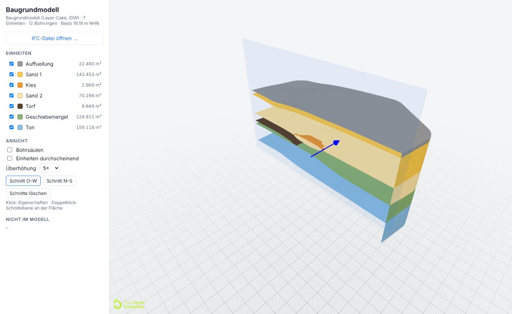
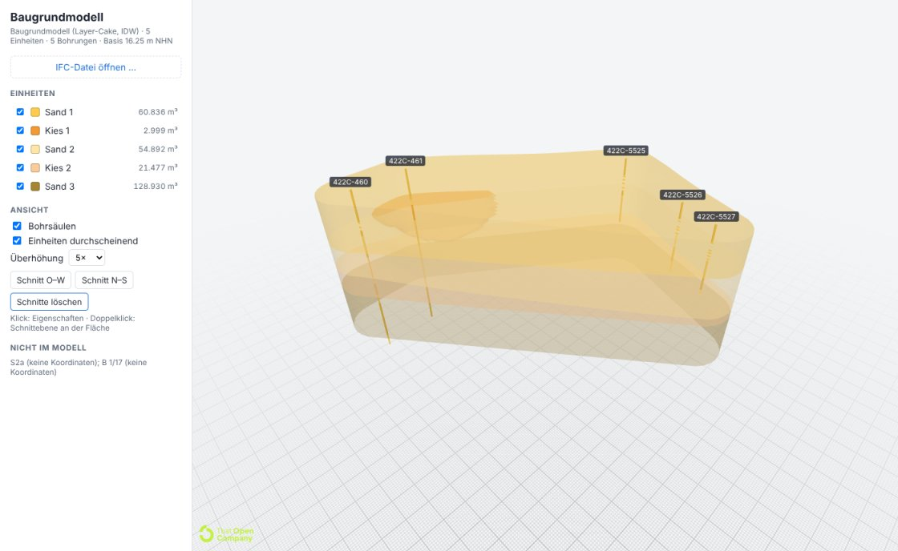

# 18 Modelador de capas (N3) y visor That Open

Primer tramo del Baugrundmodell que **genera las Bodenschichten automáticamente**: de los sondeos
extraídos (JSON canónico, [17](17_algoritmo_extraccion.md)) a unidades de modelo, superficies,
**sólidos cerrados** por unidad, IFC 4.3 (`IfcGeomodel` + `IfcBorehole`) y un visor web sobre
That Open Engine. Implementa los pasos 1–6 del algoritmo layer-cake de la
[arquitectura §7.2](ARQUITECTURA_BAUGRUNDMODELL.md#72-algoritmo-layer-cake-n3).

```
PDF ─prototyp_v4─► JSON canónico ─python -m baugrundmodell─► modelo.ifc + informe.json ─► apps/web (That Open)
                                        ▲
                                        └─ einheiten.json (opcional: el geotécnico confirma o corrige las unidades)
```

| Código | Qué |
|---|---|
| [`services/modeler/`](../services/modeler/README.md) | Paquete `baugrundmodell` (Python): unidades, superficies, sólidos, IFC; 28 pruebas con verdad sintética |
| [`apps/web/`](../apps/web/README.md) | Visor (Vite + TypeScript + `@thatopen/components` 3.6): unidades, propiedades, cortes, exageración vertical |



## 1. Unidades de modelo automáticas

**Preparación por sondeo.** Fuera del modelo, con motivo en el informe y en el IFC
(`Nicht_im_Modell`): sin coordenadas, otro CRS que la mayoría, sin cota de boca (GOK), sin capas,
duplicado o en la misma posición que otro. Huecos entre capas → `unklassifiziert`; solapes → se
recorta el techo. Una capa sin clase entre dos de la misma clase se asigna a esa clase **y se anota**
(regla del proyecto: marcar, no esconder). Capas consecutivas de la misma clase se funden en un
*Abschnitt*.

**Correlación (alineamiento de secuencias).** Una unidad es una Bodenart en un lugar de la
secuencia ("Sand 1", "Kies 1", "Sand 2"). Cada sondeo se alinea contra la secuencia común con
programación dinámica:

| Operación | Significado | Coste |
|---|---|---|
| M | el Abschnitt pertenece a la unidad (misma clase) | hueco de cota × 1/m + distancia de centros × 0,1/m |
| S | la unidad **falta** en el sondeo (se acuña, espesor 0) | 2,0 |
| E | el mismo Abschnitt cubre también la siguiente unidad de su clase (una lente intermedia falta) | 0,5 + coste de cota |
| C | otro Abschnitt en la misma unidad (unidades del geotécnico con varias clases) | 0,2 + coste de cota |
| N | el Abschnitt no encaja → unidad nueva | 3,0 |
| T | la unidad queda **bajo la Endteufe**: desconocida, no "falta" | 0; 3,0 + hueco si la unidad está entera por encima del final |

La cota de referencia de cada unidad es la media IDW de los demás sondeos (*leave-one-out*). La
secuencia crece de forma progresiva (empieza el sondeo con más Abschnitte, después siempre el más
cercano) y al final todos los sondeos se realinean contra la secuencia completa hasta que no aparecen
unidades nuevas. Nombres: la clase, numerada si se repite.

**Confirmación del geotécnico.** El informe trae `vorlage_einheiten` en el formato de
`--einheiten`; se puede renombrar, juntar clases (`{"name": "Sande und Kiese", "bodenarten":
["Sand", "Kies"]}`) o reordenar y volver a ejecutar. Una clase que no cabe en ninguna unidad dada
crea una unidad nueva **con aviso**.

## 2. Contactos por sondeo

Base de cada unidad en cada sondeo, de cuatro tipos:

| Tipo | Cuándo | Uso |
|---|---|---|
| exacto | límite entre dos Abschnitte | dato |
| libre | la unidad termina dentro de un Abschnitt que cubre varias unidades (lente que falta) | se fija en la mitad interpolada de la unidad que se acuña, dentro del Abschnitt (margen 0,1 m), ordenado |
| censurado | el sondeo termina en la unidad | base ≤ Endteufe − 0,5 m; si la superficie lo viola se añade ese punto (iterativo) |
| desconocido | unidad bajo la Endteufe | sin dato; el recorte estratigráfico la mantiene por debajo |

Ejemplo real (Berlín, 422C-460, un único Sand de 0 a 7,7 m sobre Kies): Sand 1 (base libre),
Kies 1 **falta** (se acuña a 31,15 m NHN, la mitad de la lente de 422C-461), Sand 2 (base exacta
28,55), Kies 2, Sand 3 (censurado).

## 3. Superficies y sólidos

1. **Dominio**: envolvente convexa de los sondeos + buffer (½ de la distancia mediana al vecino,
   5–25 m); funciona con un sondeo (círculo) y con sondeos en línea (corredor).
2. **Malla TIN común** a todas las superficies; los sondeos son **nodos** de la malla.
3. **Interpolación exacta**: IDW (p = 2, por defecto) o spline de placa delgada con tendencia lineal
   (`--methode tps`; con < 3 puntos o colineales cae a IDW). Exacta en los datos ⇒ el modelo
   reproduce cada contacto (desviación medida: **0,0 m** en todos los casos).
4. **Recorte estratigráfico** de arriba abajo `z_base_i = min(z_base_i, z_techo_i)`, nunca bajo la
   base del modelo (= Endteufe más profunda); restos < 5 mm → 0.
5. **Extensión de unidades que no están en todos los sondeos**: IDW sólo vale 0 exactamente en los
   sondeos sin la unidad, así que una lente vista en un sondeo quedaba fina bajo todo el solar.
   Indicador presente = 1 / falta = 0 (desconocido no cuenta) interpolado; donde < 0,5 la unidad se
   colapsa a su mitad (la superior a su techo, la inferior a su base). En los sondeos no cambia nada.
6. **Sólido cerrado** por unidad: TIN de techo + TIN de base + paredes en el borde. Donde la unidad
   se acuña, techo y base comparten vértice y los triángulos planos se eliminan; comprobación de
   cierre (cada arista igual de veces en ambos sentidos) y de volumen (malla = Σ área × espesor medio).

## 4. IFC 4.3

- `IfcGeomodel` ⊃ un `IfcGeotechnicalStratum` (SOLID, `IfcPolygonalFaceSet` con `Closed`) por
  unidad, `Description = "Modelleinheit k/n"`; `CPset_Modelleinheit`: unidad, orden, clases, color,
  volumen, espesor máx./medio, distancia máxima a un sondeo (incertidumbre), sondeos con la unidad
  presente / ausente / desconocida, cerrado, avisos.
- `CPset_Baugrundmodell` en el `IfcGeomodel`: método, malla, buffer, base, sondeos dentro y fuera
  del modelo (con motivo), fuentes, versión.
- `IfcBorehole` ⊃ estratos del sondeo (prismas, `Description = "Bohrsaeule"`) con la procedencia de
  siempre (`CPset_Schichtenverzeichnis`, `CPset_Herkunft`). El exportador N1 del spike usa ahora el
  mismo escritor.
- Georreferencia `IfcMapConversion` + EPSG del JSON, origen = centroide redondeado. Validación de
  esquema: **0 errores** (demo, Berlín, todos los casos de prueba).

## 5. Visor (`apps/web`)

Carga por `?ifc=`, selector de archivo o arrastrar; añade `IFCBOREHOLE`, `IFCGEOMODEL`,
`IFCGEOSLICE`, `IFCGEOTECHNICALSTRATUM` al importer ([M2](16_lecciones_aprendidas.md#m-modelo-ifc-y-that-open)).
Lista de unidades (color, volumen, visibilidad), clic → propiedades con procedencia, etiquetas con el
código de cada sondeo, sondeos on/off, unidades translúcidas, exageración vertical 1–10×, cortes
O–W / N–S y doble clic para un plano. WASM de web-ifc y worker de Fragments se sirven **localmente**
(`npm run vendor`): sin unpkg. `scripts/check.mjs` lo prueba sin pantalla (Chromium/Playwright):
carga, unidades, etiquetas, selección por lista y por clic con exageración, corte, capturas.



## 6. Resultados

**Pruebas** (`pytest services/modeler/tests`, 28 verdes): invariantes en 6 casos × 2 métodos
(contactos exactos, espesor ≥ 0, sólidos cerrados, volumen coherente), planos inclinados
reproducidos exactamente con TPS (< 1 mm), acuñamiento, lente, censura, datos perturbados,
geotécnico que junta clases, clase no prevista, orden de entrada indiferente, 1 y 2 sondeos,
validez del IFC.

**Contra la verdad sintética** (dentro de la envolvente; volumen modelo / verdad):

| Caso | Método | RMS bases (m) | Unidades que no están en todos los sondeos |
|---|---|---|---|
| geneigt (planos) | IDW / TPS | ≤ 0,19 / 0,00 | — (volúmenes 1,00) |
| auskeilen (Torf en cuña) | IDW / TPS | ≤ 0,27 / ≤ 0,20 | Torf 0,68 / 0,85 (sin la regla 5: 0,89 / 0,97) |
| linse (lente en 1 sondeo) | IDW / TPS | ≤ 0,75 / ≤ 0,76 | Kies 1,91 / 2,26 (**sin la regla 5: 6,31 / 8,00**) |
| demo (12 sondeos) | IDW / TPS | ≤ 0,63 / ≤ 0,72 | Kies 0,70 / 0,83 · Torf 0,93 / 1,04 |

La regla 5 cambia un error cualitativo (una lente de un sondeo bajo todo el solar) por una
subestimación moderada de las cuñas; los errores grandes de RMS están en los límites internos de
la lente, que los sondeos no determinan.

**Berlín** (datos reales, extracción de *entrenamiento*, [15](15_resultados_pdfs_reales.md)):
5 de 7 sondeos con coordenadas (S2a y B 1/17 fuera: sin coordenadas, marcado en el IFC y en el
visor). Unidades automáticas: Sand 1 (60 836 m³, en 5), **Kies 1** (lente sólo en 422C-461,
falta en 4, 2 999 m³), Sand 2 (5), Kies 2 (2 presentes, 3 desconocidos bajo los sondeos cortos),
Sand 3 (base = base del modelo). Malla 2,9 m, buffer 16 m, 1 705 nodos, 3 puntos de censura,
sólidos cerrados, IFC 3,0 MB.

No hay verdad 3D del subsuelo: el modelo es tan bueno como la extracción y la densidad de
sondeos. Lo que sí se garantiza y se prueba es que respeta cada dato, que no inventa unidades
fuera de lo observado y que todo lo supuesto (censura, extensión, unidades fuera) queda anotado.

## 7. Parámetros

| Parámetro | Valor | Origen |
|---|---|---|
| `K_FEHLT`, `K_NEU`, `K_SPALT`, `K_WEITER` | 2,0 · 3,0 · 0,5 · 0,2 | Una unidad nueva debe costar más que acuñarse; una lente intermedia, menos que dos ausencias |
| `K_ABSTAND`, `K_MITTE` | 1,0/m · 0,1/m | El solape de cotas manda; el centro desempata (Berlín: Kies de 460 ↔ Kies inferior de 461) |
| `K_UEBER_ENDE` | 3,0 + hueco | Una unidad entera por encima del final del sondeo no puede ser "desconocida" |
| `ZENSUR_MARGE` | 0,5 m | La unidad en que termina el sondeo sigue al menos un poco |
| `FREI_RAND` | 0,1 m | Límite libre no pegado al techo/base del Abschnitt |
| `MIN_MAECHTIGKEIT` | 5 mm | Profundidades en cm |
| `PRAESENZ_SCHWELLE` | 0,5 | La unidad termina a medio camino de los sondeos sin ella |
| Buffer, malla | ½ dist. mediana (5–25 m); √área / 40 (0,5–10 m) | Tamaño del solar |
| Base | Endteufe más profunda | No modelar bajo lo explorado |

## 8. Límites y siguientes pasos

1. **Correlación sólo por clase y cota**: dos arenas distintas (p. ej. Talsand y Schmelzwassersand)
   con la misma clase se juntan → hoy la corrige el geotécnico con `--einheiten`; después, clases
   más finas desde la descripción (Nebenanteile, color, génesis) y la leyenda.
2. Layer-cake: sin fallas, pliegues ni cuerpos repetidos; N4 (GemPy) para eso.
3. Incertidumbre sólo como distancia máxima al sondeo; siguiente: kriging con varianza por vértice
   y color en el visor.
4. **Coordenadas siguen siendo el cuello de botella** (Berlín 5/7; el resto del corpus 0):
   [07](07_coordenadas.md) y N2 Geoslice desde el Längsschnitt ([arquitectura §7.1](ARQUITECTURA_BAUGRUNDMODELL.md#71-escalera-de-niveles-cada-uno-es-entregable)).
5. Superficie freática (Grundwasser) como superficie del modelo; Kennwerte por unidad
   (`Pset_SolidStratumCapacity`).
6. Visor: tapas de corte (ClipStyler de `components-front`), clic en procedencia → página del PDF
   (pdf.js + bbox), edición de unidades en el navegador → `einheiten.json`.
7. Supabase: guardar cada ejecución del modelo (`model_units`, parámetros, informe) junto a los
   datos de los que sale.

Up: [Índice](README.md)

Related: [Arquitectura §7](ARQUITECTURA_BAUGRUNDMODELL.md#7-baugrundmodell-generación-de-geometrías) · [17 Algoritmo de extracción](17_algoritmo_extraccion.md) · [16 Lecciones](16_lecciones_aprendidas.md) · [11 Decisiones](11_decisiones.md) · [07 Coordenadas](07_coordenadas.md)
