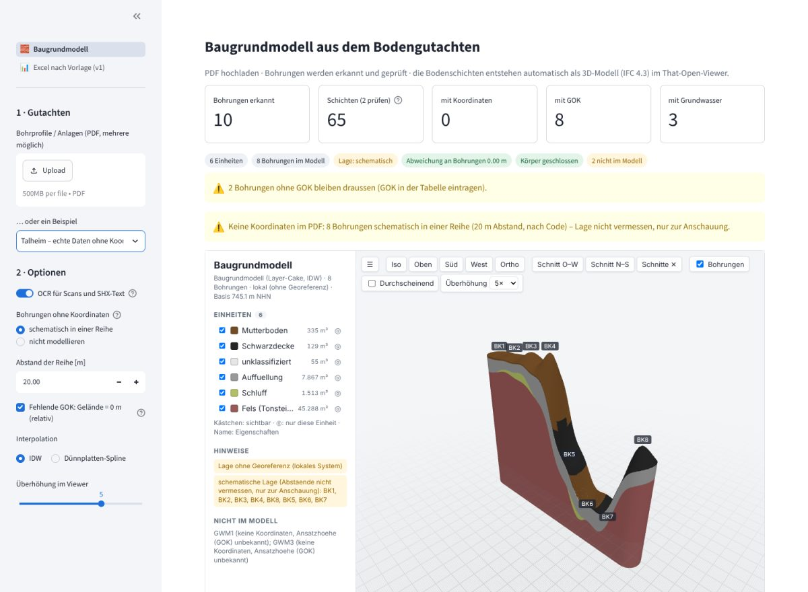

# 19 App v2: del PDF al Baugrundmodell en Streamlit

> [!NOTE]
> **Sustituida** por la app por pasos de [21](21_app_schritte_normen.md) (FastAPI + página web, `python -m server`).
> Esta nota queda como historia; la página Streamlit del Baugrundmodell ya no existe (Streamlit sigue sólo para
> Excel v1). Los proyectos guardados por esta versión se recogen al abrir el mismo PDF.

La app local une todo lo construido: **se sube el PDF del Gutachten, se reconocen los sondeos, se
revisan y el Baugrundmodell se genera solo** y se ve en el visor That Open, dentro de la misma
página. La v1 (Excel según plantilla, layout Hamburgo) sigue como segunda página.

```
PDF(s) ──► extracción v4 (docs/17) ──► tabla de sondeos: revisar / corregir ──► modelador (docs/18)
                                                                                  │
            visor That Open (componente) ◄── IFC 4.3 ◄────────────────────────────┘ ──► export
```



## 1. Arrancar

| Sistema | Cómo |
|---|---|
| Windows | doble clic en [`start.bat`](../start.bat): la primera vez crea `.venv` e instala `requirements.txt` (+ OCR si se puede), luego abre `http://localhost:8501` |
| Cualquiera | `pip install -r requirements.txt` (y opcional `-r requirements-ocr.txt`), `streamlit run app.py` |

No hace falta Node: el visor compilado está en el repo ([`apps/web/dist`](../apps/web/README.md)).
Sólo quien cambie el visor necesita `npm install && npm run build` y subir el `dist` nuevo.

## 2. La página *Baugrundmodell*

> [!NOTE]
> Desde [20](20_lage_pruefung_viewer.md) el orden es otro: **tablas primero** (Bohrungen, Schichten,
> Lage & Unterlage), sondeos ya visibles en el visor, botón *Baugrundmodell erzeugen*, después el
> modelo se ajusta solo a cada cambio; Prüfstand con *Einchecken*; Lage sobre el PDF del plano;
> estado del proyecto guardado automáticamente. Lo de abajo es la primera versión.

1. **Entrada** (barra lateral): uno o varios PDF, o un [ejemplo](../data/beispiele/README.md)
   (Berlín georreferenciado, Talheim sin coordenadas, demo sintética, PDF sintético).
2. **Extracción** con barra de progreso por página y clase de página (vector / raster / OCR). El
   resultado se guarda en disco por `sha256` del PDF, opción OCR y huella del extractor: volver a
   abrir el mismo PDF es instantáneo; cambiar el extractor invalida la caché.
3. **Indicadores**: sondeos, capas (y cuántas revisar: confianza < 0,6 o con aviso), con
   coordenadas, con GOK, con nivel freático.
4. **Modelo + visor** arriba, siempre visible; chips de control (unidades, sondeos en el modelo,
   lage, desviación en los sondeos, sólidos cerrados, fuera del modelo) y avisos de lo supuesto.
5. **Pestañas**: *Bohrungen* (tabla editable: incluir, GOK, Rechts-/Hochwert, EPSG; lageplan),
   *Schichten* (perfiles de todos los sondeos en m NHN o profundidad, detalle con descripción
   original, confianza y fuente), *Modelleinheiten* (tabla y **editor de unidades** → recalcular),
   *Prüfbericht* (excluidos con motivo, matriz unidad × sondeo ✓ / – / ?, avisos, parámetros),
   *Export* (IFC, informe, plantilla de unidades, JSON de extracción y JSON de entrada con correcciones).

## 3. Qué se supone y cómo se marca

| Caso | Por defecto | Marca |
|---|---|---|
| Ningún sondeo con coordenadas | **fila esquemática** (orden por código, 20 m) — sólo si *ningún* sondeo tiene coordenadas | `coord_source = schematisch`; aviso en la app, `Lage` en el IFC, `Lagebezug: lokal` en el modelo |
| Coordenadas escritas en la tabla | se usan; EPSG vacío = sistema local | `coord_source = manuell` |
| Ningún sondeo con GOK | GOK = 0 m (alturas relativas) | `gok_source = relativ`; `Hoehe` en el IFC |
| Algunos sin GOK / sin coordenadas | quedan fuera | motivo combinado («keine Koordinaten, Ansatzhoehe (GOK) unbekannt») en informe, IFC y visor |
| Mismo código en dos documentos | el segundo desmarcado | «doppelt (auch in …)» |
| Sondeo desmarcado | fuera | «abgewaehlt» |

Regla del proyecto: un dato dudoso se marca, nunca se esconde. Un modelo esquemático es útil
para ver la secuencia, no para medir distancias: la app lo dice en tres sitios.

## 4. Correlación con relieve fuerte

Con Talheim (GOK de 749 a 772 m) la correlación por cota absoluta daba **15 unidades**
(Schwarzdecke 1–3, Auffüllung 1–4…): las capas superficiales siguen el terreno. El coste de
emparejar es ahora el **menor entre la distancia en cota NHN y en profundidad bajo GOK**: 15 → **6
unidades** (Mutterboden, Schwarzdecke, Auffüllung, Schluff, Fels…). Los casos sintéticos dan
exactamente las mismas cifras que en [18 §6](18_modelador_capas.md#6-resultados) y Berlín las mismas
unidades que antes del cambio.

## 5. Piezas

| Archivo | Qué hace |
|---|---|
| [`app.py`](../app.py) | Entrada: navegación entre *Baugrundmodell* y *Excel nach Vorlage (v1)* |
| `ui/baugrundmodell.py` (eliminado, ver [21](21_app_schritte_normen.md)) | Página v2 |
| [`ui/pipeline.py`](../ui/pipeline.py) | Sin interfaz: extracción con progreso y caché, modelo (`modell_bauen`, `ifc_bytes`), imagen del plano |
| [`ui/projekt.py`](../ui/projekt.py) | Estado del proyecto: correcciones, Reihe, Lage, eventos del visor, Prüfstand ([20](20_lage_pruefung_viewer.md)) |
| `ui/viewer.py` (eliminado, ver [21](21_app_schritte_normen.md)) | Componente Streamlit con `apps/web/dist`; el IFC se escribe como `modelle/<hash>.ifc` y se pasa por URL |
| [`ui/excel_v1.py`](../ui/excel_v1.py) | Página v1 sin cambios funcionales |
| [`tests/test_app_pipeline.py`](../tests/test_app_pipeline.py) | 15 pruebas de la capa de la app (desde [20](20_lage_pruefung_viewer.md)) |
| [`scripts/check_app.mjs`](../scripts/check_app.mjs) | Prueba de punta a punta en Chromium (ejemplos o `--pdf`) |

Decisiones técnicas:

- **Visor como componente** (`components.declare_component(path=dist)`): mismo código que el visor
  suelto; protocolo `streamlit:componentReady` / `streamlit:render` / `streamlit:setFrameHeight`
  implementado a mano (sin `streamlit-component-lib`). El IFC no viaja por el websocket en cada
  rerun: se escribe con nombre = hash y el visor sólo recarga si cambia la URL.
- **Tipos MIME** registrados en la app (`.js`, `.mjs`, `.wasm`): Streamlit los toma de `mimetypes`
  y en Windows el registro puede devolver `text/plain`, que bloquea módulos y workers.
- **Progreso sin tocar el extractor**: se envuelve `primitives()` del módulo en tiempo de ejecución;
  `prototyp_v4.py` sigue siendo la referencia de la regresión (docs/17) sin cambios.
- **Worker de Fragments** servido por Vite (`@thatopen/fragments/worker?url`), WASM en `vendor/`:
  nada de unpkg.

## 6. Verificación

- `pytest tests` (app, 6) y `pytest services/modeler/tests` (modelador, 31): verdes (hoy 15 y 36, [20 §9](20_lage_pruefung_viewer.md#9-verificación)).
- `scripts/check_app.mjs` con Streamlit sin pantalla: Berlín (6 unidades, EPSG:25833, 5 sondeos),
  Talheim (6 unidades, esquemático, 8 sondeos, 2 fuera sin GOK), demo (7 unidades) y **subida del
  PDF sintético** (extracción → 6 unidades, sistema local del Lageplan): visor cargado en los
  cuatro, sin errores de página ni del servidor.
- Probado en Linux (contenedor). **Windows no está probado aquí**: `start.bat` y el registro de
  MIME son la parte a vigilar en el primer arranque.

## 7. Límites y siguientes pasos

1. La extracción con OCR tarda (Berlín 16 s con caché OCR, Wachenroth ~5 min la primera vez): un
   worker en segundo plano (arquitectura §4) evitaría bloquear la página.
2. ~~Sin coordenadas sólo hay fila esquemática~~ → distancias propias en la fila y sondeos colocados a
   mano sobre el Lageplan o el Längsschnitt en PDF ([20](20_lage_pruefung_viewer.md)); leerlos
   automáticamente sigue pendiente (docs/07).
3. Clic en el visor → página del PDF con la caja de la capa (procedencia visual).
4. Guardar proyectos (Supabase, docs/ARQUITECTURA §5) en lugar de sólo descargas: hoy el estado se
   guarda en el disco local ([20 §5](20_lage_pruefung_viewer.md#5-tablas-antes-del-modelo-generar-y-nachführen)).

Up: [Índice](README.md)

Related: [20 Lage y Prüfstand](20_lage_pruefung_viewer.md) · [18 Modelador de capas](18_modelador_capas.md) · [17 Algoritmo de extracción](17_algoritmo_extraccion.md) · [Ejemplos](../data/beispiele/README.md) · [11 Decisiones](11_decisiones.md) · [16 Lecciones](16_lecciones_aprendidas.md)
