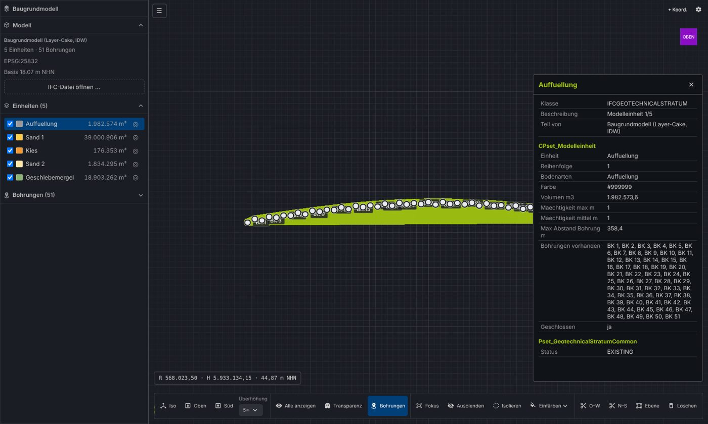
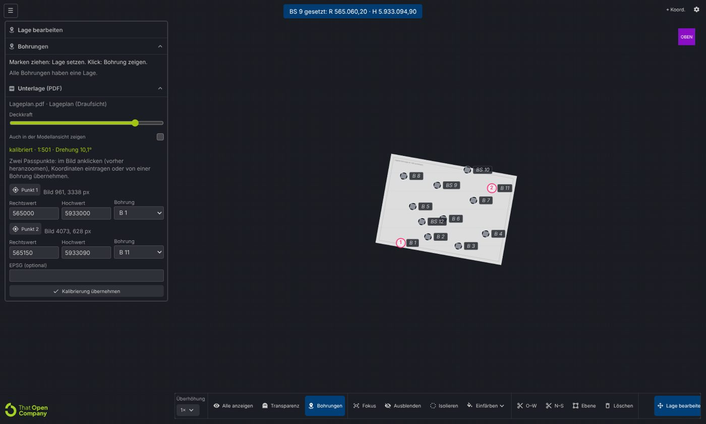
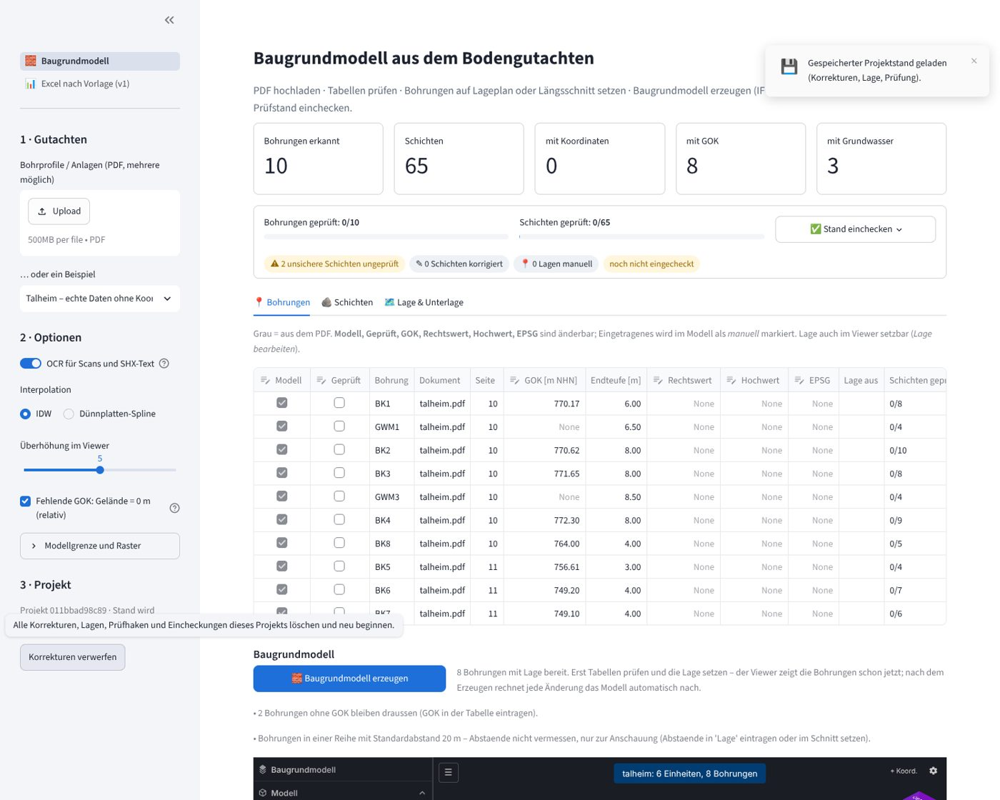
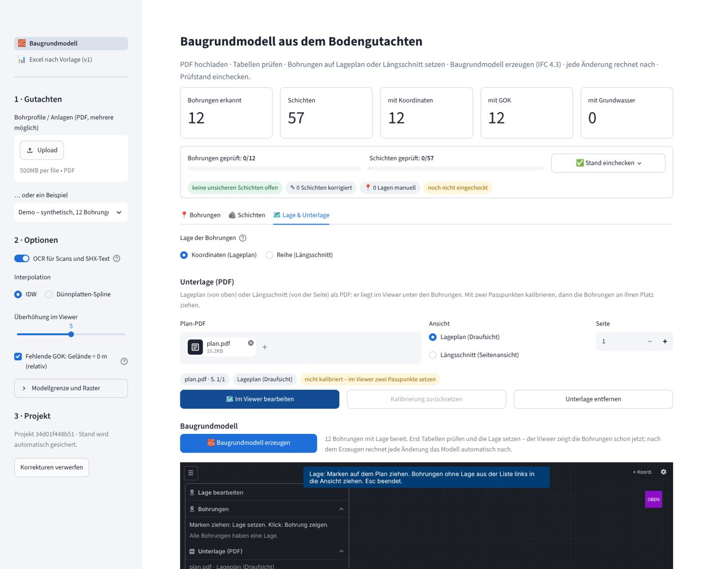

# 20 Viewer with TwinBimM controls, Lage on the plan and Prüfstand

> [!NOTE]
> Updated in [21](21_app_schritte_normen.md):
> - The app is no longer Streamlit.
> - The warnings are for unclassified Schichten.
> - The **calibration** is scale + reference point + lock (two-point calibrations are converted).
> - The viewer bar has icons only.
>
> The TwinBimM controls, the camera for > 5 km and the Prüfstand of this note stay the same.

A round requested by the user on top of [app v2](19_app_v2.md): replicate the controls of their
**TwinBimM** viewer (That Open), fix the problems when moving the geometry, get everything ready for
**Baugrundmodelle of more than 5 km**, place the Bohrungen **by hand on a PDF of the plan** (top or
side view) before modelling, **own distances in the row** (BK1 → BK2 10 m, BK2 → BK3 15 m), **see the
tables before generating** the model, have the model **follow every change by itself**, and be able
to **"einchecken"** the review state of the confidence.

```
PDF ──► extraction ──► tables (Bohrungen · Schichten · Lage & Unterlage)  ◄─┐
                          │  corrections, geprüft, distances, plan PDF        │ viewer events
                          ▼                                                   │ (lage, station, gok,
            [Baugrundmodell erzeugen] ──► model ──► That Open viewer ─────────┘  kalibrierung, geprueft)
                          ▲                     │
                          └── every change ◄────┘   Prüfstand ──► Einchecken ──► IFC with Pruefstand
```



## 1. Viewer controls (like TwinBimM)

The code of the user's viewer (repository `TwinBimM-`, `frontend/src`) was read and what applies to a
Baugrundmodell was replicated, with the same library (`@thatopen/ui` 3.4, `@thatopen/ui-obc` 3.4,
`@thatopen/components-front` 3.6):

| TwinBimM | Here | Note |
|---|---|---|
| Dark BUI theme with W&F colours (`--wf-blue`, `--wf-green`) | same | `html.bim-ui-dark`, background `#1a1d23` |
| `PostproductionRenderer` (COLOR_SHADOWS, AO, edges `#494b50`) | same | **no shadows while moving**, full image when it stops (§2) |
| `bim-view-cube` at the top right | same, faces OBEN/UNTEN/SÜD/NORD/OST/WEST | frames **the whole scene**, not the origin |
| Bottom bar *Sichtbarkeit*: Alle anzeigen, Transparenz | same (transparency keeps the colours of the Einheiten) | |
| Bottom bar *Auswahl*: Fokus, Ausblenden, Isolieren, Einfärben | same (`Highlighter` green `#a2c513`, `Hider`) | |
| Gear: Raster, Kameraprojektion | same + *Orbit um Mauspunkt* + *Kanten und Schatten* | |
| `⌖ Koord.` with a HUD at the bottom left | same, but in **Rechtswert / Hochwert / m NHN** (or station) | |
| Del deletes the clipping plane under the mouse | same | |
| — | *Ansicht* (Iso, Oben, Süd, Überhöhung 1–20×), *Schnitt* (W–E, N–S, double click, delete), *Lage* (editor, §3) | specific to the Baugrundmodell |
| Side panel with models | *Baugrundmodell* panel: model, Einheiten (visibility, ◎ only this one), Bohrungen with review state, warnings | |

The icons are bundled without network (`scripts/vendor.mjs` copies from the `@iconify-json/mdi`
package only those that `src/` uses): BUI would otherwise request them from `api.iconify.design`, and
the company network may have no way out. With little width (a Streamlit column) the bar shows icons
only, with tooltips.

## 2. Moving the geometry and models over 5 km

The "problems when moving the geometry" had three causes, none in the controls themselves:

1. **The IFC declared millimetres**: `ifcopenshell.api.unit.assign_unit()` without arguments sets
   *MILLIMETRE*, but the modeler writes metres. Every viewer showed the model **1000 times smaller**
   (a 6 km Trasse measured 6 m) and the georeferencing of `IfcMapConversion` was wrong. With That
   Open's camera (minimum distance 6 m, near 1 m) one navigated "inside" the model. Now the unit is
   an explicit METRE and a test requires it (`calculate_unit_scale == 1`).
2. **Fixed near/far** (perspective 1 / 1000 m, orthographic 0.1 / 1000 m at 200 m from the target):
   everything more than 1 km away disappeared. `kamera.ts` recomputes them on every move from the
   size of the scene and the distance (near = distance/1000, far = distance + 2 radii; in
   orthographic a negative near).
3. **Fixed grid and views**: the grid grows with the scene (1 m … 100 m), the ViewCube and the views
   frame the whole scene and a double click sets the orbit point where one clicks.

A fourth problem only appeared when opening the app: the first framing arrived with the iframe still
0 px high and left the camera at NaN (empty viewer). Now the framing waits until the canvas has a size
and a non-finite camera repairs itself ([M25](16_lessons_learned.md#m-model-ifc-and-that-open)).

In addition the viewer **draws on demand** (`RendererMode.MANUAL`): while the camera moves, without
postproduction (smooth even with 20,000 nodes per surface); 50 ms after it stops, an image with
shadows and edges; at rest, one frame per second. On laptops it saves GPU and battery.

Test with the **synthetic 6 km Trasse** (51 Bohrungen, `synthetisch.trasse`, now also an
[example](../data/beispiele/README.md)): loading, far 24.6 km > 6.1 km length, getting as close as
2 m without clipping (near 0.02 m), HUD coordinates in EPSG:25832.

**Model boundary** (*Modellgrenze und Raster* in the sidebar): the model covers the convex hull of
the Bohrungen + a buffer. Automatic: half the spacing between Bohrungen (5–100 m); by hand up to 5 km.
The mesh is limited to 30,000 nodes also with a grid set by hand: if it does not fit, it becomes
coarser and a warning appears (test `test_grosse_modellgrenze_von_hand`).

## 3. Lage: Bohrungen on the plan before modelling



**Unterlage.** In the *Lage & Unterlage* tab the PDF of the plan is uploaded and the view chosen:
*Lageplan (Draufsicht)* or *Längsschnitt (Seitenansicht)*, and the page. PyMuPDF turns it into an
image (≤ 6000 px, ≤ 300 dpi) and the viewer places it in the scene: the Lageplan horizontally over the
Bohrungen, the Längsschnitt vertically behind the row. *Im Viewer bearbeiten* opens the Lage mode: an
orthographic view from above (or from the south), framed to the right of the panel.

**Calibrating with two control points.** *Punkt 1* → click on the plan → coordinates by hand or
*Bohrung* (takes those of a Bohrung with coordinates from the PDF or the table). The same with point
2 and *Kalibrierung übernehmen*.

- Lageplan: **similarity** (scale, rotation, translation) with complex numbers, `w = A·q + B`,
  `q = u − i·v` (the image rows go down). Scale and rotation are shown: *1:500 · Drehung 10,0°*.
- Längsschnitt: **affine by axes** with separate scales for station and height: *Länge 1:500 · Höhe
  1:100 (Überhöhung 5,0×)*; the drawing's exaggeration is undone, the viewer's is separate.
- Uncalibrated, the plan is placed at 1:1000 (and 1:100 in height) next to the Bohrungen, to get
  started.

**Moving Bohrungen.** Each Bohrung is a pin (a column with the colours of its Schichten + a mark with
the code and the state: green reviewed, orange confidence < 0.6, grey outside the model). In Lage
mode:

- Lageplan: drag the mark → Rechts-/Hochwert in the system of the plan (with EPSG if given).
- Längsschnitt: drag along the row → **station**; with Shift → **collar elevation (GOK)**.
- Bohrungen **without a position** appear in a list (*Ohne Lage*) and are dragged to their place.

Every change goes to Python as an event and is marked: `coord_source = "Plan (kalibriert)"`,
`"manuell (Viewer)"` or `"Reihe (Station im Schnitt gesetzt)"`; the GOK as `gok_source = manuell`.

**Measured precision** (`apps/web/scripts/check.mjs` with [`scripts/testplan.py`](../scripts/testplan.py),
synthetic plans with known ground truth, rendered by the same route as the app):

| Test | Result |
|---|---|
| Lageplan 1:500 rotated by 10°: calibrated scale and rotation | 1:499–1:501 · 10.0–10.1° |
| Mark of B 7 on its symbol after calibrating | 0.1–0.4 px |
| B 6 and BS 9 (without coordinates) dragged to their symbol | 0.22–0.45 m |
| Längsschnitt 1:500 / 1:100 calibrated | Länge 1:500 · Höhe 1:100 |
| B 2 and B 3 dragged to their column | station 10.00 / 25.00 m (error ≤ 0.01 m) |
| Shift + drag B 4 one metre up | GOK 40.78 m (truth 40.77) |

To pick precisely you have to zoom in (the panel says so): without zoom one screen pixel can be half a
metre.

## 4. Row with own distances

Without coordinates the Lage is a **Reihe** (Längsschnitt). In the table of the *Lage* tab each
Bohrung has **Nr** (order), **Abstand zum Vorgänger** and **Station**:

- Abstand: BK1 → BK2 **10 m**, BK2 → BK3 **15 m** … (without a value the *Standardabstand* applies).
- Station: absolute; the viewer also sets it when dragging in the Längsschnitt.
- Priority: set station > own distance > standard distance. With only standard distances the model is
  marked *schematisch*; with own distances *Reihe (Abstand manuell)*.

## 5. Tables before the model, Erzeugen and nachführen



1. After the PDF is uploaded, **the tables** are shown (*Bohrungen*, *Schichten*, *Lage &
   Unterlage*) and the viewer already shows the Bohrungen at their positions: **there is no model
   yet**.
2. *Baugrundmodell erzeugen* generates it.
3. From then on, **every change** (table, viewer, settings, Einheiten) recomputes the model
   (*Automatisch nachführen*, on). Switched off, the model stays frozen and *Jetzt neu rechnen*
   appears.

The geometry is cached by the input **without the review marks**: marking Schichten as reviewed does
not recompute the model or reload the viewer (the review state is visible on the pins and goes into
the export IFC, which is generated when the download is pressed).

The **project state** (corrections, Lage, review, Unterlage, eincheckungen) lives apart from the
extraction ([`ui/projekt.py`](../ui/projekt.py)), is saved on disk automatically by the signature of
the documents and is restored when the same PDF is opened again; *Korrekturen verwerfen* deletes it.

## 6. Prüfstand and Einchecken

- **Schichten**: editable table per Bohrung (von, bis, Bodenart, Geprüft) with the extraction's
  confidence; correcting a Schicht marks it as reviewed and as *korrigiert* (the confidence becomes
  1.0 and the original is kept). *Alle Schichten dieser Bohrung geprüft*, *Nächste ungeprüfte →*.
- **Prüfstand** at the top: Bohrungen and Schichten reviewed (bars), uncertain Schichten (< 0.6) not
  reviewed, corrected ones, positions set by hand.
- **Einchecken** stores an entry with the time, counters, a comment and the **model fingerprint**
  (key of its inputs: the IFC carries the time in its header,
  [M24](16_lessons_learned.md#m-model-ifc-and-that-open)); if something changes afterwards, the chip
  says *seitdem geändert*. History in the *Prüfprotokoll* tab.
- In the **IFC**: `CPset_Herkunft.Geprueft` per Bohrung; `CPset_Schichtenverzeichnis.Geprueft`,
  `Korrigiert`, `Konfidenz_Extraktion` per Schicht; `CPset_Baugrundmodell.Pruefstand` with the last
  einchecken. In the viewer, *Als geprüft markieren* in the panel of a Bohrung.

## 7. Viewer ↔ Streamlit protocol

| Direction | Content |
|---|---|
| Python → viewer (`streamlit:render`) | `ifc` (URL, or nothing before generating), `projekt` (signature: same signature = the camera stays), `ursprung`, `epsg`, `modus`, `bohrungen` (pins), `unterlage` (image URL, size, calibration), `ueberhoehung`, `nr` (last event applied), `bearbeiten` (counter: opens the Lage mode) |
| viewer → Python (`setComponentValue`) | `{typ, nr, projekt, …}` with `typ` ∈ `lage` (x, y), `station`, `gok`, `kalibrierung` (2 points, EPSG), `geprueft` |

Each event carries an increasing number and the project signature: Python applies each number only
once (Streamlit repeats the last value on every rerun) and ignores events from another project. The
viewer starts its counter at the `nr` it receives, so as not to repeat numbers after being re-mounted.
The page has a **fixed skeleton of containers**: the viewer iframe is not re-mounted when elements
above it change (it used to happen when pressing *Erzeugen*,
[X13](16_lessons_learned.md#x-working-environment)).

Coordinate frame: the IFC is local to the project origin (`ursprung`, fixed, rounded to 100 m) and is
loaded **without** `COORDINATE_TO_ORIGIN`; three.js x = E − E₀, y = NHN (exaggerated around a
reference elevation), −z = N − N₀. That way pins, plan and IFC coincide to the centimetre (BK 1 of the
Trasse: R 565,000.00 / H 5,932,985.00 / GOK 45.00, as in the synthetic case).



## 8. Pieces

| File | What it does |
|---|---|
| [`apps/web/src/main.ts`](../apps/web/src/viewer/viewer.ts) | World, postproduction, Highlighter/Hider/Clipper, bottom bar, gear, ViewCube, HUD, side panel, Streamlit |
| [`apps/web/src/kamera.ts`](../apps/web/src/viewer/kamera.ts) | Dynamic near/far, grid, views, framing next to the panel |
| [`apps/web/src/lage.ts`](../apps/web/src/viewer/lage.ts) | Pins, plan, calibration, dragging, list without a position, Lage panel |
| [`apps/web/src/rahmen.ts`](../apps/web/src/viewer/rahmen.ts) | Coordinate frame and exaggeration |
| [`apps/web/src/streamlit.ts`](../apps/web/src/viewer/kanal.ts) | Protocol with Streamlit and numbered events |
| [`ui/projekt.py`](../ui/projekt.py) | Project state: corrections, Reihe, Lage, events, Prüfstand, einchecken, save/load |
| `ui/baugrundmodell.py` (removed, see [21](21_app_schritte_normen.md)) | Page: tables → Lage → erzeugen → viewer → results |
| [`ui/pipeline.py`](../ui/pipeline.py) | Extraction, `modell_bauen`/`ifc_bytes`, image of the plan |
| [`scripts/testplan.py`](../scripts/testplan.py) | Synthetic Lageplan and Längsschnitt with known ground truth |

## 9. Verification

- `pytest tests` (app, **15**) and `pytest services/modeler/tests` (modeler, **36**): green.
- `apps/web/scripts/check.mjs` (headless Chromium): **17/17** — 6 km Trasse (loading, far, near when
  zooming in, HUD, selection, transparency, section), Lageplan (calibration, alignment, dragging
  Bohrungen without a position and a mark), Längsschnitt (calibration, stations, GOK).
- `scripts/check_app.mjs` with Streamlit: **7/7** — tables and pins before the model, *Erzeugen*,
  dragging BK2 in the viewer → event → Python recomputes → the viewer reloads, einchecken, Lageplan
  uploaded and *Im Viewer bearbeiten*.
- Tested on Linux with SwiftShader (software rendering: a frame with postproduction takes ~1 s; on a
  PC with a GPU it does not). **Windows not tested from here.**

## 10. Limits and next steps

1. The plan is calibrated with 2 points: it does not correct distortions (skewed scanned plans); with
   3+ points a general affinity could be fitted by least squares with residuals.
2. The boundary is the convex hull: on curved alignments it includes ground without Bohrungen; a
   **corridor** (buffer around the alignment) would be more honest for Trassen.
3. Read the Bohrung symbols on the plan automatically (text + circle) and propose the position
   (docs/07); today they are dragged by hand.
4. Context models (tunnel alignment, terrain) in the same viewer, aligned by georeferencing.
5. Multi-user and server: the state is saved on the local disk; with Supabase (architecture §5) the
   Prüfstand would be shared.

Up: [Index](README.md)

Related: [19 App v2](19_app_v2.md) · [18 Layer modeler](18_layer_modeler.md) · [11 Decisions](11_decisions.md) · [16 Lessons](16_lessons_learned.md) · [07 Coordinates](07_coordinates.md) · [Viewer](../apps/web/README.md)
