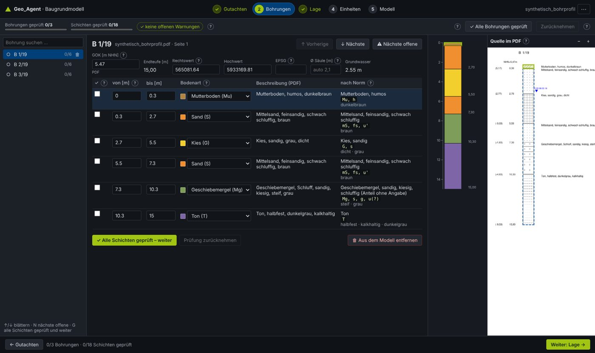
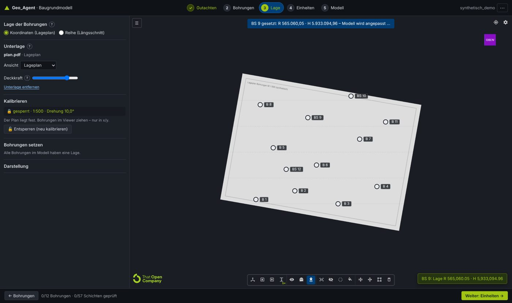
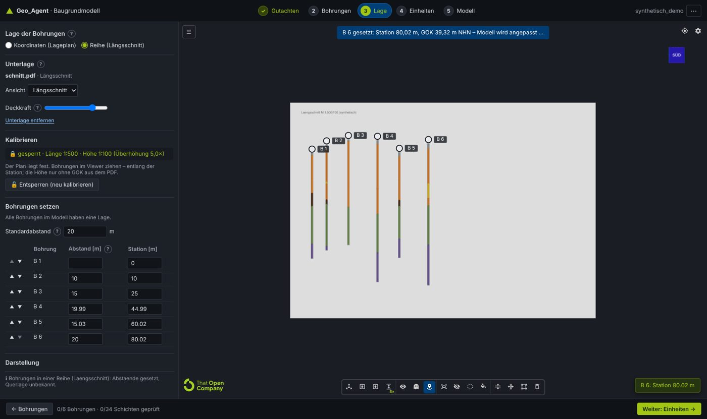
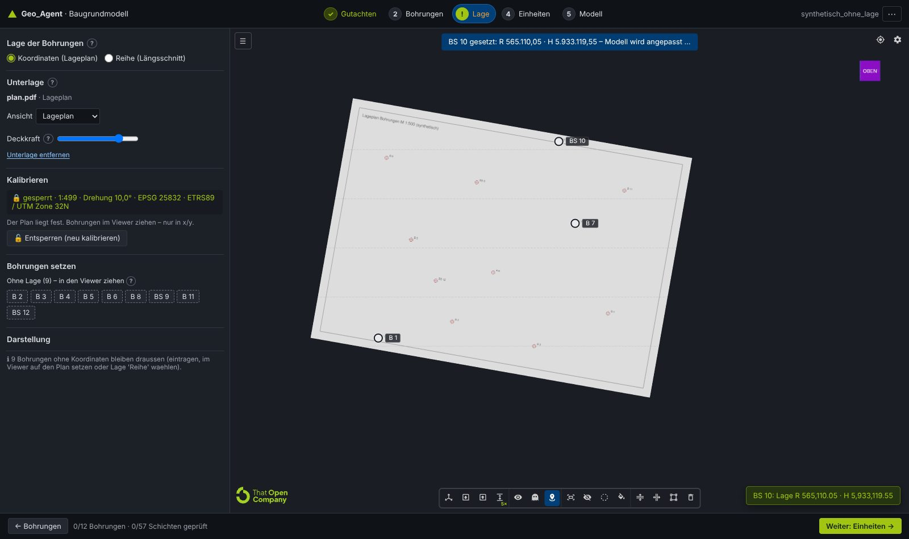
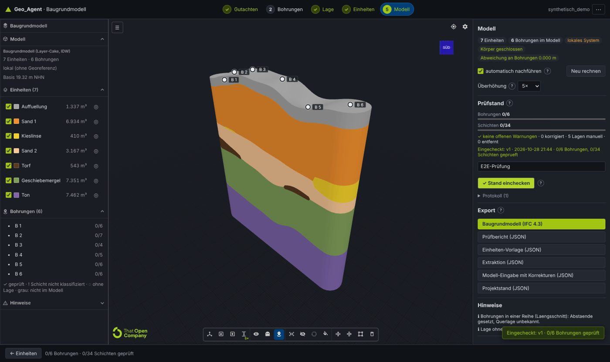

# 21 App por pasos, normas de la descripción y nueva calibración

La app del Baugrundmodell deja Streamlit: ahora es una **app por pasos a pantalla completa** (FastAPI + página
web con el visor That Open integrado). Cada paso lleva al siguiente y lo actualiza:

**1 Gutachten → 2 Bohrungen → 3 Lage → 4 Einheiten → 5 Modell.**

Además:

- **Avisos**: sólo para capas **sin clasificar** (`unklassifiziert`), no por la confianza.
- **Normas**: una mini base de datos con DIN 4023, DIN EN ISO 14688-1 y DIN 18196 lee cada descripción.
- **Calibración nueva**: distancia medida, punto de referencia y candado.
- **Diámetro de los sondeos**: configurable.
- **IFC**: cada capa lleva su descripción y su interpretación por norma.

Sustituye la página Streamlit de [19](19_app_v2.md) y la calibración por dos puntos de [20](20_lage_pruefung_viewer.md);
lo demás de 20 (controles TwinBimM, cámara > 5 km, Prüfstand, einchecken) sigue igual.



## 1. Arranque y arquitectura

| Pieza | Qué hace |
|---|---|
| [`start.bat`](../start.bat) / `python -m server` | Arranca la app en <http://localhost:8500> y abre el navegador (`--port`, `--arbeit <carpeta>`, `--kein-browser`) |
| [`server/api.py`](../server/api.py) | API HTTP (FastAPI) y la página compilada `apps/web/dist` en el mismo puerto: no hace falta Node |
| [`server/arbeitsplatz.py`](../server/arbeitsplatz.py) | Proyectos en disco, extracción en segundo plano con progreso, caché del modelo, Unterlage, páginas del PDF |
| [`ui/projekt.py`](../ui/projekt.py) | Estado del proyecto y **todas las reglas** (`aendern(op)`): correcciones, avisos, eliminar, calibración, diámetro |
| [`apps/web/src/app`](../apps/web/src/app) | Los 5 pasos (lit), ayudas, columna SVG |
| [`apps/web/src/viewer`](../apps/web/src/viewer) | El visor como módulo (`viewerStarten`), también solo en `viewer.html` |
| [`start_excel.bat`](../start_excel.bat) / `streamlit run app.py` | Sólo la página *Excel nach Vorlage* (v1) |

Datos en `ARBEIT` (`%TEMP%\geo_agent`, o `GEO_AGENT_ARBEIT` / `--arbeit`):

- `projekte/<firma>/docs.json`: la extracción, sin cambios.
- `projekte/<firma>/projekt.json`: correcciones, Lage, revisión, en formato `geo_agent-projekt/2`.
- `web/`: IFC, imágenes del plano y páginas del Gutachten.

Un proyecto guardado por la app v2 (`projekte/<firma>.json`) se recoge solo al abrir el mismo PDF.

La dirección `#/<proyecto>/<paso>/<sondeo>` deja recargar o guardar un marcador sin perder el sitio.

| API | |
|---|---|
| `GET /api/info`, `GET /api/projekte` | Versión, OCR, ejemplos; proyectos recientes |
| `POST /api/gutachten` (PDF o JSON de extracción), `GET /api/auftrag/<id>` | Extracción en segundo plano con página x/y |
| `POST /api/beispiel` | Abrir un ejemplo |
| `GET /api/projekt/<firma>`, `POST …/aendern {ops}` | Estado completo; lista de cambios (todo o nada) |
| `GET …/bohrung/<id>`, `GET …/seite/<doc>/<página>` | Capas con norma y propuesta; página del PDF (px por pt) |
| `POST/DELETE …/unterlage`, `POST …/unterlage/seite` | Plano o sección en PDF, página y vista |
| `POST …/modell`, `POST …/einchecken`, `GET …/export/<art>` | Modelo (caché por entradas), Prüfstand, descargas |

## 2. Paso Bohrungen: revisar y corregir

- **Aviso ⚠ = capa sin clasificar y sin revisar.** Se quita de tres maneras: elegir la Bodenart, aplicar la
  *propuesta según norma* o marcar la capa como revisada (queda constancia de que una persona la vio). La confianza
  de la extracción ya no genera avisos.
- **Navegación estable.** La selección vive en la dirección y el estado; los vecinos se precargan.
  - Teclas: ↑/↓ (o J/K) para pasar de sondeo, **N** para el siguiente abierto, **G** para marcar todas las capas
    revisadas y seguir.
  - Las teclas funcionan también con el foco en un botón; dentro de un campo, escribir sigue siendo escribir.
  - El botón *Nächste offene* funciona; el problema de Streamlit era cambiar un `selectbox` ya creado.
- **Alle Bohrungen geprüft** marca todas las capas de todos los sondeos del modelo; se puede deshacer.
- **Eliminar** (🗑 en la lista o el botón): el sondeo sale del modelo y queda en *Entfernt* para restaurarlo.
- **Fuente en el PDF.** Página del Gutachten con la columna del sondeo y la capa elegida marcadas, con zoom.
  En los ejemplos que sólo traen el JSON se ve únicamente la columna.
- **Campos del sondeo**: GOK, coordenadas, EPSG, Ø de la columna.

## 3. Mini base de datos de normas

Archivos:

- [`normen.json`](../services/modeler/baugrundmodell/normen.json): los datos.
- [`normen.py`](../services/modeler/baugrundmodell/normen.py): el lector.
- Pruebas: [`test_normen.py`](../services/modeler/tests/test_normen.py).

Cada entrada lleva su **evidencia**:

- `DIN4023`: confirmado en fuentes secundarias.
- `praxis`: usual en leyendas de Gutachten, pero no confirmado en el texto de la norma.
- `darstellung`: color elegido sólo para mostrar.

El texto de las normas es de pago y no se leyó.

| Tabla | Contenido |
|---|---|
| Clases (las de la extracción) | Kurzzeichen DIN 4023 (G, S, U, T, X, Y, H, F, Mu, A, Mg, Lg, Lö, Löl), símbolo ISO 14688-1 (Gr, Sa, Si, Cl, Co, Bo, Or, Mg), color, fracciones con tamaño de grano (fG 2–6,3 mm … gS 0,63–2 mm …) |
| Nebenanteile | g/fg/mg/gg, s/fs/ms/gs, u, t, x, y, h (humos), o (organisch); grados `''` muy débil, `'` schwach, — normal, `¯`/`*` stark, `=` sehr stark |
| Estado | Konsistenz (breiig/weich/steif/halbfest/fest; brg, wch, stf, hfst, fst), Lagerungsdichte (I_D, ISO 14688-2), Kalk (k0, k+, k++), Feuchte, Bodenfarbe (bn, gr, sw, we/ws, ro/rt, ge/gb, h/d) |
| DIN 18196 | GE … HZ, F, A, `[ ]` (Auffüllung de suelo natural); **sólo si el texto la nombra**, nunca se estima |
| Fels | Sst, Ust, Tst, Mst, Kst, Ko, Br; meteorización (angewittert … zersetzt) |
| Ambigüedades | `Mg` (Geschiebemergel en DIN 4023 antigua / *made ground* en ISO), `Gr`, `H`, `Schotter` |

Colores DIN 4023, ahora también en el modelador, el IFC y el visor:

| Clase | Color | Entre paréntesis: DIN 6164 |
|---|---|---|
| Kies | amarillo | 2:6:1 |
| Sand | naranja | 6:6:2 |
| Schluff | oliva | 1:4:5; Grobschluff turquesa (2023) |
| Ton | violeta | 14:5:4 |
| Torf/Humus | marrón oscuro | – |
| Mudde | lila | 11:4:4 |
| Mutterboden | marrón amarillento | 4:5:3 |
| Auffüllung | sin color en la norma; gris para mostrar | – |

La norma de 2023 ya sólo nombra los colores, sin el número DIN 6164.

**Lectura** (`deuten`). Sirve igual para texto escrito ("Schluff, stark tonig, kiesig, weich-steif, TA") y
abreviado ("mS, fs', u").

Preparación del texto:

- Apóstrofos y sobrerrayas unificados.
- La coma decimal ("770,17 mNN") no corta el texto.
- Se separan las palabras pegadas por el PDF ("FeinsandbisMittelsand", "schwachhumos", "MittelsandFeinkies").

Elección del componente principal:

- El primer sustantivo o Kurzzeichen es el principal.
- *Auffüllung* o *Mutterboden* + suelo da un material ("Auffüllung (Schluff, stark tonig)").
- Un nombre geológico + suelo también ("Geschiebemergel (Schluff, sandig, kiesig)").
- Sustantivos del mismo tipo forman un rango ("Fein- bis Mittelsand"); de otro tipo, Nebenanteil sin grado (`fg(?)`).

Salida:

- Benennung y Kurzzeichen DIN 4023 / ISO.
- Bodengruppe, consistencia, densidad, cal, humedad, color.
- Inclusiones y materiales extraños.

**Lo dudoso se marca**:

- `Mg` solo se trata como ambiguo.
- `Lehm` es una propuesta insegura.
- Un error de OCR a distancia 1 ("Grobaand" → Grobsand) se acepta como inseguro.
- Materiales extraños dan el aviso "Auffüllung prüfen".
- Un grupo que no casa con el componente principal se avisa ("TL" en un Kies).
- Si difiere de la extracción, se avisa ("Extraktion: Sand, nach Norm gelesen: Auffuellung").

Una **propuesta** para una capa sin clasificar se aplica sólo con un clic, y queda como corregida.

| Ejemplo | Capas | Leídas | Contradicen la extracción |
|---|---|---|---|
| Talheim | 65 | 63 (2 sin texto) | 0 |
| Berlín | 69 | 66 (3 sin texto; 2 "Grobaand" inseguras) | **13**: el texto dice *Auffüllung* (de arena), la extracción puso "Sand" |
| Demo / Trasse | 57 / 127 | todas | 0 |

Los 13 casos de Berlín son un hallazgo real: según DIN 4023 son rellenos, no arena natural. Quedan marcados, no
cambiados (lección B4).

## 4. Lage: calibración nueva

Pasos en el panel izquierdo; el visor queda a la derecha:

1. **Unterlage**: Lageplan o Längsschnitt en PDF, con página, vista y opacidad.
2. **Maßstab**:
   - *Strecke messen*: dos clics en el plano (escala gráfica, una cota, dos sondeos) y la longitud real en m.
   - O bien *1:n*, con el tamaño de papel de la imagen.
   - En la sección, la **escala vertical** puede ser la misma, `1:n` o medida (Überhöhung).
3. **Bezugspunkt**: un clic en un punto conocido y su coordenada (Rechts-/Hochwert, o Estación/NHN en la sección).
   Se puede copiar de un sondeo con coordenadas.
4. **Drehung** (plano): grados frente al norte de cuadrícula, positivo en sentido antihorario. El **sistema de
   coordenadas (EPSG)** se elige de una lista junto al punto de referencia (§4.2).
5. **🔒 Übernehmen und sperren**. El plano queda fijo y no se mueve más.

Cómo se mueven los sondeos:

- Antes de bloquear, los sondeos no se pueden arrastrar.
- Después, en el plano sólo se mueven en **x/y**.
- En la sección se mueven a lo largo de la **estación**. En **altura** sólo si el PDF **no trae GOK**; el servidor
  rechaza también un evento `gok` en ese caso.

Mientras se escribe, la vista previa mueve el plano; las marcas 1, 2 y B se ven sólo durante la calibración. Si el
plano salta lejos (al escribir su Rechts-/Hochwert), la cámara lo sigue y no desaparece de la vista.

Fórmulas (iguales en [`ui/projekt.bild_zu_welt`](../ui/projekt.py) y en `lage.ts/abbildung`):

```
s = metros / |p2 − p1|   ó   n · mm_por_px / 1000          (m por px)
plano:   (x, y) = (x0, y0) + R(−θ) · s · (u − u0, −(v − v0))
sección: estación = x0 + s·(u − u0),  NHN = y0 − s_h·(v − v0)
```

Una calibración antigua de dos puntos se convierte al cargar en exactamente la misma transformación (probado).

**Ø de las columnas**:

- Por proyecto y por sondeo.
- Automático: `clamp(extensión/300, 0,8, 12)` m. Es representación, para que se vean en una trasse de 6 km.
- Se aplica igual en el visor y en el IFC (`CPset_Darstellung.Durchmesser_m` y su origen).





Resultados con los planos sintéticos de [`scripts/testplan.py`](../scripts/testplan.py):

| Caso | Resultado |
|---|---|
| Plano 1:500 girado 10°, calibrado desde la UI (distancia B 1–B 4 + B 1 como referencia + 10°) | **1:500 · 10,0°** |
| Marcas sobre los círculos del plano | 0,3 px |
| B 6 y BS 9 arrastrados desde la lista | 0,06–0,08 m |
| Sección 1:500/1:100: estaciones | ≤ 0,02 m |
| Sección: GOK del PDF | sin cambio |

### 4.1 Ningún sondeo con coordenadas (caso real: RKS sin posición)

Informe del usuario: tras bloquear el plano no se podían arrastrar los sondeos y el plano parpadeaba (también
transparente); el visor salía negro. Reproducido con [`testplan.py`](../scripts/testplan.py)
(`plan_ohne_lage_extraktion.json`: el plano de prueba sin una sola coordenada). Causas y arreglos:

| Síntoma | Causa | Arreglo |
|---|---|---|
| Parpadeo | En `RendererMode.MANUAL` That Open dibuja cada fotograma sin posproducción y 50 ms después con ella; el visor pedía un fotograma por cada movimiento del ratón y cada segundo | El visor decide la posproducción (D73, M29): nunca en *Lage*; en el modelo sólo en reposo; sin redibujar por mover el ratón |
| Visor negro | El pase GTAO seguía calculando con fórmulas de perspectiva en la vista ortográfica (y `near` negativo) | `PERSPECTIVE_CAMERA` sigue a la proyección (M30) |
| Sondeos "no se arrastran" | El primer sondeo soltado movía el origen del proyecto ~6000 km (de las estaciones de la *Reihe* al plano) y la cámara se quedaba mirando al vacío | Origen desde el punto de referencia del plano al calibrarlo; la cámara acompaña cualquier cambio de origen (D74, M31) |
| Arrastre bloqueado | Un "Punkt im Plan wählen" pendiente bloqueaba todo arrastre | Se cancela al bloquear y al arrastrar (M32) |
| Vista previa vacía | Al escribir el Rechts-/Hochwert el plano saltaba fuera de la vista | La cámara sigue los saltos grandes del plano; vértices relativos a su esquina (precisión Float32) |

El mismo guion contra la versión anterior (`3005cb9`) y la nueva:

| | Anterior | Nueva |
|---|---|---|
| Vista previa tras escribir la coordenada | plano fuera de la vista | a la vista |
| Origen tras bloquear | (100, 0) | (565 000, 5 933 000) |
| Fotogramas en reposo (3 s) / al mover el ratón | 12 alternando E/P / 80, 20 con posproducción | sin alternancia / 0 con posproducción |
| B 1, B 7, BS 10 desde la lista | B 1 colocado, luego plano y marcas fuera de la vista; B 7 y BS 10 sin colocar | los tres a 0,35–0,45 m, plano siempre a la vista |

Además, en *Lage* el botón izquierdo **desplaza** el plano (navegación *Plan* de That Open) en vez de girar la vista
(D76).



### 4.2 Sistema de coordenadas (EPSG)

Una lista en lugar de un número libre, en el panel de calibración y en el paso *Bohrungen* (por sondeo). Códigos y
nombres verificados con la base EPSG de pyproj 3.8 ([`epsg.ts`](../apps/web/src/app/epsg.ts)):

| Grupo | Sistemas |
|---|---|
| Alemania · ETRS89/UTM | 25832 (UTM 32N), 25833 (UTM 33N), 4647 (32N con prefijo 32…), 5650 (33N con prefijo 33…) |
| Alemania · Gauß-Krüger | 31466–31469 (DHDN, zonas 2–5), 2398/2399 (Krassowski 42/83, zonas 4/5) |
| Alemania · otros | 3068 (Soldner Berlin) |
| Suiza | 2056 (LV95), 21781 (LV03) |
| Austria | 31254–31256 (GK West/Central/East), 31257–31259 (BMN M28/M31/M34) |
| GPS | 32632, 32633 (WGS 84 / UTM) |

Cada sistema lleva su **rango de Rechts-/Hochwert** (zona de uso en DACH, franjas GK ±1°, redondeado a 10 km). Al
escribir una coordenada aparece un aviso si no encaja, con los sistemas que sí encajarían; nunca bloquea (D75).
Ejemplos: 565 000 / 5 933 000 → ✓ 25832; 4 468 000 / 5 333 000 con 25832 → "encaja con 31468"; 74 848,90 /
5 603 772,65 (el valor de la captura del usuario) → "no encaja en ningún sistema, revisar cifras". Un código
desconocido que traiga el PDF se muestra marcado (⚠), no se pierde. Sin EPSG en los sondeos, el visor usa el del
plano.

## 5. Einheiten y Modell

**Einheiten**:

- Tabla de unidades con color, volumen, espesor y sondeos con / sin / bajo la Endteufe.
- Editor de la *Vorgabe*: renombrar, juntar Bodenarten, ordenar.
- Perfil de todos los sondeos por unidad, en m NHN.
- Al elegir una unidad, todas las **descripciones del PDF** que la forman.
- Ajustes del modelo (IDW/TPS, Puffer, Raster, Basis, GOK relativa), cada uno con su **?**.

**Modell**:

- Visor a pantalla completa con la barra lateral de unidades.
- A la derecha: Prüfstand, einchecken con comentario y protocolo, exportaciones y avisos.
- Recálculo automático tras cada cambio, desactivable.



## 6. IFC: la descripción en cada capa

| Pset | Dónde | Contenido |
|---|---|---|
| `CPset_Schichtenverzeichnis` | estrato de la columna | `Beschreibung` (texto original, `IfcText`), Bodenart, profundidades, fuente, revisión |
| `CPset_Bodenansprache` (nuevo) | estrato de la columna | Benennung, Hauptanteil, Material, Nebenanteile, Kurzzeichen DIN 4023 / ISO 14688, Bodengruppe DIN 18196 (si se nombra), Konsistenz, Lagerungsdichte, Kalk, Feuchte, Bodenfarbe, Felsart, Verwitterung, Beimengungen, Farbe DIN 4023, `Deutung_eindeutig`, avisos, normas |
| `CPset_Modelleinheit` | unidad del modelo | además `Beschreibungen` (cada capa del PDF que la forma: sondeo, profundidad, texto), `Benennungen` (por norma, con frecuencia), `Farbname_DIN4023` |
| `CPset_Darstellung` (nuevo) | `IfcBorehole` | `Durchmesser_m`, `Durchmesser_Quelle` (manual por sondeo, por proyecto o automático) |

Los textos largos van como `IfcText` (`IfcLabel` es para nombres cortos). El IFC valida sin errores
(`test_bodenansprache_beschreibungen_und_durchmesser`).

## 7. Visor

- Es un módulo reutilizable ([`viewer.ts`](../apps/web/src/viewer/viewer.ts)). La app lo crea una vez y lo
  reutiliza en *Lage* y *Modell* (no se recarga al cambiar de paso).
- El canal de eventos ([`kanal.ts`](../apps/web/src/viewer/kanal.ts)) sustituye al protocolo de componentes
  Streamlit.
- **Barra de herramientas compacta**: sólo iconos de 1 rem, con el nombre en el tooltip, y la Überhöhung como menú.
  Mide unos 460 px frente a más de 1500 px antes.
  - `bim-toolbar-section` quitaba `label-hidden` a sus botones (M26): ahora son grupos propios.
- Cada ajuste del engranaje lleva su explicación (raster, órbita, aristas y sombras, proyección), y cada ajuste
  de la app tiene su botón **?**.
- **Posproducción** (sombras, D73): imagen simple mientras la cámara se mueve, se cargan fragmentos o se arrastra
  algo; al quedar quieto, un fotograma con sombras; en *Lage* nunca. En reposo no se dibuja nada (0 fotogramas
  medidos con la trasse de 6 km).

## 8. Pruebas

| Prueba | Resultado |
|---|---|
| Modelador (`cd services/modeler && python -m pytest tests`) | 57 (19 de normas, 1 IFC de Bodenansprache/diámetro) |
| App y API (`python -m pytest tests`) | 23 de lógica del proyecto + 9 de API (TestClient) |
| Visor (`node scripts/check.mjs <trasse.ifc> <planes>`) | 19/19: trasse 6 km; *Lage* sin posproducción (0 de 14 fotogramas) y GTAO ortográfico; plano no arrastrable sin bloquear, escala por distancia, 1:500 · 10,0°, B 6/BS 9 a 0,3 m; sección 1:500/1:100, estaciones exactas, GOK del PDF fija, sin GOK se mueve en altura |
| App de punta a punta (`node scripts/check_app.mjs <url> <planes> <capturas>`) | 24/24 y ningún error de página: avisos, ↓/N/G, clasificar, eliminar/restaurar, todo revisado, propuesta por norma, calibración por UI del plano y de la sección, **plano sin ninguna coordenada** (aviso EPSG, vista previa a la vista, elección pendiente + bloqueo, origen = referencia, 0 de 31 fotogramas con posproducción, B 1/B 7/BS 10 a 0,35–0,45 m y el plano siempre a la vista), Einheit renombrada, modelo, einchecken, IFC con Bodenansprache, PDF con progreso y la capa marcada en la página |

## 9. Supuestos y límites (marcados)

- **Normas.** El texto de DIN 4023 / 14688 / 18196 no está disponible (de pago).
  - Colores y Kurzzeichen salen de fuentes secundarias.
  - Las abreviaturas de consistencia, color y cal son `praxis`.
  - Los porcentajes de los grados son valores orientativos.
  - El prefijo ISO se forma sólo con el Nebenanteil más fuerte.
- **Lehm, Mergel, Schotter**: la propuesta es insegura o ambigua y se marca.
- **Windows**: `start.bat` no se ha probado en Windows desde aquí. Si falta un paquete nuevo (fastapi), lo
  reinstala.
- **Lectura directa de fuentes**: `de.wikipedia.org` y `www.gdws.wsv.bund.de` están bloqueados por la política de
  red de la sesión. Hay que permitirlos para leer páginas enteras; aquí sólo se usaron resultados de búsqueda.

Fuentes consultadas (búsqueda web):

- [Spektrum, Lexikon der Geowissenschaften: Konsistenzermittlung](https://www.spektrum.de/lexikon/geowissenschaften/konsistenzermittlung/8676)
- [DIN 4023:2023-02, índice (Anexo B: Kurzformen DIN 4023 ↔ Kurzzeichen ISO 14688-1)](https://www.din.de/de/mitwirken/normenausschuesse/nabau/veroeffentlichungen/wdc-beuth:din21:360893743/toc-3395929/download)
- [Leyenda de Bohrprofil según DIN 4022/4023 (Tempelhofer Feld, Alte Gärtnerei)](https://Tempelhofer-Feld.Berlin.de/documents/594/AlteGaertnerei_Bodenunters_Anlagen_1-2.pdf)
- [Bohrprofile NLWKN (Konsistenz brg/wch/stf)](https://www.nlwkn.niedersachsen.de/download/95034/Baugrunduntersuchung_1._Bericht_-_Anlage_2_Bohrprofile_BS_1_bis_BS_8.pdf)
- [Bohrprofil ULB Münster (hfst)](https://epflicht.ulb.uni-muenster.de/download/pdf/630789)
- [Regierung von Mittelfranken, anexos (Mg Geschiebemergel, Lg Geschiebelehm)](https://www.regierung.mittelfranken.bayern.de/mam/service/planfeststellung/pls-entengraben-neu/12_03_2_stellungnahmeboeschungen_anlagen.pdf)
- [Hypersoil Uni Münster: prueba de cal con HCl](https://www.hypersoil.uni-muenster.de/1/01/pdf/Boden/2_16.pdf)

Up: [Índice](README.md)

Related: [19 App v2](19_app_v2.md) · [20 Lage y Prüfstand](20_lage_pruefung_viewer.md) · [18 Modelador de capas](18_modelador_capas.md) · [04 Schraffur DIN 4023](04_schraffur_din4023.md) · [11 Decisiones](11_decisiones.md) · [16 Lecciones](16_lecciones_aprendidas.md)
