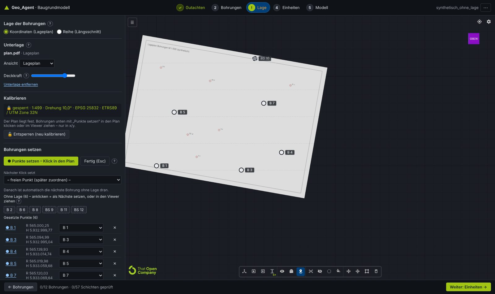

# 21 Step app, norms for the description and new calibration

The Baugrundmodell app leaves Streamlit: it is now a **full-screen step app** (FastAPI + a web page
with the integrated That Open viewer). Each step leads to the next and updates it:

**1 Gutachten → 2 Bohrungen → 3 Lage → 4 Einheiten → 5 Modell.**

In addition:

- **Warnings**: only for **unclassified** Schichten (`unklassifiziert`), not for confidence.
- **Norms**: a mini database with DIN 4023, DIN EN ISO 14688-1 and DIN 18196 reads every description.
- **New calibration**: measured distance, reference point and lock.
- **Diameter of the Bohrungen**: configurable.
- **IFC**: every Schicht carries its description and its interpretation by norm.

It replaces the Streamlit page of [19](19_app_v2.md) and the two-point calibration of
[20](20_lage_pruefung_viewer.md); the rest of 20 (TwinBimM controls, camera > 5 km, Prüfstand,
einchecken) stays the same.


## 1. Start-up and architecture

| Piece | What it does |
|---|---|
| [`start.bat`](../start.bat) / `python -m server` | Starts the app at <http://localhost:8500> and opens the browser (`--port`, `--arbeit <folder>`, `--kein-browser`) |
| [`server/api.py`](../server/api.py) | HTTP API (FastAPI) and the compiled page `apps/web/dist` on the same port: no Node needed |
| [`server/arbeitsplatz.py`](../server/arbeitsplatz.py) | Projects on disk, background extraction with progress, model cache, Unterlage, PDF pages |
| [`ui/projekt.py`](../ui/projekt.py) | Project state and **all the rules** (`aendern(op)`): corrections, warnings, removal, calibration, diameter |
| [`apps/web/src/app`](../apps/web/src/app) | The 5 steps (lit), help texts, SVG column |
| [`apps/web/src/viewer`](../apps/web/src/viewer) | The viewer as a module (`viewerStarten`), also standalone in `viewer.html` |
| [`start_excel.bat`](../start_excel.bat) / `streamlit run app.py` | Only the *Excel nach Vorlage* page (v1) |

Data in `ARBEIT` (`%TEMP%\geo_agent`, or `GEO_AGENT_ARBEIT` / `--arbeit`):

- `projekte/<signature>/docs.json`: the extraction, unchanged.
- `projekte/<signature>/projekt.json`: corrections, Lage, review, in the `geo_agent-projekt/2` format.
- `web/`: IFC, images of the plan and pages of the Gutachten.

A project saved by app v2 (`projekte/<signature>.json`) is picked up automatically when the same PDF
is opened.

The address `#/<project>/<step>/<Bohrung>` allows reloading or bookmarking without losing the place.

| API | |
|---|---|
| `GET /api/info`, `GET /api/projekte` | Version, OCR, examples; recent projects |
| `POST /api/gutachten` (PDF or extraction JSON), `GET /api/auftrag/<id>` | Background extraction with page x/y |
| `POST /api/beispiel` | Open an example |
| `GET /api/projekt/<signature>`, `POST …/aendern {ops}` | Full state; list of changes (all or nothing) |
| `GET …/bohrung/<id>`, `GET …/seite/<doc>/<page>` | Schichten with norm and proposal; page of the PDF (px per pt) |
| `POST/DELETE …/unterlage`, `POST …/unterlage/seite` | Plan or section as PDF, page and view |
| `POST …/modell`, `POST …/einchecken`, `GET …/export/<art>` | Model (cache by inputs), Prüfstand, downloads |

## 2. Bohrungen step: review and correct

- **Warning ⚠ = unclassified Schicht that has not been reviewed.** It goes away in three ways:
  choose the Bodenart, apply the *proposal by norm* or mark the Schicht as reviewed (a record remains
  that a person saw it). The extraction's confidence no longer generates warnings.
- **Stable navigation.** The selection lives in the address and the state; the neighbours are
  preloaded.
  - Keys: ↑/↓ (or J/K) to move between Bohrungen, **N** for the next open one, **G** to mark all
    Schichten as reviewed and move on.
  - The keys also work with the focus on a button; inside a field, typing is still typing.
  - The *Nächste offene* button works; the Streamlit problem was changing a `selectbox` that already
    existed.
- **Alle Bohrungen geprüft** marks all Schichten of all Bohrungen of the model; it can be undone.
- **Remove** (🗑 in the list or the button): the Bohrung leaves the model and stays under
  *Entfernt*, where it can be restored.
- **Source in the PDF.** Page of the Gutachten with the column of the Bohrung and the chosen Schicht
  marked, with zoom. In the examples that only bring the JSON, only the column is shown.
- **Fields of the Bohrung**: GOK, coordinates, EPSG, Ø of the column.

## 3. Mini database of norms

Files:

- [`normen.json`](../services/modeler/baugrundmodell/normen.json): the data.
- [`normen.py`](../services/modeler/baugrundmodell/normen.py): the reader.
- Tests: [`test_normen.py`](../services/modeler/tests/test_normen.py).

Each entry carries its **evidence**:

- `DIN4023`: confirmed in secondary sources.
- `praxis`: usual in the legends of Gutachten, but not confirmed in the text of the standard.
- `darstellung`: a colour chosen for display only.

The text of the standards is paid and was not read.

| Table | Content |
|---|---|
| Classes (those of the extraction) | DIN 4023 Kurzzeichen (G, S, U, T, X, Y, H, F, Mu, A, Mg, Lg, Lö, Löl), ISO 14688-1 symbol (Gr, Sa, Si, Cl, Co, Bo, Or, Mg), colour, fractions with grain size (fG 2–6.3 mm … gS 0.63–2 mm …) |
| Nebenanteile | g/fg/mg/gg, s/fs/ms/gs, u, t, x, y, h (humos), o (organisch); degrees `''` very weak, `'` schwach, — normal, `¯`/`*` stark, `=` sehr stark |
| State | Konsistenz (breiig/weich/steif/halbfest/fest; brg, wch, stf, hfst, fst), Lagerungsdichte (I_D, ISO 14688-2), Kalk (k0, k+, k++), Feuchte, Bodenfarbe (bn, gr, sw, we/ws, ro/rt, ge/gb, h/d) |
| DIN 18196 | GE … HZ, F, A, `[ ]` (Auffüllung of natural soil); **only if the text names it**, never estimated |
| Fels | Sst, Ust, Tst, Mst, Kst, Ko, Br; weathering (angewittert … zersetzt) |
| Ambiguities | `Mg` (Geschiebemergel in the old DIN 4023 / *made ground* in ISO), `Gr`, `H`, `Schotter` |

DIN 4023 colours, now also in the modeler, the IFC and the viewer:

| Class | Colour | In brackets: DIN 6164 |
|---|---|---|
| Kies | yellow | 2:6:1 |
| Sand | orange | 6:6:2 |
| Schluff | olive | 1:4:5; Grobschluff turquoise (2023) |
| Ton | violet | 14:5:4 |
| Torf/Humus | dark brown | – |
| Mudde | lilac | 11:4:4 |
| Mutterboden | yellowish brown | 4:5:3 |
| Auffüllung | no colour in the standard; grey for display | – |

The 2023 edition of the standard only names the colours, without the DIN 6164 number.

**Reading** (`deuten`). It works the same for written text ("Schluff, stark tonig, kiesig,
weich-steif, TA") and for abbreviations ("mS, fs', u").

Preparing the text:

- Apostrophes and overlines unified.
- The decimal comma ("770,17 mNN") does not split the text.
- Words glued together by the PDF are separated ("FeinsandbisMittelsand", "schwachhumos",
  "MittelsandFeinkies").

Choosing the main component:

- The first noun or Kurzzeichen is the main one.
- *Auffüllung* or *Mutterboden* + soil gives a material ("Auffüllung (Schluff, stark tonig)").
- A geological name + soil does too ("Geschiebemergel (Schluff, sandig, kiesig)").
- Nouns of the same type form a range ("Fein- bis Mittelsand"); of another type, a Nebenanteil
  without a degree (`fg(?)`).

Output:

- Benennung and Kurzzeichen DIN 4023 / ISO.
- Bodengruppe, consistency, density, lime, moisture, colour.
- Inclusions and foreign materials.

**What is doubtful is marked**:

- `Mg` on its own is treated as ambiguous.
- `Lehm` is an uncertain proposal.
- An OCR error at distance 1 ("Grobaand" → Grobsand) is accepted as uncertain.
- Foreign materials give the warning "Auffüllung prüfen".
- A group that does not match the main component is flagged ("TL" in a Kies).
- If it differs from the extraction, it is flagged ("Extraktion: Sand, nach Norm gelesen:
  Auffuellung").

A **proposal** for an unclassified Schicht is only applied with a click, and it stays marked as
corrected.

| Example | Schichten | Read | Contradict the extraction |
|---|---|---|---|
| Talheim | 65 | 63 (2 without text) | 0 |
| Berlin | 69 | 66 (3 without text; 2 "Grobaand" uncertain) | **13**: the text says *Auffüllung* (of sand), the extraction put "Sand" |
| Demo / Trasse | 57 / 127 | all | 0 |

The 13 cases in Berlin are a real finding: according to DIN 4023 they are fills, not natural sand.
They stay marked, not changed (lesson B4).

## 4. Lage: new calibration

Steps in the left panel; the viewer stays on the right:

1. **Unterlage**: Lageplan or Längsschnitt as PDF, with page, view and opacity.
2. **Maßstab**:
   - *Strecke messen*: two clicks on the plan (graphic scale, a dimension, two Bohrungen) and the real
     length in m.
   - Or *1:n*, with the paper size of the image.
   - In the section, the **vertical scale** can be the same, `1:n` or measured (Überhöhung).
3. **Bezugspunkt**: a click on a known point and its coordinate (Rechts-/Hochwert, or Station/NHN in
   the section). It can be copied from a Bohrung with coordinates.
4. **Drehung** (plan): degrees against grid north, positive anticlockwise. The **coordinate system
   (EPSG)** is chosen from a list next to the reference point (§4.2).
5. **🔒 Übernehmen und sperren**. The plan is fixed and does not move any more.

How the Bohrungen move:

- Before locking, the Bohrungen cannot be dragged.
- Afterwards, on the plan they only move in **x/y**.
- In the section they move along the **station**. In **height** only if the PDF has **no GOK**; the
  server also rejects a `gok` event in that case.

While typing, the preview moves the plan; marks 1, 2 and B are only visible during the calibration.
If the plan jumps far away (when typing its Rechts-/Hochwert), the camera follows it and it does not
disappear from view.

Formulas (the same in [`ui/projekt.bild_zu_welt`](../ui/projekt.py) and in `lage.ts/abbildung`):

```
s = metres / |p2 − p1|   or   n · mm_per_px / 1000          (m per px)
plan:    (x, y) = (x0, y0) + R(−θ) · s · (u − u0, −(v − v0))
section: station = x0 + s·(u − u0),  NHN = y0 − s_h·(v − v0)
```

An old two-point calibration is converted on loading into exactly the same transformation (tested).

**Ø of the columns**:

- Per project and per Bohrung.
- Automatic: `clamp(extent/300, 0.8, 12)` m. It is a display value, so that they are visible on a
  6 km Trasse.
- Applied the same way in the viewer and in the IFC (`CPset_Darstellung.Durchmesser_m` and its
  origin).


Results with the synthetic plans of [`scripts/testplan.py`](../scripts/testplan.py):

| Case | Result |
|---|---|
| Plan 1:500 rotated by 10°, calibrated from the UI (distance B 1–B 4 + B 1 as reference + 10°) | **1:500 · 10.0°** |
| Marks on the circles of the plan | 0.3 px |
| B 6 and BS 9 dragged from the list | 0.06–0.08 m |
| Section 1:500/1:100: stations | ≤ 0.02 m |
| Section: GOK from the PDF | unchanged |

### 4.1 No Bohrung with coordinates (real case: RKS without a position)

User report: after locking the plan the Bohrungen could not be dragged and the plan flickered (also
when transparent); the viewer turned black. Reproduced with [`testplan.py`](../scripts/testplan.py)
(`plan_ohne_lage_extraktion.json`: the test plan without a single coordinate). Causes and fixes:

| Symptom | Cause | Fix |
|---|---|---|
| Flicker | In `RendererMode.MANUAL` That Open draws every frame without postproduction and 50 ms later with it; the viewer requested a frame on every mouse move and every second | The viewer decides the postproduction (D73, M29): never in *Lage*; in the model only at rest; no redraw just for moving the mouse |
| Black viewer | The GTAO pass kept computing with perspective formulas in the orthographic view (and a negative `near`) | `PERSPECTIVE_CAMERA` follows the projection (M30) |
| Bohrungen "do not drag" | The first dropped Bohrung moved the project origin by ~6000 km (from the stations of the *Reihe* to the plan) and the camera was left looking into the void | Origin from the reference point of the plan when calibrating it; the camera follows any change of origin (D74, M31) |
| Dragging blocked | A pending "Punkt im Plan wählen" blocked all dragging | It is cancelled when locking and when dragging (M32) |
| Empty preview | When the Rechts-/Hochwert was typed, the plan jumped out of view | The camera follows large jumps of the plan; vertices relative to its corner (Float32 precision) |

The same script against the previous version (`3005cb9`) and the new one:

| | Previous | New |
|---|---|---|
| Preview after typing the coordinate | plan out of view | in view |
| Origin after locking | (100, 0) | (565,000, 5,933,000) |
| Frames at rest (3 s) / when moving the mouse | 12 alternating E/P / 80, 20 with postproduction | no alternation / 0 with postproduction |
| B 1, B 7, BS 10 from the list | B 1 placed, then plan and marks out of view; B 7 and BS 10 not placed | all three at 0.35–0.45 m, plan always in view |

In addition, in *Lage* the left button **pans** the plan (That Open's *Plan* navigation) instead of
rotating the view (D76).

Second report: *"I could drag some GWM but not BH"*. The test data had elevations of ~38 m NHN, which
hid it; with real elevations (`plan_ohne_lage_extraktion.json` now with GOK + 300 m and the BS without
a GOK, like GWM) and the app opened directly at `#/<project>/lage`, three causes appeared (D78):

| Symptom | Cause | Fix |
|---|---|---|
| BH with a GOK do not drag; GWM without a GOK do | In the orthographic view three.js starts the mouse ray at the camera plane. Without placed Bohrungen the plan was drawn at 10 m NHN and the camera 200 m above it; with the ×5 exaggeration the GOK of a BH (≈ 340 m NHN → +1700 m in the scene) lay **above** the camera and the ray never hit it; a GWM without a GOK (0 m) lay below | Ray from the `near` edge ([`kamera.strahl`](../apps/web/src/viewer/kamera.ts), M34); the plan is drawn above the highest known GOK |
| Plan rotated by 180° (calibration with «Drehung 180»), clicks that miss | When switching to orthographic with the camera not yet placed, That Open computes a **negative** width/height (and scales it with the first size of the viewer): inverted frame and zoom stuck at the minimum | Frame always positive at the viewer's aspect (`orthoRichten`, M35); minimum zoom 1e-4 |

With the previous version (`a6c1511`) and that data the plan was not even visible after uploading it
(inverted, tiny frame) and the calibration clicks failed. With the fix, in the end-to-end test: B 1 and
B 7 (GOK 338 m) and BS 10 (without a GOK) dragged to within 0.29–0.36 m.

### 4.3 Points: place, assign to a Bohrung and delete

Besides dragging, **points** can now be placed (user request), only with the Lageplan calibrated and
locked:

1. **＋ Punkte im Plan setzen** switches the mode on (crosshair cursor; Esc or *Fertig* ends it).
2. *Nächster Klick setzt*: the Bohrung that gets the next click. By default the first one without a
   position; after each click it moves on to the next one without a position. A click on a chip in
   *Ohne Lage* selects it.
3. With *– freien Punkt –* the click leaves a **free point ◆ P1, P2 …** (yellow) that is assigned
   later in the list.
4. **Gesetzte Punkte**: every Bohrung placed on the plan and every free point, with its coordinates, a
   dropdown (assign the free point; move the position to another Bohrung, or *Zuordnung lösen*, which
   turns it into a free point) and **✕** (delete the point; for a Bohrung, remove its position: it goes
   back to *Ohne Lage* or to the coordinates from the PDF).
5. In the viewer: clicking a mark and pressing **Del** does the same as ✕. Panning the plan does not
   place points (5 px threshold).

Server operations ([`ui/projekt.py`](../ui/projekt.py)): `punkt` (with or without `bohrung`),
`punkt_zuordnen`, `punkt_loeschen`, `lage_entfernen`, `lage_loesen`, `lage_umhaengen`. Free points are
saved with the project (`punkte`); an assigned position is that of the Bohrung (`Plan (kalibriert)`,
with the EPSG of the plan).




### 4.2 Coordinate system (EPSG)

A list instead of a free number, in the calibration panel and in the *Bohrungen* step (per Bohrung).
Codes and names verified with the EPSG database of pyproj 3.8 ([`epsg.ts`](../apps/web/src/app/epsg.ts)):

| Group | Systems |
|---|---|
| Germany · ETRS89/UTM | 25832 (UTM 32N), 25833 (UTM 33N), 4647 (32N with prefix 32…), 5650 (33N with prefix 33…) |
| Germany · Gauß-Krüger | 31466–31469 (DHDN, zones 2–5), 2398/2399 (Krassowski 42/83, zones 4/5) |
| Germany · others | 3068 (Soldner Berlin) |
| Switzerland | 2056 (LV95), 21781 (LV03) |
| Austria | 31254–31256 (GK West/Central/East), 31257–31259 (BMN M28/M31/M34) |
| GPS | 32632, 32633 (WGS 84 / UTM) |

Each system carries its **range of Rechts-/Hochwert** (area of use in DACH, GK strips ±1°, rounded to
10 km). When a coordinate is typed, a warning appears if it does not fit, with the systems that would;
it never blocks (D75). Examples: 565,000 / 5,933,000 → ✓ 25832; 4,468,000 / 5,333,000 with 25832 →
"fits 31468"; 74,848.90 / 5,603,772.65 (the value in the user's screenshot) → "fits no system, check
the digits". An unknown code coming from the PDF is shown marked (⚠), not lost. Without an EPSG on the
Bohrungen, the viewer uses the plan's.

## 5. Einheiten and Modell

**Einheiten**:

- Table of Einheiten with colour, volume, thickness and Bohrungen with / without / below the
  Endteufe.
- Editor of the *Vorgabe*: rename, merge Bodenarten, reorder.
- Log of all Bohrungen per Einheit, in m NHN.
- When an Einheit is chosen, all the **descriptions from the PDF** that make it up.
- Model settings (IDW/TPS, Puffer, Raster, Basis, relative GOK), each with its **?**.

**Modell**:

- Full-screen viewer with the Einheiten sidebar.
- On the right: Prüfstand, einchecken with a comment and protocol, exports and warnings.
- Automatic recomputation after every change, can be switched off.


## 6. IFC: the description on every Schicht

| Pset | Where | Content |
|---|---|---|
| `CPset_Schichtenverzeichnis` | stratum of the column | `Beschreibung` (original text, `IfcText`), Bodenart, depths, source, review |
| `CPset_Bodenansprache` (new) | stratum of the column | Benennung, Hauptanteil, Material, Nebenanteile, Kurzzeichen DIN 4023 / ISO 14688, Bodengruppe DIN 18196 (if named), Konsistenz, Lagerungsdichte, Kalk, Feuchte, Bodenfarbe, Felsart, Verwitterung, Beimengungen, Farbe DIN 4023, `Deutung_eindeutig`, warnings, norms |
| `CPset_Modelleinheit` | model Einheit | in addition `Beschreibungen` (each Schicht of the PDF that makes it up: Bohrung, depth, text), `Benennungen` (by norm, with frequency), `Farbname_DIN4023` |
| `CPset_Darstellung` (new) | `IfcBorehole` | `Durchmesser_m`, `Durchmesser_Quelle` (manual per Bohrung, per project or automatic) |

Long texts go as `IfcText` (`IfcLabel` is for short names). The IFC validates without errors
(`test_bodenansprache_beschreibungen_und_durchmesser`).

## 7. Viewer

- It is a reusable module ([`viewer.ts`](../apps/web/src/viewer/viewer.ts)). The app creates it once
  and reuses it in *Lage* and *Modell* (it does not reload when switching steps).
- The event channel ([`kanal.ts`](../apps/web/src/viewer/kanal.ts)) replaces the Streamlit component
  protocol.
- **Compact toolbar**: icons of 1 rem only, with the name in the tooltip, and the Überhöhung as a
  menu. It measures about 460 px against more than 1500 px before.
  - `bim-toolbar-section` removed `label-hidden` from its buttons (M26): they are now our own groups.
- Every setting in the gear carries its explanation (grid, orbit, edges and shadows, projection), and
  every setting of the app has its **?** button.
- **Postproduction** (shadows, D73): a plain image while the camera moves, fragments load or something
  is dragged; once still, one frame with shadows; never in *Lage*. At rest nothing is drawn (0 frames
  measured with the 6 km Trasse).

## 8. Tests

| Test | Result |
|---|---|
| Modeler (`cd services/modeler && python -m pytest tests`) | 57 (19 for norms, 1 IFC with Bodenansprache/diameter) |
| App and API (`python -m pytest tests`) | 24 for project logic (points included) + 9 for the API (TestClient) |
| Viewer (`node scripts/check.mjs <trasse.ifc> <plans>`) | 19/19: 6 km Trasse; *Lage* with a correct orthographic frame, no postproduction (0 of 14 frames) and orthographic GTAO; plan not draggable without locking, scale by distance, 1:500 · 10.0°, B 6/BS 9 within 0.3 m; section 1:500/1:100, exact stations, GOK from the PDF fixed, without a GOK it moves in height |
| End-to-end app (`node scripts/check_app.mjs <url> <plans> <screenshots>`) | 28/28 and no page error: warnings, ↓/N/G, classify, remove/restore, all reviewed, proposal by norm, calibration of plan and section through the UI, **plan without any coordinate and with real elevations** (EPSG warning, preview in view, pending pick + lock, origin = reference, 0 frames with postproduction, B 1/B 7 with GOK 338 m and BS 10 without GOK within 0.29–0.36 m), **points** (B 2/B 3 by click within 0.04–0.16 m, free point assigned to B 4, chip, ✕, Del, panning without a point), **direct opening** with a correct frame, Einheit renamed, model, einchecken, IFC with Bodenansprache, PDF with progress and the Schicht marked on the page |

## 9. Assumptions and limits (marked)

- **Norms.** The text of DIN 4023 / 14688 / 18196 is not available (paid).
  - Colours and Kurzzeichen come from secondary sources.
  - The abbreviations for consistency, colour and lime are `praxis`.
  - The percentages of the degrees are indicative values.
  - The ISO prefix is formed only from the strongest Nebenanteil.
- **Lehm, Mergel, Schotter**: the proposal is uncertain or ambiguous and is marked.
- **Windows**: `start.bat` has not been tested on Windows from here. If a new package (fastapi) is
  missing, it reinstalls it.
- **Reading sources directly**: `de.wikipedia.org` and `www.gdws.wsv.bund.de` are blocked by the
  session's network policy. They would have to be allowed to read whole pages; only search results
  were used here.

Sources consulted (web search):

- [Spektrum, Lexikon der Geowissenschaften: Konsistenzermittlung](https://www.spektrum.de/lexikon/geowissenschaften/konsistenzermittlung/8676)
- [DIN 4023:2023-02, table of contents (Annex B: Kurzformen DIN 4023 ↔ Kurzzeichen ISO 14688-1)](https://www.din.de/de/mitwirken/normenausschuesse/nabau/veroeffentlichungen/wdc-beuth:din21:360893743/toc-3395929/download)
- [Legend of a Bohrprofil according to DIN 4022/4023 (Tempelhofer Feld, Alte Gärtnerei)](https://Tempelhofer-Feld.Berlin.de/documents/594/AlteGaertnerei_Bodenunters_Anlagen_1-2.pdf)
- [Bohrprofile NLWKN (Konsistenz brg/wch/stf)](https://www.nlwkn.niedersachsen.de/download/95034/Baugrunduntersuchung_1._Bericht_-_Anlage_2_Bohrprofile_BS_1_bis_BS_8.pdf)
- [Bohrprofil ULB Münster (hfst)](https://epflicht.ulb.uni-muenster.de/download/pdf/630789)
- [Regierung von Mittelfranken, annexes (Mg Geschiebemergel, Lg Geschiebelehm)](https://www.regierung.mittelfranken.bayern.de/mam/service/planfeststellung/pls-entengraben-neu/12_03_2_stellungnahmeboeschungen_anlagen.pdf)
- [Hypersoil Uni Münster: lime test with HCl](https://www.hypersoil.uni-muenster.de/1/01/pdf/Boden/2_16.pdf)

Up: [Index](README.md)

Related: [19 App v2](19_app_v2.md) · [20 Lage and Prüfstand](20_lage_pruefung_viewer.md) · [18 Layer modeler](18_layer_modeler.md) · [04 Schraffur DIN 4023](04_schraffur_din4023.md) · [11 Decisions](11_decisions.md) · [16 Lessons](16_lessons_learned.md) · [22 Online](22_deployment.md)
