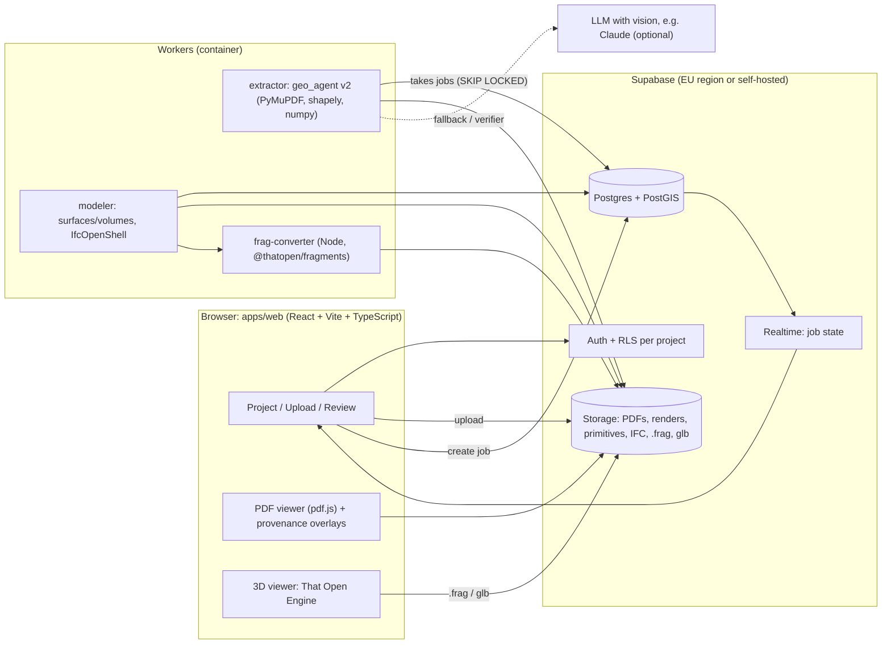
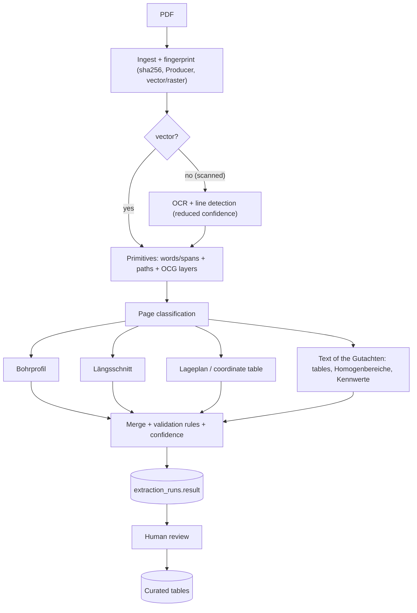

# Geo_Agent → Baugrundmodell: evaluation, benchmark and proposed architecture

> Status: technical proposal (October 2026). Context document for implementing the next version of
> Geo_Agent: **Bodengutachten (vector CAD PDF) → validated data in Supabase → 3D Baugrundmodell →
> IFC 4.3 / That Open Engine**.
>
> Statements marked **[verified]** were checked with a spike in this repo
> ([`spikes/ifc_thatopen/`](../spikes/ifc_thatopen/README.md)). What is marked **[to be verified]**
> are reasonable assumptions that must be confirmed during implementation.
>
> Detailed notes (diagnosis, generalisation, Schraffur, Sondierungen, Grundwasser, coordinates,
> swissgeol, validation, plan): [documentation index](README.md).

---

## 0. Executive summary

**Verdict: yes, it is worth it. The improvement is feasible and significant.** The current base
(vector reading with PyMuPDF, no OCR, with arithmetic validations) is more precise than most
commercial "AI borehole digitising" tools, which work on images. What is missing is not precision but
**generality, persistence and a model**:

| Today | Goal |
|---|---|
| One Gutachter layout (offsets and colours fixed in the code) | Any DIN 4023 drawing: geometric detection + configurable *layout profiles* |
| Only text (head word) for the Bodenart | **Signal fusion**: text + Schraffur (DIN 4023 pattern) + boundary lines + legend |
| Ephemeral result → Excel | Canonical data with **provenance** (page + bbox) and confidence, versioned in **Supabase** |
| No coordinates (Rechts-/Hochwert empty) | Georeferencing via the Lageplan, a table in the Gutachten or the alignment (Trasse/Station) |
| Bodenart in the tunnel = nearest Bohrung | **3D Baugrundmodell** (surfaces + solids), real intersection with the tunnel |
| PNG preview | **That Open Engine** web viewer + **IFC 4.3** export (IfcBorehole, IfcGeomodel, IfcGeotechnicalStratum) |

**Five key decisions**

1. **Canonical data model first** (Pydantic ↔ Postgres): every value carries `provenance`
   (document, page, bbox, method) and `confidence`. Excel, IFC, AGS, etc. become *exporters* of that
   model.
2. **"The LLM proposes, the geometry decides"**: numbers (depths, NHN, stations) always come from
   tokens/vectors of the PDF. An LLM (e.g. Claude) is used only to classify pages, parse free
   descriptions, propose layout profiles for new templates and as a verifier. Never as the only
   source of a number.
3. **Supabase = data and files; Python worker = computation.** PyMuPDF, shapely and IfcOpenShell
   run in a Python worker (container), not in Edge Functions.
4. **IFC 4.3 as the open deliverable, Fragments as the viewing format.** The backend generates IFC
   with IfcOpenShell and converts it to `.frag` with `@thatopen/fragments`. **[verified]** This
   works, *but* That Open's `IfcImporter` discards the geotechnical entities by default: they have to
   be added to `importer.classes.elements` (see §8.3).
5. **Incremental migration (strangler)**: the Streamlit app and the current Excel keep working during
   the whole transition; each phase delivers value on its own.

**Recommended first step:** Phase 0 (§11) — canonical model + JSON + YAML profiles + a test bench with
ground truth. Without that, any improvement to the extraction is impossible to measure.

---

## 1. Starting point: what the app does today

Current pipeline (≈1,260 lines of Python, Streamlit, `localhost` only):

```
Bohrprofil.pdf ──► legend.py (Bodenarten + DIN-Sektionen)
               └─► bohrprofil.py (Kernbohrungen, Tiefenpaare, Schichttext) ──┐
Längsschnitt.pdf ─► laengsschnitt.py (Achsen-Regression, Tunnelmaske, Zonen) ┴─► excel_writer.py ─► Geo_Daten.xlsx
```

### 1.1 Strengths (keep them)

- **Vector-first**: reads text and paths of the CAD PDF directly → centimetre precision.
- **Built-in validation**: NHN arithmetic (`GOK − Endtiefe = NHN Sohle`), check of the Sohle against
  `TS=…m` labels, green/yellow cells.
- **Vocabulary from the legend** (not hard-coded), merging of Schichten, Prüfbild.
- Linear regression of the axes (`X→Tunnelmeter`, `Y→NHN`): the right technique, reusable.

### 1.2 Limits (what prevents scaling)

| Limit | Where | Consequence |
|---|---|---|
| Column offsets fixed relative to the token `B` (`-65`, `+8`, `+58`) | `geo_agent/bohrprofil.py:26-28` | Another Gutachter / another scale → fails silently |
| Station labels expected at `y≈1137`, NHN axis at `290<x<360` | `geo_agent/laengsschnitt.py:105`, `:110`, `:428` | Tied to a single drawing |
| Tunnel = grey fill `RGB 0.73`; geology = 5 fixed colours | `geo_agent/laengsschnitt.py:28-35` | Any change of CAD style breaks the detection |
| Fixed vertical region `160…1130 pt`, only `doc[0]` | `geo_agent/laengsschnitt.py:200`, `:238-239` | Multi-page drawings or other formats |
| Graphic column (DIN 4023 Schraffur) ignored | `geo_agent/bohrprofil.py:13` | A second independent signal for Bodenart and boundaries is lost |
| Classification by head word + substring rules | `geo_agent/soil.py:22`, `:51` | Nebenanteile, Lagerungsdichte, colour, stratigraphy not structured |
| Sondierungen (DS), GWM and Grundwasser discarded | `geo_agent/bohrprofil.py:32` | Valuable data for the model (Lagerungsdichte, Grundwasser) is lost |
| No coordinates | `geo_agent/excel_writer.py:145-147` | A real 3D model is impossible |
| Bodenart in the tunnel by "zone of influence" (midpoint between Bohrungen) | `geo_agent/laengsschnitt.py` `_build_borehole_zones` | Between Bohrungen the geological interpretation of the Längsschnitt is ignored |
| No persistence or versioning; global cache `_NHN_FIT` by `id(page)` | `geo_agent/laengsschnitt.py:419` | No history, review or traceability |
| No tests or ground truth (real PDFs in `.gitignore`) | — | Every change is an unmeasurable risk |

---

## 2. What already exists? (benchmark)

### 2.1 Extracting Bohrprofile from PDF

| Tool | Type | What it does | What to take from it |
|---|---|---|---|
| **swisstopo `swissgeol-boreholes-dataextraction`** (full analysis and test: [08](08_swissgeol_reuse.md)) | Open source (Python, PyMuPDF, AGPL-3.0, beta, v1.1.0 May 2026) | PDF → JSON pipeline: name, coordinates (LV95/LV03), elevation, depths per Schicht, descriptions, Grundwasser (keywords + symbol detection by lines). Optimised for Swiss logs in German. API + benchmark mode against ground truth. | It is **the closest thing** to Geo_Agent. Copy: (1) the decomposition *sidebar* (depth column) / *interval* / *depth-description alignment* / variant without a sidebar; (2) the **benchmark harness** with ground truth JSON; (3) symbol detection by geometry. |
| **swisstopo `swissgeol-boreholes-suite` (BDMS)** | Open source, web app | Management of Bohrung data (capture, review, publication). | Reference for the data model and the review workflow. |
| **Civils.ai – Borehole Digitiser** | Commercial SaaS | PDF (also scanned) → AGS 4.1 / Excel, georeferenced for OpenGround/Leapfrog. | AGS4 output as an exchange format; human review workflow. |
| **GeoLayer** | Commercial SaaS | Scanned/handwritten logs → Excel/AGS4/gINT/OpenGround/CAD, with *confidence flags* and on-screen review. | Review UI with confidence flags. |
| **BoreholeAI** | SaaS + Python SDK | XLSX/AGS/CSV/JSON + **annotated PDF**; batch processing. | The "annotated PDF" as a traceability artifact. |
| **Strataworks** | SI platform | AI-native logging, export AGS4/gINT/OpenGround/DXF. | Scope of a full platform (field → model). |

Observations (the commercial figures/claims are marketing, not verified):
- The commercial market is oriented to **UK/AGS and raster logs** (images, OCR + vision). None
  positions itself on **German vector CAD drawings DIN 4023 + tunnel Längsschnitt + IFC**.
- Recent research with LLMs mostly works on the **text** of the descriptions (StratumGPT,
  GEOBERTje): it confirms that parsing descriptions is a good place for an LLM, while the geometry is
  better solved deterministically.

### 2.2 Software that *produces* these PDFs

GGU-STRATIG, DC-BOHR (DC-Software), WinBohr, AutoCAD/Civil 3D with their own blocks. This is useful:
the `Producer/Creator` field of the PDF and the structure of CAD layers (OCG) make it possible to
**choose a layout profile automatically** by software/office (§6.10). DIN 4023 was revised in **2023**
(adaptation to ISO 710, DIN EN ISO 14688-1/14689, 22475-1): the description parser must support the
new notation and that of 2006.

### 2.3 Subsurface modelling

| Tool | Comment |
|---|---|
| **Seequent Leapfrog Works** (+ **Bentley OpenGround** as DB, PLAXIS for calculation) | De facto standard for implicit models; license ≈ USD 11,000–11,600/year depending on the source. It is the "competitor" of the Baugrundmodell, but it does not extract PDFs. |
| **Autodesk Civil 3D – Geotechnical Module** | Current destination of the Excel (coarse classes for Civil 3D). Keep compatibility. |
| **GemPy** (open source) | Implicit modelling (cokriging of contacts + orientations); imports Bohrungen via `subsurface` (`structural_elements_from_borehole_set`). Option for complex geology (lenses, glacial channels). |
| **LoopStructural, PyVista** | Open-source alternatives / visualisation and meshing. |

### 2.4 Relevant standards

- **IFC 4.3 (IFC4X3_ADD2)**: `IfcBorehole`, `IfcGeomodel`, `IfcGeoslice` (subtypes of
  `IfcGeotechnicalAssembly`), `IfcGeotechnicalStratum` (SOLID/VOID/WATER), and the Psets
  `Pset_BoreholeCommon`, `Pset_GeotechnicalStratumCommon`, `Pset_SolidStratumCapacity`
  (FrictionAngle, HydraulicConductivity, NValue…), `Pset_SolidStratumComposition` (SandVolume,
  SiltVolume, ClayVolume…). **[verified]** with the IfcOpenShell 0.9 templates. Note: the **IFC 4.4
  draft** deprecates `IfcGeotechnicalStratum` in favour of `IfcGeoScienceFeature` → the IFC writer
  must be a swappable adapter.
- **DGGT AK "Digitalisierung in der Geotechnik"**: Empfehlungen Nr. 1 (terms, *Fachmodell
  Baugrund*) and Nr. 4 (roles and responsibilities). Key point: separate **exploration data** (facts)
  from the **model** (interpretation, the Gutachter's responsibility).
- **DB InfraGO – Handlungsempfehlung BIM Baugrund**: distinguishes existing, project and **synthetic**
  Bohrungen (to fill areas without data).
- **Exchange**: SEP 3 (Schichtenverzeichnis, Geologische Dienste) and BoreholeML (BGR) in Germany;
  AGS4 (UK, Leapfrog/OpenGround); DIGGS (US).
- Research: *Implementierung von probabilistischen Baugrundmodellen* (Bautechnik 11/2024):
  isosurfaces as a provisional way of representing Schichten and uncertainty in IFC.

**Conclusion of the benchmark:** there is no tool that does the whole chain *German CAD PDF →
validated data with traceability → Baugrundmodell → IFC 4.3 on the web*. The niche is real;
Geo_Agent's distinctive advantage is **exact vector reading + validation + clickable provenance**.

---

## 3. Design principles

1. **Facts vs. interpretation.** `boreholes`/`layers` (what the PDF says) are separate from
   `model_units`/`models` (what the geotechnical engineer interprets). They are never mixed in the
   same table.
2. **Provenance everywhere.** Every value knows which page and bbox it came from and with which method
   (`text`, `vector`, `hatch`, `llm`, `manual`). In the 3D viewer: click on a stratum → the PDF opens
   at that bbox.
3. **Immutable runs, editable curated data.** Each extraction produces an `extraction_run` with its
   full JSON (immutable). Review promotes that result to the curated tables, with an audit trail.
   Reprocessing = a new run + diff, never an overwrite.
4. **Fusion of independent signals** → confidence comes from the agreement between signals (text ↔
   Schraffur ↔ lines ↔ arithmetic), not from an arbitrary threshold.
5. **Configuration, not code, per template.** What is specific to one Gutachter lives in a YAML
   profile; the code is generic.
6. **Deterministic and measurable.** Every change to the extractor is measured against ground truth
   in CI.

---

## 4. Target architecture



### 4.1 Components and why

| Component | Technology | Reason |
|---|---|---|
| Frontend | React + Vite + TS, `@thatopen/components` + `components-front` + `@thatopen/ui`, `three`, pdf.js, `supabase-js` | That Open is MIT, based on three.js, and loads IFC/Fragments in the browser; pdf.js for side-by-side review. |
| Extractor | Python 3.12, PyMuPDF, numpy, shapely, pydantic v2, (scikit-learn for kNN) | Reuses `geo_agent`; PyMuPDF is the best available for vector paths. |
| Modeler | Python: numpy/scipy (interpolation), shapely, IfcOpenShell 0.9; optionally GemPy | IfcOpenShell generates valid IFC4X3 **[verified]**. |
| frag-converter | Node 22 + `@thatopen/fragments` 3.6 + `web-ifc` 0.0.78 | **[verified]** `IfcImporter.process()` works in Node; it is converted once on the server, the client only downloads `.frag`. |
| DB | Supabase Postgres + PostGIS | Georeferenced points/lines/polygons, RLS, Realtime, Storage and Auth in one. |
| Job queue | `jobs` table + `SELECT … FOR UPDATE SKIP LOCKED` (alternative: Supabase Queues/pgmq) | Simple, portable, no extra infrastructure. |
| Streamlit (`app.py`) | Kept | Internal debugging tool during the migration. |

**What NOT to do**
- Do not parse PDFs in Edge Functions (Deno, CPU/time limits, no PyMuPDF).
- Do not store 3D meshes in PostGIS (SFCGAL availability on Supabase is not verified and not
  needed): meshes in Storage (`.frag`/`.glb`/`.ifc`), metadata in Postgres.
- Do not extract "LLM-only": it hallucinates numbers and loses the vector accuracy.
- Do not rewrite everything at once.

### 4.2 Data flow

1. Upload PDF → Storage (`source-pdfs/{project}/{sha256}.pdf`) → row in `documents` → `jobs`.
2. Worker: fingerprint → primitives (cached in Storage) → page classification → extractors → merge +
   rules → `extraction_runs.result` (canonical JSON) + `issues`.
3. Realtime notifies the UI → review (PDF with overlays + live 3D view of the columns).
4. Approval → promotion to the curated tables (`boreholes`, `borehole_layers`, …) with an audit trail.
5. Modeler (on demand): model Einheiten + surfaces + solids → IFC → `.frag` → Storage.
6. Exporters: current Excel (no regression), IFC 4.3, glTF, LandXML (surfaces for Civil 3D),
   AGS4/SEP 3 (later).

---

## 5. Data model

### 5.1 Canonical model (Python, sketch)

```python
# geo_agent/model.py  (pydantic v2)
class Provenance(BaseModel):
    document_id: str
    page: int                                   # 0-basiert
    bbox: tuple[float, float, float, float]     # PDF-Punkte
    method: Literal["text", "vector", "hatch", "symbol", "llm", "manual"]

class Layer(BaseModel):
    top_depth: float                            # m unter GOK
    bottom_depth: float
    description_raw: str                        # Originaltext
    main_fraction: str | None                   # DIN 4023: S, U, T, G, H, A (Auffüllung) …
    grain_range: Literal["f", "m", "g"] | None
    secondary: list[Admixture] = []             # [{fraction:"u", strength:"schwach"}]
    consistency: str | None                     # breiig … fest
    density: str | None                         # locker / mitteldicht / dicht
    lime: str | None                            # k0 / k+ / k++
    colour: str | None
    stratigraphy: str | None                    # z. B. qw, qs, Lauenburger Ton
    soil_class: str                             # Legenden-/Projektklasse
    hatch_class: str | None                     # per Schraffur erkannt (2. Signal)
    confidence: float                           # 0..1, aus Signal-Übereinstimmung
    provenance: list[Provenance]
    issues: list[str] = []

class Borehole(BaseModel):
    code: str                                   # "B 18/19"
    kind: Literal["kernbohrung", "rks", "drucksondierung", "rammsondierung", "gwm", "schurf"]
    gok_nhn: float | None
    end_depth: float | None
    x: float | None; y: float | None; crs_epsg: int | None
    station: float | None; offset: float | None # aus Längsschnitt/Achse
    layers: list[Layer]
    groundwater: list[GroundwaterObs] = []
    soundings: list[SoundingCurve] = []         # q_c / N10 über Tiefe
    provenance: list[Provenance]
    checks: dict[str, CheckResult]              # z. B. "nhn_arithmetic"
```

`excel_writer.py` then consumes this model (same result as today → non-regression test).

### 5.2 Supabase schema (draft migration)

```sql
-- supabase/migrations/0001_core.sql  (Entwurf)
create extension if not exists postgis with schema extensions;

create type document_kind as enum ('bohrprofil','laengsschnitt','lageplan','gutachten_text','labor','sonstiges');
create type review_status as enum ('extracted','in_review','approved','rejected');

create table projects (
  id uuid primary key default gen_random_uuid(),
  name text not null,
  crs_epsg int not null default 25832,          -- ETRS89 / UTM 32N (Ost: 25833)
  height_datum text not null default 'DHHN2016 (NHN)',
  created_at timestamptz not null default now()
);

create table project_members (
  project_id uuid references projects on delete cascade,
  user_id uuid references auth.users on delete cascade,
  role text not null check (role in ('owner','editor','viewer')),
  primary key (project_id, user_id)
);

create table documents (
  id uuid primary key default gen_random_uuid(),
  project_id uuid not null references projects on delete cascade,
  kind document_kind,
  storage_path text not null,
  sha256 text not null,
  page_count int,
  pdf_producer text,                            -- wählt das Layout-Profil vor
  created_at timestamptz not null default now(),
  unique (project_id, sha256)
);

create table extraction_runs (                  -- unveränderlich
  id uuid primary key default gen_random_uuid(),
  document_id uuid not null references documents on delete cascade,
  parser_version text not null,
  layout_profile text,
  status text not null default 'queued' check (status in ('queued','running','done','failed')),
  result jsonb,                                 -- kanonisches Modell (5.1)
  issues jsonb not null default '[]',
  metrics jsonb not null default '{}',
  created_at timestamptz not null default now(),
  finished_at timestamptz
);

create table boreholes (                        -- kuratiert
  id uuid primary key default gen_random_uuid(),
  project_id uuid not null references projects on delete cascade,
  source_run_id uuid references extraction_runs on delete set null,
  code text not null,
  kind text not null,
  collar extensions.geometry(PointZ),                      -- SRID = projects.crs_epsg, Z = GOK [m NHN]
  gok_nhn numeric(8,2),
  end_depth numeric(7,2),
  station numeric(10,3),
  offset_m numeric(7,2),
  review review_status not null default 'extracted',
  provenance jsonb not null default '[]',
  unique (project_id, code)
);

create table borehole_layers (
  id uuid primary key default gen_random_uuid(),
  borehole_id uuid not null references boreholes on delete cascade,
  top_depth numeric(7,2) not null,
  bottom_depth numeric(7,2) not null check (bottom_depth > top_depth),
  description_raw text,
  main_fraction text, grain_range text, secondary jsonb not null default '[]',
  consistency text, density text, lime text, colour text, stratigraphy text,
  soil_class text not null,
  hatch_class text,
  confidence real,
  provenance jsonb not null default '[]'
);

create table groundwater_obs (
  id uuid primary key default gen_random_uuid(),
  borehole_id uuid not null references boreholes on delete cascade,
  depth numeric(7,2), nhn numeric(8,2), kind text, observed_on date,
  provenance jsonb not null default '[]'
);

-- Interpretation (Verantwortung Gutachter)
create table model_units (                      -- Homogenbereiche / geotechnische Einheiten
  id uuid primary key default gen_random_uuid(),
  project_id uuid not null references projects on delete cascade,
  name text not null,
  strat_order int not null,                     -- 1 = oben
  colour text,
  parameters jsonb not null default '{}',       -- γ, γ', φ', c', E_s, k … (→ Pset_SolidStratumCapacity)
  unique (project_id, name)
);
create table layer_unit_map (
  layer_id uuid references borehole_layers on delete cascade,
  unit_id uuid references model_units on delete cascade,
  primary key (layer_id)
);

create table sections (                         -- Längsschnitte
  id uuid primary key default gen_random_uuid(),
  document_id uuid not null references documents on delete cascade,
  x_to_station jsonb, y_to_nhn jsonb,           -- Regressionen + Residuen
  alignment extensions.geometry(LineStringZ)               -- falls Trasse bekannt
);
create table section_polygons (                 -- Geoslice in (Station, NHN)
  id uuid primary key default gen_random_uuid(),
  section_id uuid not null references sections on delete cascade,
  unit_id uuid references model_units,
  geom extensions.geometry(Polygon),                       -- x = Station [m], y = NHN [m] (kein CRS)
  provenance jsonb not null default '[]'
);
create table tunnel_profile (
  section_id uuid references sections on delete cascade,
  station numeric(10,3), ok_nhn numeric(8,2), axis_nhn numeric(8,2), sohle_nhn numeric(8,2),
  primary key (section_id, station)
);

create table models (
  id uuid primary key default gen_random_uuid(),
  project_id uuid not null references projects on delete cascade,
  version int not null,
  method text not null,                         -- 'layer_cake_idw' | 'layer_cake_rbf' | 'gempy'
  params jsonb not null default '{}',
  status text not null default 'draft',
  ifc_path text, frag_path text, glb_path text,
  created_at timestamptz not null default now(),
  unique (project_id, version)
);

create table jobs (
  id bigint generated always as identity primary key,
  kind text not null,                           -- 'extract' | 'build_model' | 'export'
  payload jsonb not null,
  status text not null default 'queued',
  attempts int not null default 0,
  locked_at timestamptz,
  created_at timestamptz not null default now()
);

create table audit_log (
  id bigint generated always as identity primary key,
  table_name text, row_id uuid, user_id uuid, before jsonb, after jsonb,
  at timestamptz not null default now()
);

-- RLS (Beispiel; analog für alle projektbezogenen Tabellen)
create function is_member(p uuid) returns boolean
  language sql stable security definer set search_path = public as $$
  select exists (select 1 from project_members where project_id = p and user_id = auth.uid());
$$;
alter table boreholes enable row level security;
create policy boreholes_read on boreholes for select using (is_member(project_id));
```

> [!NOTE]
> Verified on PostgreSQL 16 + PostGIS 3 ([Supabase spike](../spikes/supabase/README.md)): with
> `create extension postgis with schema extensions` the types must be qualified
> (`extensions.geometry`), otherwise the migration fails outside Supabase.

**Storage**: private buckets `source-pdfs` and `artifacts` (page renders, primitives cache
`.json.gz`, `.ifc`, `.frag`, `.glb`); client access only with signed URLs. The `service_role` key
lives only in the worker.

---

## 6. Extraction pipeline v2 (the focus)



### 6.1 Ingest and fingerprint

- `sha256` (deduplication), `Producer`/`Creator` metadata, page size, number of paths vs. images,
  presence of a text layer → decides the vector or OCR route and preselects the profile.

### 6.2 Primitives (once per document, cached)

- Text with font/size/colour: `page.get_text("rawdict")` (spans and a bbox per character).
- Paths: `page.get_drawings()` → `fill`, `color`, `width`, `dashes`, `items`, **`layer`**.
  **[verified]** (PyMuPDF 2.0, test PDF with OCG) PyMuPDF returns the name of the CAD layer (OCG) on
  each path, and `doc.get_ocgs()` lists the layers. **[to be verified]** with the real PDFs: if the
  CAD exporter kept layers such as `GEOLOGIE`, `TUNNEL`, `BOHRUNGEN`, **selecting by layer is much
  more robust than by colour**.
- Performance: the Längsschnitt has > 150,000 objects (~20 s). The serialised result is cached in
  Storage and the work is parallelised by page. `page.get_cdrawings()` (fast variant) and
  `page.cluster_drawings()` exist in the current version **[verified: they exist]**; measure.

### 6.3 Page classification

Rules first (density of keywords: `Zeichenerklärung`, `Station`, `NHN`, `M 1:…`, `B nn/jj` patterns,
coordinate grid), an LLM with vision on a small render only if the rules do not decide. Classes:
`bohrprofil`, `laengsschnitt`, `lageplan`, `legende`, `text`, `labor`.

### 6.4 Bohrprofil: from fixed offsets to geometric detection

> Details and results of the prototype: [01 Diagnosis](01_diagnosis_fixed_layout.md), [02 Bohrprofil](02_bohrprofil_generalization.md), [04 Schraffur](04_schraffur_din4023.md), [05 Sondierungen](05_sondierungen.md), [06 Grundwasser](06_grundwasser.md).

**a) Columns (Säulen).** A DIN 4023 column is a vertical sequence of rectangles of the same width,
stacked without gaps, each with a fill/Schraffur. They are detected by grouping rectangular paths by
`x0/x1` (±0.5 pt) and vertical continuity. The ID is assigned from the nearest text `B nn/jj`,
`RKS …`, `DS …` above it. It no longer depends on offsets relative to the token `B`.

**b) Vertical scale per column with residual validation.** The same technique already used in the
Längsschnitt, applied to each column:

```python
def depth_scale(labels):            # labels: [(y_pt, tiefe_m), ...] aus "(NHN) Tiefe"-Paaren
    ys, ds = np.array(labels).T
    a, b = np.polyfit(ys, ds, 1)    # tiefe = a*y + b
    resid = ds - (a * ys + b)
    # M 1:100 -> 1 pt = 0.3528 mm Papier = 0.0353 m Natur: Plausibilität gegen Maßstabstext
    return a, b, np.abs(resid) > 0.05   # Ausreißer (5 cm) -> falsch zugeordnetes Label
```

This (1) detects labels assigned to the wrong column, (2) makes it possible to convert **any** y
coordinate into a depth (lines, symbols, text) and (3) is checked against `M 1:100`.

**c) Schicht boundaries from geometry.** The horizontal lines crossing the column (or the edges of
the stacked rectangles) give the boundaries independently of the text. Merge: if
`|tiefe_label − tiefe_line| < 2 cm` → high confidence; a line without a label or a label without a
line → issue for review.

**d) Assigning the descriptive text.** By vertical overlap with the interval `[y_top, y_bot]` and
horizontal adjacency to the column (or following the leader lines when the text is offset), instead
of the fixed band `x_label+58 … next−25`.

**e) Schraffur classifier self-trained on the legend (second signal).** The DIN 4023
Zeichenerklärung contains samples of the pattern of each Bodenart next to its name. Those samples are
a **free training set specific to the document**:

```python
KEYS = ["dot", "circle", "line_0", "line_45", "line_90", "line_135", "dash", "fill_r", "fill_g", "fill_b"]

def hatch_features(drawings, rect: pymupdf.Rect) -> np.ndarray:
    """Merkmalsvektor der Schraffur innerhalb eines Rechtecks (Schicht oder Legendenfeld)."""
    f = Counter()
    for d in drawings:
        r = d["rect"]
        if not rect.contains(r):
            continue
        if r.width < 1.5 and r.height < 1.5 and d.get("fill"):
            f["dot"] += 1                                   # Punkte -> Sand
        elif r.width < 5 and any(it[0] == "c" for it in d["items"]):
            f["circle"] += 1                                # Kreise -> Kies
        for it in d["items"]:
            if it[0] == "l":
                p, q = it[1], it[2]
                ang = math.degrees(math.atan2(q.y - p.y, q.x - p.x)) % 180
                f[f"line_{int(((ang + 22.5) % 180) // 45) * 45}"] += abs(q - p)
        if d.get("dashes") not in (None, "[] 0"):
            f["dash"] += 1
        if d.get("fill") and r.width > rect.width * 0.8:    # Flächenfarbe der Schicht
            f["fill_r"], f["fill_g"], f["fill_b"] = d["fill"]
    area = max(rect.width * rect.height, 1.0)
    return np.array([f[k] / area if not k.startswith("fill") else f[k] for k in KEYS])

# Training: legend_swatches = [(name, rect), ...] aus der Zeichenerklärung
X = np.stack([hatch_features(drawings, r) for _, r in legend_swatches]); y = [n for n, _ in legend_swatches]
# Klassifikation: Nächster Nachbar (Kosinus) je Schichtrechteck -> hatch_class + Distanz als Konfidenz
```

**[verified]** with synthetic patterns in PyMuPDF: dots → `dot` (Sand), circles → `circle` (Kies),
dashed horizontal stripes → `line_0` + `dash` (Ton). In real drawings, rectangle edges drawn as loose
lines have to be normalised and the thresholds calibrated.

Result: each Schicht has a `soil_class` (text) and a `hatch_class` (drawing). If they agree, the
confidence goes up; if not, it is marked for review. This also solves Schichten whose text does not
start with the Bodenart (today they fall into "Fortsetzung der vorigen Schicht").

**f) Symbols.** Grundwasser (triangles + depth + date), samples (`P1`, boxes), Kernverlust,
Endtiefe. The exact convention (▽/▼, fills) is taken from the legend of the document, as swisstopo
does with the geometric detection of the water symbol.

**g) Sondierungen (DS / DPH / CPT).** Discarded today. Their diagrams are vector polylines: with the
axis calibration (regression on the labels of the `q_c`/`N10` axis) they are digitised exactly as
`depth → value` curves. They provide Lagerungsdichte and consistency between Bohrungen.

### 6.5 Description parser (DIN 4023 / DIN EN ISO 14688-1)

Two levels:

1. **Deterministic grammar** for abbreviations: main fraction (capital: `S`, `G`, `U`, `T`, `H`,
   `A`…), range prefix (`f`, `m`, `g`), secondary fractions in lower case with intensity (`'`
   schwach, `''` sehr schwach, `¯` stark, `=` sehr stark — as `soil.parse_nebenanteil` already does,
   but **per fraction** and not globally), consistency (`brg`, `wch`, `stf`, `hfst`, `fst`),
   Lagerungsdichte, lime (`k0`, `k+`, `k++`), colour, stratigraphy.
2. **LLM with JSON-Schema output** only for long or ambiguous free text. The result is validated
   against the vocabulary of the legend and against the grammar; disagreements are marked.

Example of structured output:

```json
{"raw": "Mittelsand, feinsandig, schwach schluffig, kalkhaltig, braun, mitteldicht",
 "main_fraction": "S", "grain_range": "m",
 "secondary": [{"fraction": "fs", "strength": "normal"}, {"fraction": "u", "strength": "schwach"}],
 "lime": "k+", "colour": "braun", "density": "mitteldicht",
 "soil_class": "Sand"}
```

### 6.6 Längsschnitt v2

> Details: [03 Längsschnitt](03_laengsschnitt_generalization.md).

- **Axes**: detect station labels in several notations (`0+100`, `km 1+250,000`, `1+250.000`) at any
  position, group them by row (clustering in y) and fit; the same for the NHN axis (column of evenly
  spaced numbers). The ratio of the scales gives the **Überhöhung** (vertical exaggeration) →
  plausibility check.
- **Tunnel**: by OCG layer if there is one; otherwise the geometric candidate = a polygon that is
  long in X with an almost constant vertical thickness (= diameter × Überhöhung), validated with
  `TS=`, `Ø`, `D=`. UI fallback: the user makes **one click** on the tunnel and the profile stores
  layer/colour.
- **Geology as vectors, not as raster**: the fill polygons of the geology are converted into
  `shapely.Polygon` in `(station, NHN)` coordinates through the regressions. That **is an
  `IfcGeoslice`**, and it also provides the **interfaces interpreted by the Gutachter between
  Bohrungen**, which feed the 3D model as constraints (§7).

```python
def section_polygons(page, layer_or_colours, x2tm, y2nhn):
    out = []
    for d in page.get_drawings():
        unit = classify_fill(d, layer_or_colours)          # per OCG-Layer oder Legendenfarbe
        if not unit:
            continue
        pts = [p for it in d["items"] for p in it[1:] if hasattr(p, "x")]
        poly = Polygon([(x2tm(p.x), y2nhn(p.y)) for p in pts]).buffer(0)
        if poly.area > 0:
            out.append((unit, poly))
    return merge_by_unit(out)                               # unary_union je Einheit
```

- Cross-check: the mini-columns of Bohrungen drawn in the Längsschnitt vs. the Bohrprofil (GOK,
  boundaries) → an additional validation rule.

### 6.7 Coordinates (they unlock 3D)

> Details and the table-reading test: [07 Coordinates](07_coordinates.md).

In order of preference:
1. **Table in the Gutachten** ("Lage- und Höhenverzeichnis der Aufschlüsse"): `page.find_tables()`
   + parsing, validated against the GOK of the Bohrprofil.
2. **Lageplan PDF**: Bohrung point symbols + `B nn/jj` label; affine georeferencing (6 parameters)
   from ≥ 3 labels of the coordinate grid (UTM E/N or Gauß-Krüger R/H), with residuals as a check.
3. **Alignment + station**: if the alignment exists (LandXML from Civil 3D),
   `XY = alignment(station) + offset` (the Längsschnitte usually note the offset, e.g. "5,2 m li.").
4. Manual input / CSV in the UI.

Optional: the model's GOK from a **DGM** (open data of the Länder, e.g. DGM1) instead of
interpolating the GOK of the Bohrungen.

### 6.8 Merge, rules and confidence

Declarative rules, each one produces `issues` with severity and provenance:

| Rule | Example |
|---|---|
| `nhn_arithmetic` | GOK − Endtiefe = NHN Sohle (±6 cm) — already exists |
| `depth_monotonic`, `no_gaps_overlaps` | contiguous, increasing Schichten |
| `scale_residuals` | residual of the regression per column < 5 cm |
| `label_vs_line` | boundary from text vs. boundary from a line < 2 cm |
| `text_vs_hatch` | `soil_class == hatch_class` |
| `legend_coverage` | every Bodenart found exists in the legend |
| `cross_doc_gok` | GOK in the Bohrprofil = GOK in the Längsschnitt |
| `tunnel_ts_labels` | detected Sohle = `TS=` labels — already exists |
| `coords_vs_station` | coordinate of the Bohrung consistent with station/alignment |
| `strat_order` | plausible stratigraphic order (mark inversions) |

`confidence` per value = combination of agreeing signals (e.g. text + hatch + line = high; LLM only =
low). The green/yellow of the Excel stays, now derived from this.

### 6.9 Where to use an LLM and where not

| Yes | No |
|---|---|
| Classify ambiguous pages | Read depths, NHN, stations |
| Parse free descriptions → JSON-Schema | Decide the geometry of the tunnel |
| Propose a layout profile for a new template (which is then validated deterministically) | Be the only source of any number |
| Verifier: render of a column + extracted JSON → "do you see discrepancies?" | Process confidential data without a processing/retention agreement |
| Extract Kennwerte/Homogenbereiche tables from the text of the Gutachten | |

Golden rule: every number proposed by an LLM must match a token of the PDF.

### 6.10 Layout profiles

The current constants move to YAML and are chosen by fingerprint (Producer, OCG layers, keywords).
The code uses the profile only as a *hint*; the geometric detection decides.

```yaml
# geo_agent/profiles/hamburg_tunnel_2019.yaml
match: {producer_contains: "AutoCAD", keywords: ["ZEICHENERKLÄRUNG", "BODENARTEN"]}
bohrprofil:
  header_regex: '^(B|RKS|DS|GWM)\s*\d+[a-z]?/\d{2}$'
  depth_pair_regex: '\(\s*(-?\d+[,.]\d+)\s*\)\s*(\d+[,.]\d+)'
  scale_hint: 100
laengsschnitt:
  station_regex: '^(\d)\+(\d{3})\.000$'
  tunnel: {by: fill, rgb: [0.73, 0.73, 0.73]}      # oder {by: layer, name: "TUNNEL"}
  geology_colours:
    Sand: [1.0, 0.75, 0.0]
    Kies: [1.0, 1.0, 0.5]
    "Lauenburger Ton": [0.88, 1.0, 1.0]
    Klei: [0.5, 1.0, 0.87]
    Glimmerton: [0.87, 0.5, 1.0]
```

### 6.11 Test bench (indispensable)

> Details, v1/v2/swissgeol results and metrics: [09 Validation](09_validation_benchmark.md).

- **Ground truth JSON** per reference PDF (format = canonical model), like swisstopo's harness.
  Metrics: precision/recall of boundaries (tolerance 1–2 cm), accuracy of `soil_class`, GOK/NHN
  error, coverage of Bohrungen, coordinate error.
- The real PDFs are not versioned (`.gitignore`): keep them in a private test bucket or generate
  **synthetic PDFs** (reportlab/PyMuPDF) with variations of layout, scale and style for CI. The
  non-regression test of the current Excel goes first.

---

## 7. Baugrundmodell: generating the geometry

### 7.1 Ladder of levels (each one is deliverable)

| Level | What | Requirements | IFC |
|---|---|---|---|
| **N1 Columns** | Each Schicht as a prism/cylinder at the position of the Bohrung | Coordinates | `IfcBorehole` ⊃ `IfcGeotechnicalStratum` |
| **N2 Geoslice** | Polygons of the Längsschnitt as a vertical "curtain" along the alignment | Längsschnitt (+ alignment for real 3D; without it: a provisional straight line) | `IfcGeoslice` ⊃ strata |
| **N3 Layer-cake** | Top/base surfaces per Einheit + closed solids | Coordinates + model Einheiten | `IfcGeomodel` ⊃ strata (solids) |
| **N4 Implicit** | GemPy for lenses, channels, faults | N3 + geological judgement | same as N3 |

N2 adds value **even before there are coordinates**: a "section model" in `(station, NHN)` already
makes it possible to compute the Bodenart in the tunnel with the Gutachter's interpretation instead of
the midpoint between Bohrungen.

### 7.2 Layer-cake algorithm (N3)

1. **Model Einheiten** (Homogenbereiche / stratigraphic Einheiten) with an order: proposed from the
   legend + the current `soil.classify()`, and the geotechnical engineer confirms them
   (`layer_unit_map`). Repetitions (`Sand`, `Sand1`) → lenses: their own Einheit or N4 treatment.
2. **Contacts**: per Bohrung, the base elevation of each Einheit; an absent Einheit → thickness 0
   (*pinch-out*). Add dense points from the interfaces of the Längsschnitt (§6.6) with a weight.
3. **Interpolation** of each surface on a regular grid (IDW as the base; thin-plate RBF or kriging
   (`scipy`/`gstools`) as an improvement), inside the model boundary (corridor = alignment ± buffer,
   or convex hull + buffer).
4. **Stratigraphic order**: trimming from top to bottom `z_base_i = min(z_base_i, z_top_i)`.
5. **Closed solids** per Einheit: top TIN + bottom TIN + side walls → watertightness and volume check.
6. **Uncertainty**: distance to the nearest data point or kriging variance per vertex → colour in the
   viewer and a property in IFC.
7. **Tunnel**: a solid swept along the alignment with OK/Sohle from the Längsschnitt → intersection
   with the solids → composition per station. It replaces the current computation of
   `Geo_Tunnel`/`Geo_Spec` (which is kept as a comparison).

The spike (`spikes/ifc_thatopen/baugrund_ifc_spike.py`) implements steps 3–5 in a minimal version
(IDW + trimming + solids) for 3 synthetic Bohrungen.

> [!NOTE]
> **Implemented (2026-10-27)** in [`services/modeler`](../services/modeler/README.md): steps 1–6 with
> automatic Einheiten by sequence correlation, censored contacts, lenses, Bohrungen as mesh nodes,
> limited extent of partial Einheiten and closed solids; viewer in [`apps/web`](../apps/web/README.md).
> Details and results: [18](18_layer_modeler.md).

---

## 8. IFC 4.3 + That Open Engine

### 8.1 Entity mapping

| Geo_Agent | IFC4X3_ADD2 | Properties |
|---|---|---|
| Project (CRS, NHN) | `IfcProject` + `IfcMapConversion` + `IfcProjectedCRS` (EPSG:25832) | — |
| Bohrung | `IfcBorehole` | `Pset_BoreholeCommon` (GroundwaterDepth, …) |
| Schicht of the Bohrung | `IfcGeotechnicalStratum` (SOLID) aggregated to the borehole, tube/prism geometry | `Pset_GeotechnicalStratumCommon`, `Pset_SolidStratumComposition`, `CPset_Schichtenverzeichnis` (original text, DIN, **provenance**) |
| Section of the Längsschnitt | `IfcGeoslice` ⊃ strata (thin extruded polygons) | origin: document/page |
| 3D model | `IfcGeomodel` ⊃ `IfcGeotechnicalStratum` (solids) | `Pset_SolidStratumCapacity` (FrictionAngle, HydraulicConductivity, …) from `model_units.parameters` |
| Tunnel (reference) | `IfcAlignment` + a simple solid (later `IfcLinearPlacement` per station) | — |

The IFC writer is encapsulated in `exporters/ifc4x3.py` so that it can migrate to IFC 4.4
(`IfcGeoScienceFeature`) without touching the rest.

### 8.2 Spike results **[verified]**

Environment: IfcOpenShell 0.9.0.post1, `@thatopen/fragments` 3.6.0, `@thatopen/components` 3.6.0,
`web-ifc` 0.0.78, Node 22.

| Test | Result |
|---|---|
| Generate IFC4X3 with 3 `IfcBorehole`, 1 `IfcGeomodel`, 16 `IfcGeotechnicalStratum`, georeferenced | OK; `ifcopenshell.validate` (schema): **0 issues** |
| `web-ifc` `StreamAllMeshes` | generates meshes for the **16** `IfcGeotechnicalStratum` |
| That Open's `IfcImporter` **by default** | **0 elements with geometry** — the geotechnical classes are not in `classes.elements` and are discarded |
| `IfcImporter` with `IFCBOREHOLE`, `IFCGEOMODEL`, `IFCGEOTECHNICALSTRATUM` added | **16** elements with geometry; categories `IFCBOREHOLE` (3), `IFCGEOMODEL` (1), `IFCGEOTECHNICALSTRATUM` (16) |

Reproduce:

```bash
cd spikes/ifc_thatopen
pip install ifcopenshell numpy && python baugrund_ifc_spike.py baugrund_spike.ifc
npm install && npm run spike
```

### 8.3 Frontend integration (sketch, API v3.6)

> [!NOTE]
> Real implementation: [`apps/web/src/main.ts`](../apps/web/src/viewer/viewer.ts) (local WASM and
> worker, web-ifc 0.0.77, see [18 §5](18_layer_modeler.md#5-viewer-appsweb)).

```ts
import * as OBC from "@thatopen/components";
import * as WEBIFC from "web-ifc";

const components = new OBC.Components();
const world = components.get(OBC.Worlds)
  .create<OBC.SimpleScene, OBC.OrthoPerspectiveCamera, OBC.SimpleRenderer>();
world.scene = new OBC.SimpleScene(components);
world.scene.setup();
world.renderer = new OBC.SimpleRenderer(components, container);
world.camera = new OBC.OrthoPerspectiveCamera(components);
components.init();

const fragments = components.get(OBC.FragmentsManager);
fragments.init(await OBC.FragmentsManager.getWorker());
world.camera.controls.addEventListener("rest", () => fragments.core.update(true));
fragments.list.onItemSet.add(({ value: model }) => {
  model.useCamera(world.camera.three);
  world.scene.three.add(model.object);
  fragments.core.update(true);
});

// a) Model generated in the backend (.frag in Supabase Storage)
const { data } = await supabase.storage.from("artifacts").download(`${projectId}/models/v3.frag`);
await fragments.core.load(new Uint8Array(await data!.arrayBuffer()), { modelId: "baugrund-v3" });

// b) IFC uploaded by the user: add the geotechnical classes to the importer!
const ifcLoader = components.get(OBC.IfcLoader);
ifcLoader.onIfcImporterInitialized.add((importer) => {
  for (const c of [WEBIFC.IFCBOREHOLE, WEBIFC.IFCGEOMODEL, WEBIFC.IFCGEOSLICE,
                   WEBIFC.IFCGEOTECHNICALSTRATUM]) importer.classes.elements.add(c);
});
```

In the backend (Node) the equivalent is `importer.classes.elements.add(...)` before
`importer.process({ bytes })` (see `spikes/ifc_thatopen/thatopen_import_spike.mjs`).

Viewer functions (existing components in 3.6): `Clipper` (cuts/sections), `Classifier` (group by
Einheit/Bodenart), `Hider` (visibility), `Raycasters`, `Highlighter` and `LengthMeasurement`
(`components-front`). During review, the columns are drawn as `three.js` meshes directly from the DB
(without going through IFC) for immediate feedback.

**Clickable provenance**: `CPset_Schichtenverzeichnis.Quelle` stores `document_id/page/bbox`; when
a stratum is selected, pdf.js opens at that bbox. It is the function that gives the user confidence,
and the one the tools in the benchmark do not have.

---

## 9. Supabase: implementation details

- **Project**: EU region (Frankfurt) or **self-hosted Supabase** if the Gutachten must not leave the
  own infrastructure (today the app is "nur localhost" and the PDFs are excluded from git:
  confidentiality is a requirement, not a detail).
- **Extensions**: `postgis` (mandatory); `pgvector` optional (search similar descriptions / map
  vocabularies); `pg_cron` optional (cleanup of jobs/artifacts).
- **Migrations** versioned in `supabase/migrations/` with the Supabase CLI; TS types with
  `supabase gen types typescript`; the Pydantic models mirror the same schema.
- **RLS** on all tables by `project_id` (`is_member`), roles `owner/editor/viewer`.
- **Realtime** on `extraction_runs`/`jobs` for the progress in the UI.
- **Worker**: a Python process that polls `jobs` with `FOR UPDATE SKIP LOCKED`, retries with
  `attempts`, writes results and uploads artifacts; `service_role` only in the worker.
- **Edge Functions**: only light tasks (e.g. webhook "new document" → insert a job).

---

## 10. Proposed repository structure

```
cad_extract/
├─ apps/web/                      React + Vite + That Open (project, review, 3D viewer)
├─ services/extractor/
│  └─ geo_agent/                  current package, refactored by stages
│     ├─ model.py                 canonical model (Pydantic) + provenance
│     ├─ ingest/  primitives/  pages/
│     ├─ bohrprofil/              columns.py, scale.py, boundaries.py, text_assign.py, hatch.py, symbols.py, soundings.py
│     ├─ descriptions/            din4023_grammar.py, llm_parser.py
│     ├─ laengsschnitt/           axes.py, tunnel.py, geoslice.py
│     ├─ lageplan/                georef.py, coord_tables.py
│     ├─ validate/                rules.py, confidence.py
│     ├─ exporters/               excel_writer.py (current), json.py, ifc4x3.py, landxml.py, ags4.py
│     └─ profiles/*.yaml
├─ services/modeler/              surfaces/solids (Python) + frag-converter (Node)
├─ supabase/                      config.toml, migrations/, seed.sql
├─ tests/                         fixtures/synthetic/, groundtruth/*.json, test_*.py
├─ spikes/ifc_thatopen/           spike of this document
├─ app.py                         Streamlit (internal debugging during the migration)
└─ docs/
```

---

## 11. Roadmap

Indicative estimates for one person; they depend above all on the variety of templates.

| Phase | Content | Acceptance criterion | Approx. duration |
|---|---|---|---|
| **F0 Foundations** | Canonical model + JSON export; constants → YAML profile; ground truth of the current PDFs; pytest + non-regression test of the Excel | Excel identical (cell by cell) to the current one with the reference PDFs; baseline metrics recorded | 1–2 weeks |
| **F1 Persistence** | Supabase schema, Storage, Auth/RLS, `jobs` table, worker; Streamlit reads/writes the DB | Upload → run → rows with provenance; reprocessing creates a new run, without overwriting | 1–2 weeks |
| **F2 Extraction v2** | Geometric columns, scale per column, boundaries from lines, Schraffur classifier, Grundwasser, DIN grammar, Längsschnitt by layers/vectors → geoslice, coordinates | ≥ 2 different Gutachter templates **without code changes** (profile only); metrics ≥ baseline | 3–5 weeks |
| **F3 Web + That Open** | Web app: projects, review with PDF + overlays, live 3D columns, geoslice, approval | A user reviews and approves a complete project without Streamlit | 2–3 weeks |
| **F4 Baugrundmodell + IFC** | Layer-cake, intersection with the tunnel, IFC 4.3 → `.frag`, LandXML for Civil 3D | Valid IFC (schema), opens in That Open and in a second viewer; watertight solids; composition in the tunnel compared with the current one | 2–3 weeks |
| **F5 AI and scaling** | LLM for new templates and descriptions, OCR for scans, Kennwerte from the text, GemPy, uncertainty, AGS4/SEP 3 | Depending on the use cases | ongoing |

---

## 12. Risks, licenses and open questions

| Risk | Mitigation |
|---|---|
| **Missing coordinates** → no real 3D | N2 (section model) does not need them; sources §6.7; manual input |
| Unknown **variety of templates** | Get a corpus of 5–10 Gutachten from different offices before F2 |
| That Open discards geotechnical entities by default **[verified]** | Add the classes to the importer; pin versions; a CI test with the spike |
| IFC 4.4 changes (`IfcGeotechnicalStratum` → `IfcGeoScienceFeature` in the draft) | IFC writer as an adapter |
| **AGPL license of PyMuPDF** (and of swisstopo's code) | Internal use: no problem. If it is offered as a service to third parties, the AGPL also applies to use over a network → publish the code or a commercial license from Artifex. IfcOpenShell (LGPL-3.0), That Open (MIT) and web-ifc (MPL-2.0) do not pose that problem. Details and a permissive alternative (pypdfium2): [14 Licensing](14_licensing.md). |
| Confidentiality / GDPR | EU region or self-hosted, private buckets, signed URLs; LLM only with a no-retention agreement or switchable off per project |
| Responsibility for the interpretation | Separation facts/model, approval state, the model is marked "not approved" until the Gutachter signs it (DGGT Empf. Nr. 4) |
| Performance (Längsschnitt > 150,000 paths) | Primitives cache, parallelism per page, `get_cdrawings` |

**Questions to decide before F1/F2**

1. How many different offices/templates of Gutachten have to be supported? Are there samples?
2. Are there Lagepläne as PDF, coordinate tables or the alignment (LandXML) of the project?
3. Internal use or a product for third parties? (it decides the AGPL question and the hosting)
4. Supabase Cloud (EU) or self-hosted?
5. Is Civil 3D still a destination (keep Excel/LandXML) or is the final goal IFC/web?

---

## 13. Sources

- swisstopo, *swissgeol-boreholes-dataextraction*: <https://github.com/swisstopo/swissgeol-boreholes-dataextraction> · fact sheet: <https://www.opensource.admin.ch/en/softwares/iukpt6>
- swisstopo, BDMS / Swissforages (FOSS4G): <https://callforpapers.2021.foss4g.org/foss4g2021/talk/3EPUQN>
- Civils.ai Borehole Digitiser: <https://civils.ai/blog/ai-borehole-log-digitiser-for-geotechnical/>
- GeoLayer: <https://geolayer.tech/> · <https://geolayer.tech/borehole-data-for-gint-openground/>
- BoreholeAI: <https://www.boreholeai.com/> · <https://pypi.org/project/boreholeai/0.9.8/>
- Strataworks: <https://strataworks.app/>
- buildingSMART IFC 4.3 – IfcBorehole: <https://ifc43-docs.standards.buildingsmart.org/IFC/RELEASE/IFC4x3/HTML/lexical/IfcBorehole.htm>
- buildingSMART IFC 4.3 – IfcGeotechnicalStratum: <https://ifc43-docs.standards.buildingsmart.org/IFC/RELEASE/IFC4x3/HTML/lexical/IfcGeotechnicalStratum.htm>
- buildingSMART IFC 4.3 – Shared infrastructure elements: <https://standards.buildingsmart.org/IFC/RELEASE/IFC4_3/HTML/ifcsharedinfrastructureelements/content.html>
- buildingSMART IFC 4.4 (draft) – IfcGeotechnicalStratumTypeEnum: <https://standards.buildingsmart.org/IFC/DEV/IFC4_4/HTML/lexical/IfcGeotechnicalStratumTypeEnum.html>
- That Open – engine_fragment: <https://github.com/ThatOpen/engine_fragment>
- Geology IFC example (IfcOpenShell): <https://github.com/vmarquar/ifc-geology-example>
- GemPy – boreholes: <https://docs.gempy.org/examples/real/mik.html> · <https://docs.gempy.org/GemPy%20API/gempy.structural_elements_from_borehole_set.html>
- Leapfrog Works: <https://www.bentley.com/en/products/leapfrog-works/> · webinar OpenGround→Leapfrog: <https://www.bentley.com/en/webinars/reduced-rework-and-risk-in-3d-ground-model-development-for-transport-infrastructure/>
- DGGT Empfehlung Fachmodell Baugrund (geotechnik 2021/1): <https://artikeldatenbank.ernst-und-sohn.de/artikel/gete-2021-1-das-fachmodell-baugrund-empfehlungen-des-arbeits-42086>
- DGGT Rollenverteilung (geotechnik 2023/2): <https://artikeldatenbank.ernst-und-sohn.de/artikel/gete-2023-2-rollenverteilung-bei-erstellung-fortschreibung-und-44212>
- Probabilistische Baugrundmodelle in IFC (Bautechnik 11/2024): <https://artikeldatenbank.ernst-und-sohn.de/artikel/bt-2024-11-implementierung-von-probabilistischen-baugrundmode-51046>
- DB InfraGO Handlungsempfehlung BIM Baugrund: <https://bim.dbinfrago.com/resource/blob/12624366/b5c3c758731552c082611290de4b0013/Handlungsempfehlung-BIM-FM-Baugrund-16012023-V3-ext-data.pdf>
- TUM, boreholes in PostgreSQL with SEP 3 / BoreholeML: <https://mediatum.ub.tum.de/node?id=1759874>
- LBEG, SEP 3 format: <https://www.lbeg.niedersachsen.de/download/70103> · BGR BoreholeML: <https://schemas.bgr.de/boreholeml/codelists/v1/CodingStandardList.xml>
- DIN 4023 (2023): <https://www.dinmedia.de/de/norm/din-4023/360893743>
- WinBohr: <https://www.softguide.de/programm/winbohr-winschicht-winpump> · DC-BOHR: <https://www.b-tu.de/fg-geotechnik/forschung/profil/software/dc-bodenmechanik>
- LLMs in geotechnics (review, GEOBERTje): <https://arxiv.org/pdf/2507.05613> · StratumGPT: <https://scholars.cityu.edu.hk/en/publications/locally-tuned-large-language-model-llm-to-empower-digitalization-/>
- Supabase extensions: <https://supabase.com/docs/guides/database/extensions>
- PostGIS PolyhedralSurface / SFCGAL: <https://postgis.net/docs/postgis_cheatsheet-en.html>

---

Up: [Index](README.md)

Related: [11 Decisions](11_decisions.md) · [01 Diagnosis](01_diagnosis_fixed_layout.md) · [08 swissgeol](08_swissgeol_reuse.md) · [09 Validation](09_validation_benchmark.md) · [10 Plan](10_implementation_plan.md)
