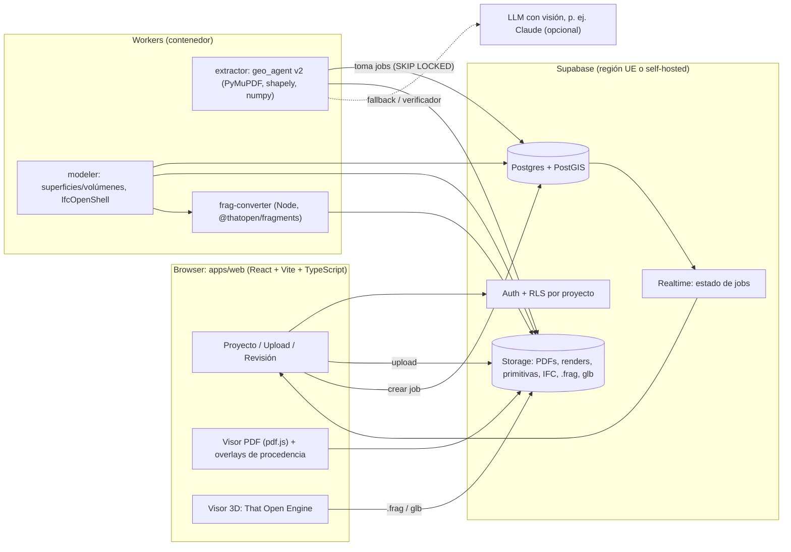
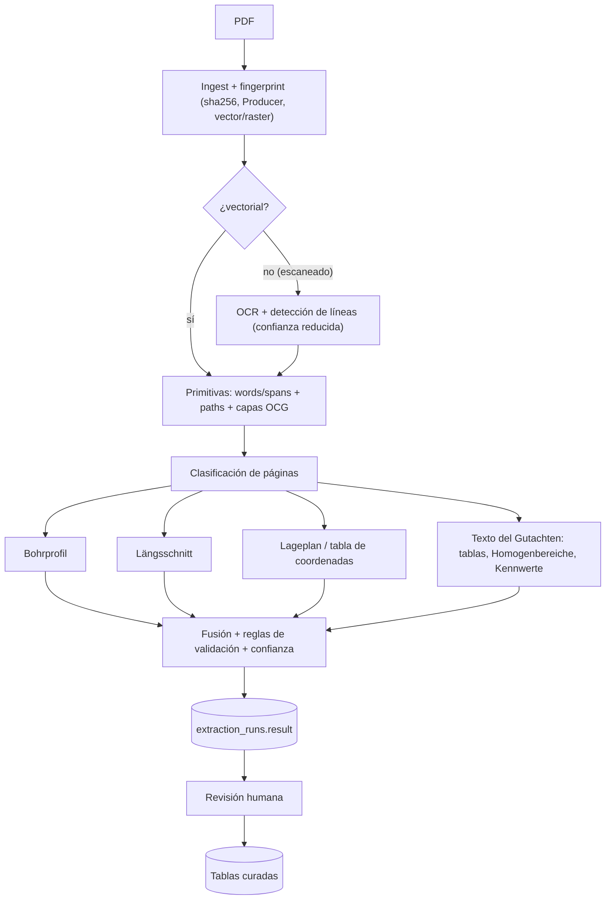

# Geo_Agent → Baugrundmodell: evaluación, benchmark y arquitectura propuesta

> Estado: propuesta técnica (octubre 2026). Documento de contexto para implementar la
> siguiente versión de Geo_Agent: **Bodengutachten (PDF CAD vectorial) → datos validados
> en Supabase → Baugrundmodell 3D → IFC 4.3 / That Open Engine**.
>
> Las afirmaciones marcadas con **[verificado]** se comprobaron con un spike en este repo
> ([`spikes/ifc_thatopen/`](../spikes/ifc_thatopen/README.md)). Lo marcado con **[a verificar]** son
> supuestos razonables que deben confirmarse en la implementación.
>
> Notas de detalle (diagnóstico, generalización, Schraffur, Sondierungen, Grundwasser,
> coordenadas, swissgeol, validación, plan): [índice de documentación](README.md).

---

## 0. Resumen ejecutivo

**Veredicto: sí, vale la pena. La mejora es viable y significativa.** La base actual
(lectura vectorial con PyMuPDF, sin OCR, con validaciones aritméticas) es más precisa que la
mayoría de las herramientas comerciales de "AI borehole digitising", que trabajan sobre
imágenes. Lo que falta no es precisión sino **generalidad, persistencia y modelo**:

| Hoy | Objetivo |
|---|---|
| Un layout de Gutachter (offsets y colores fijos en el código) | Cualquier plano DIN 4023: detección geométrica + *perfiles de layout* configurables |
| Solo texto (palabra cabeza) para la Bodenart | **Fusión de señales**: texto + Schraffur (patrón DIN 4023) + líneas límite + leyenda |
| Resultado efímero → Excel | Datos canónicos con **procedencia** (página + bbox) y confianza, versionados en **Supabase** |
| Sin coordenadas (Rechts-/Hochwert vacíos) | Georreferencia vía Lageplan, tabla del Gutachten o eje (Trasse/Station) |
| Bodenart en túnel = Bohrung más cercana | **Baugrundmodell 3D** (superficies + sólidos), intersección real con el túnel |
| Vista previa PNG | Visor web **That Open Engine** + exportación **IFC 4.3** (IfcBorehole, IfcGeomodel, IfcGeotechnicalStratum) |

**Cinco decisiones clave**

1. **Modelo de datos canónico primero** (Pydantic ↔ Postgres): todo valor lleva
   `provenance` (documento, página, bbox, método) y `confidence`. Excel, IFC, AGS, etc. pasan
   a ser *exportadores* de ese modelo.
2. **"El LLM propone, la geometría decide"**: los números (profundidades, NHN, estaciones)
   salen siempre de tokens/vectores del PDF. Un LLM (p. ej. Claude) se usa solo para clasificar
   páginas, parsear descripciones libres, proponer perfiles de layout para plantillas nuevas y
   como verificador. Nunca como fuente única de un número.
3. **Supabase = datos y archivos; Python worker = cómputo.** PyMuPDF, shapely, IfcOpenShell
   corren en un worker Python (contenedor), no en Edge Functions.
4. **IFC 4.3 como entrega abierta, Fragments como formato de visualización.** El backend
   genera IFC con IfcOpenShell y lo convierte a `.frag` con `@thatopen/fragments`.
   **[verificado]** Esto funciona, *pero* el `IfcImporter` de That Open descarta las entidades
   geotécnicas por defecto: hay que añadirlas a `importer.classes.elements` (ver §8.3).
5. **Migración incremental (strangler)**: la app Streamlit y el Excel actual siguen
   funcionando durante toda la transición; cada fase entrega valor por sí sola.

**Primer paso recomendado:** Fase 0 (§11) — modelo canónico + JSON + perfiles YAML + banco
de pruebas con ground truth. Sin eso, cualquier mejora de extracción es imposible de medir.

---

## 1. Punto de partida: qué hace la app hoy

Pipeline actual (≈1 260 líneas Python, Streamlit, sólo `localhost`):

```
Bohrprofil.pdf ──► legend.py (Bodenarten + DIN-Sektionen)
               └─► bohrprofil.py (Kernbohrungen, Tiefenpaare, Schichttext) ──┐
Längsschnitt.pdf ─► laengsschnitt.py (Achsen-Regression, Tunnelmaske, Zonen) ┴─► excel_writer.py ─► Geo_Daten.xlsx
```

### 1.1 Fortalezas (conservar)

- **Vector-first**: lee texto y paths del PDF CAD directamente → precisión de centímetro.
- **Validación integrada**: aritmética NHN (`GOK − Endtiefe = NHN Sohle`), comprobación de la
  Sohle contra etiquetas `TS=…m`, celdas verde/amarillo.
- **Vocabulario desde la leyenda** (no hard-codeado), consolidación de capas, Prüfbild.
- Regresión lineal de ejes (`X→Tunnelmeter`, `Y→NHN`): técnica correcta y reutilizable.

### 1.2 Límites (lo que impide escalar)

| Límite | Dónde | Consecuencia |
|---|---|---|
| Offsets de columnas fijos relativos al token `B` (`-65`, `+8`, `+58`) | `geo_agent/bohrprofil.py:26-28` | Otro Gutachter / otra escala → falla silenciosamente |
| Etiquetas de estación esperadas en `y≈1137`, eje NHN en `290<x<360` | `geo_agent/laengsschnitt.py:105`, `:110`, `:428` | Atado a un único plano |
| Túnel = relleno gris `RGB 0.73`; geología = 5 colores fijos | `geo_agent/laengsschnitt.py:28-35` | Cualquier cambio de estilo CAD rompe la detección |
| Región vertical fija `160…1130 pt`, solo `doc[0]` | `geo_agent/laengsschnitt.py:200`, `:238-239` | Planos multipágina o de otro formato |
| Columna gráfica (Schraffur DIN 4023) ignorada | `geo_agent/bohrprofil.py:13` | Se pierde una segunda señal independiente para la Bodenart y los límites |
| Clasificación por palabra cabeza + reglas de subcadena | `geo_agent/soil.py:22`, `:51` | Nebenanteile, Lagerungsdichte, color, estratigrafía no estructurados |
| Sondierungen (DS), GWM y nivel freático descartados | `geo_agent/bohrprofil.py:32` | Datos valiosos para el modelo (Lagerungsdichte, Grundwasser) se pierden |
| Sin coordenadas | `geo_agent/excel_writer.py:145-147` | Imposible un modelo 3D real |
| Bodenart en túnel por "zona de influencia" (punto medio entre Bohrungen) | `geo_agent/laengsschnitt.py` `_build_borehole_zones` | Entre Bohrungen se ignora la interpretación geológica del Längsschnitt |
| Sin persistencia ni versionado; caché global `_NHN_FIT` por `id(page)` | `geo_agent/laengsschnitt.py:419` | No hay historial, revisión ni trazabilidad |
| Sin tests ni ground truth (PDFs reales en `.gitignore`) | — | Cada cambio es un riesgo no medible |

---

## 2. ¿Qué existe ya? (benchmark)

### 2.1 Extracción de Bohrprofile desde PDF

| Herramienta | Tipo | Qué hace | Qué tomar de ella |
|---|---|---|---|
| **swisstopo `swissgeol-boreholes-dataextraction`** (análisis completo y prueba: [08](08_swissgeol_reutilizacion.md)) | Open source (Python, PyMuPDF, AGPL-3.0, beta, v1.1.0 mayo 2026) | Pipeline PDF → JSON: nombre, coordenadas (LV95/LV03), cota, profundidades por capa, descripciones, Grundwasser (palabras clave + detección del símbolo por líneas). Optimizado para perfiles suizos en alemán. API + modo benchmark contra ground truth. | Es **lo más parecido** a Geo_Agent. Copiar: (1) la descomposición *sidebar* (columna de profundidades) / *interval* / *depth-description alignment* / variante sin sidebar; (2) el **harness de benchmark** con ground truth JSON; (3) la detección de símbolos por geometría. |
| **swisstopo `swissgeol-boreholes-suite` (BDMS)** | Open source, app web | Gestión de datos de sondeos (captura, revisión, publicación). | Referencia de modelo de datos y flujo de revisión. |
| **Civils.ai – Borehole Digitiser** | SaaS comercial | PDF (también escaneado) → AGS 4.1 / Excel, georreferenciado para OpenGround/Leapfrog. | Salida AGS4 como formato de intercambio; flujo de revisión humana. |
| **GeoLayer** | SaaS comercial | Logs escaneados/manuscritos → Excel/AGS4/gINT/OpenGround/CAD, con *confidence flags* y revisión en pantalla. | UI de revisión con banderas de confianza. |
| **BoreholeAI** | SaaS + SDK Python | XLSX/AGS/CSV/JSON + **PDF anotado**; procesamiento por lotes. | El "PDF anotado" como artefacto de trazabilidad. |
| **Strataworks** | Plataforma SI | Logging AI-native, export AGS4/gINT/OpenGround/DXF. | Alcance de plataforma completa (campo → modelo). |

Observaciones (las cifras/claims comerciales son de marketing, no verificadas):
- El mercado comercial está orientado a **UK/AGS y logs raster** (imágenes, OCR + visión).
  Ninguno se posiciona en **planos CAD vectoriales alemanes DIN 4023 + Längsschnitt de túnel + IFC**.
- La investigación reciente con LLMs trabaja sobre todo el **texto** de las descripciones
  (StratumGPT, GEOBERTje): confirma que el parseo de descripciones es buen sitio para un LLM,
  mientras que la geometría se resuelve mejor de forma determinista.

### 2.2 Software que *produce* estos PDFs

GGU-STRATIG, DC-BOHR (DC-Software), WinBohr, AutoCAD/Civil 3D con bloques propios. Esto es
útil: el campo `Producer/Creator` del PDF y la estructura de capas CAD (OCG) permiten
**elegir automáticamente un perfil de layout** por software/oficina (§6.10). DIN 4023 se revisó
en **2023** (adaptación a ISO 710, DIN EN ISO 14688-1/14689, 22475-1): el parser de
descripciones debe soportar la notación nueva y la de 2006.

### 2.3 Modelado del subsuelo

| Herramienta | Comentario |
|---|---|
| **Seequent Leapfrog Works** (+ **Bentley OpenGround** como BD, PLAXIS para cálculo) | Estándar de facto para modelos implícitos; licencia ≈ 11 000–11 600 USD/año según fuente. Es el "competidor" del Baugrundmodell, pero no extrae PDFs. |
| **Autodesk Civil 3D – Geotechnical Module** | Destino actual del Excel (clases gruesas para Civil 3D). Mantener compatibilidad. |
| **GemPy** (open source) | Modelado implícito (cokriging de contactos + orientaciones); importa sondeos vía `subsurface` (`structural_elements_from_borehole_set`). Opción para geología compleja (lentes, canales glaciares). |
| **LoopStructural, PyVista** | Alternativas open source / visualización y mallado. |

### 2.4 Estándares relevantes

- **IFC 4.3 (IFC4X3_ADD2)**: `IfcBorehole`, `IfcGeomodel`, `IfcGeoslice`
  (subtipos de `IfcGeotechnicalAssembly`), `IfcGeotechnicalStratum` (SOLID/VOID/WATER), y los
  Psets `Pset_BoreholeCommon`, `Pset_GeotechnicalStratumCommon`, `Pset_SolidStratumCapacity`
  (FrictionAngle, HydraulicConductivity, NValue…), `Pset_SolidStratumComposition`
  (SandVolume, SiltVolume, ClayVolume…). **[verificado]** con las plantillas de IfcOpenShell 0.9.
  Nota: el **borrador IFC 4.4** depreca `IfcGeotechnicalStratum` en favor de
  `IfcGeoScienceFeature` → el escritor IFC debe ser un adaptador intercambiable.
- **DGGT AK "Digitalisierung in der Geotechnik"**: Empfehlungen Nr. 1 (términos, *Fachmodell
  Baugrund*) y Nr. 4 (roles y responsabilidades). Clave: separar **datos de exploración**
  (hechos) de **modelo** (interpretación, responsabilidad del Gutachter).
- **DB InfraGO – Handlungsempfehlung BIM Baugrund**: distingue sondeos existentes, de proyecto y
  **sintéticos** (para rellenar zonas sin datos).
- **Intercambio**: SEP 3 (Schichtenverzeichnis, Geologische Dienste) y BoreholeML (BGR) en
  Alemania; AGS4 (UK, Leapfrog/OpenGround); DIGGS (US).
- Investigación: *Implementierung von probabilistischen Baugrundmodellen* (Bautechnik 11/2024):
  isosuperficies como forma provisional de representar capas e incertidumbre en IFC.

**Conclusión del benchmark:** no hay una herramienta que haga la cadena completa *PDF CAD
alemán → datos validados con trazabilidad → Baugrundmodell → IFC 4.3 en la web*. El nicho es
real; la ventaja diferencial de Geo_Agent es la **lectura vectorial exacta + validación +
procedencia clicable**.

---

## 3. Principios de diseño

1. **Hechos vs. interpretación.** `boreholes`/`layers` (lo que dice el PDF) están separados de
   `model_units`/`models` (lo que interpreta el geotécnico). Nunca se mezclan en la misma tabla.
2. **Procedencia en todo.** Cada valor sabe de qué página y bbox salió y con qué método
   (`text`, `vector`, `hatch`, `llm`, `manual`). En el visor 3D: clic en un estrato → se abre el
   PDF en esa bbox.
3. **Corridas inmutables, datos curados editables.** Cada extracción produce un
   `extraction_run` con su JSON completo (inmutable). La revisión promueve ese resultado a las
   tablas curadas, con auditoría. Reprocesar = nuevo run + diff, nunca sobrescritura.
4. **Fusión de señales independientes** → la confianza surge del acuerdo entre señales
   (texto ↔ Schraffur ↔ líneas ↔ aritmética), no de un umbral arbitrario.
5. **Configuración, no código, por plantilla.** Lo específico de un Gutachter vive en un perfil
   YAML; el código es genérico.
6. **Determinista y medible.** Todo cambio de extractor se mide contra ground truth en CI.

---

## 4. Arquitectura objetivo



### 4.1 Componentes y por qué

| Componente | Tecnología | Motivo |
|---|---|---|
| Frontend | React + Vite + TS, `@thatopen/components` + `components-front` + `@thatopen/ui`, `three`, pdf.js, `supabase-js` | That Open es MIT, basado en three.js, carga IFC/Fragments en el navegador; pdf.js para la revisión lado a lado. |
| Extractor | Python 3.12, PyMuPDF, numpy, shapely, pydantic v2, (scikit-learn para kNN) | Reutiliza `geo_agent`; PyMuPDF es lo mejor disponible para paths vectoriales. |
| Modeler | Python: numpy/scipy (interpolación), shapely, IfcOpenShell 0.9; opcional GemPy | IfcOpenShell genera IFC4X3 válido **[verificado]**. |
| frag-converter | Node 22 + `@thatopen/fragments` 3.6 + `web-ifc` 0.0.78 | **[verificado]** `IfcImporter.process()` funciona en Node; se convierte una vez en servidor, el cliente sólo descarga `.frag`. |
| BD | Supabase Postgres + PostGIS | Puntos/líneas/polígonos georreferenciados, RLS, Realtime, Storage y Auth en uno. |
| Cola de jobs | Tabla `jobs` + `SELECT … FOR UPDATE SKIP LOCKED` (alternativa: Supabase Queues/pgmq) | Simple, portable, sin infraestructura extra. |
| Streamlit (`app.py`) | Se mantiene | Herramienta interna de depuración durante la migración. |

**Qué NO hacer**
- No parsear PDFs en Edge Functions (Deno, límites de CPU/tiempo, sin PyMuPDF).
- No guardar mallas 3D en PostGIS (la disponibilidad de SFCGAL en Supabase no está
  verificada y no hace falta): mallas en Storage (`.frag`/`.glb`/`.ifc`), metadatos en Postgres.
- No extraer con "LLM-only": alucina números y pierde la exactitud vectorial.
- No reescribir todo de golpe.

### 4.2 Flujo de datos

1. Upload PDF → Storage (`source-pdfs/{project}/{sha256}.pdf`) → fila en `documents` → `jobs`.
2. Worker: fingerprint → primitivas (cacheadas en Storage) → clasificación de páginas →
   extractores → fusión + reglas → `extraction_runs.result` (JSON canónico) + `issues`.
3. Realtime notifica a la UI → revisión (PDF con overlays + vista 3D en vivo de columnas).
4. Aprobación → promoción a tablas curadas (`boreholes`, `borehole_layers`, …) con auditoría.
5. Modeler (on demand): unidades de modelo + superficies + sólidos → IFC → `.frag` → Storage.
6. Exportadores: Excel actual (sin regresión), IFC 4.3, glTF, LandXML (superficies para
   Civil 3D), AGS4/SEP 3 (más adelante).

---

## 5. Modelo de datos

### 5.1 Modelo canónico (Python, esbozo)

```python
# geo_agent/model.py  (pydantic v2)
class Provenance(BaseModel):
    document_id: str
    page: int                                   # 0-basiert
    bbox: tuple[float, float, float, float]     # PDF-Punkte
    method: Literal["text", "vector", "hatch", "symbol", "llm", "manual"]

class Layer(BaseModel):
    top_depth: float                            # m unter GOK
    bottom_depth: float
    description_raw: str                        # Originaltext
    main_fraction: str | None                   # DIN 4023: S, U, T, G, H, A (Auffüllung) …
    grain_range: Literal["f", "m", "g"] | None
    secondary: list[Admixture] = []             # [{fraction:"u", strength:"schwach"}]
    consistency: str | None                     # breiig … fest
    density: str | None                         # locker / mitteldicht / dicht
    lime: str | None                            # k0 / k+ / k++
    colour: str | None
    stratigraphy: str | None                    # z. B. qw, qs, Lauenburger Ton
    soil_class: str                             # Legenden-/Projektklasse
    hatch_class: str | None                     # per Schraffur erkannt (2. Signal)
    confidence: float                           # 0..1, aus Signal-Übereinstimmung
    provenance: list[Provenance]
    issues: list[str] = []

class Borehole(BaseModel):
    code: str                                   # "B 18/19"
    kind: Literal["kernbohrung", "rks", "drucksondierung", "rammsondierung", "gwm", "schurf"]
    gok_nhn: float | None
    end_depth: float | None
    x: float | None; y: float | None; crs_epsg: int | None
    station: float | None; offset: float | None # aus Längsschnitt/Achse
    layers: list[Layer]
    groundwater: list[GroundwaterObs] = []
    soundings: list[SoundingCurve] = []         # q_c / N10 über Tiefe
    provenance: list[Provenance]
    checks: dict[str, CheckResult]              # z. B. "nhn_arithmetic"
```

`excel_writer.py` pasa a consumir este modelo (mismo resultado que hoy → test de no-regresión).

### 5.2 Esquema Supabase (borrador de migración)

```sql
-- supabase/migrations/0001_core.sql  (Entwurf)
create extension if not exists postgis with schema extensions;

create type document_kind as enum ('bohrprofil','laengsschnitt','lageplan','gutachten_text','labor','sonstiges');
create type review_status as enum ('extracted','in_review','approved','rejected');

create table projects (
  id uuid primary key default gen_random_uuid(),
  name text not null,
  crs_epsg int not null default 25832,          -- ETRS89 / UTM 32N (Ost: 25833)
  height_datum text not null default 'DHHN2016 (NHN)',
  created_at timestamptz not null default now()
);

create table project_members (
  project_id uuid references projects on delete cascade,
  user_id uuid references auth.users on delete cascade,
  role text not null check (role in ('owner','editor','viewer')),
  primary key (project_id, user_id)
);

create table documents (
  id uuid primary key default gen_random_uuid(),
  project_id uuid not null references projects on delete cascade,
  kind document_kind,
  storage_path text not null,
  sha256 text not null,
  page_count int,
  pdf_producer text,                            -- wählt das Layout-Profil vor
  created_at timestamptz not null default now(),
  unique (project_id, sha256)
);

create table extraction_runs (                  -- unveränderlich
  id uuid primary key default gen_random_uuid(),
  document_id uuid not null references documents on delete cascade,
  parser_version text not null,
  layout_profile text,
  status text not null default 'queued' check (status in ('queued','running','done','failed')),
  result jsonb,                                 -- kanonisches Modell (5.1)
  issues jsonb not null default '[]',
  metrics jsonb not null default '{}',
  created_at timestamptz not null default now(),
  finished_at timestamptz
);

create table boreholes (                        -- kuratiert
  id uuid primary key default gen_random_uuid(),
  project_id uuid not null references projects on delete cascade,
  source_run_id uuid references extraction_runs on delete set null,
  code text not null,
  kind text not null,
  collar geometry(PointZ),                      -- SRID = projects.crs_epsg, Z = GOK [m NHN]
  gok_nhn numeric(8,2),
  end_depth numeric(7,2),
  station numeric(10,3),
  offset_m numeric(7,2),
  review review_status not null default 'extracted',
  provenance jsonb not null default '[]',
  unique (project_id, code)
);

create table borehole_layers (
  id uuid primary key default gen_random_uuid(),
  borehole_id uuid not null references boreholes on delete cascade,
  top_depth numeric(7,2) not null,
  bottom_depth numeric(7,2) not null check (bottom_depth > top_depth),
  description_raw text,
  main_fraction text, grain_range text, secondary jsonb not null default '[]',
  consistency text, density text, lime text, colour text, stratigraphy text,
  soil_class text not null,
  hatch_class text,
  confidence real,
  provenance jsonb not null default '[]'
);

create table groundwater_obs (
  id uuid primary key default gen_random_uuid(),
  borehole_id uuid not null references boreholes on delete cascade,
  depth numeric(7,2), nhn numeric(8,2), kind text, observed_on date,
  provenance jsonb not null default '[]'
);

-- Interpretation (Verantwortung Gutachter)
create table model_units (                      -- Homogenbereiche / geotechnische Einheiten
  id uuid primary key default gen_random_uuid(),
  project_id uuid not null references projects on delete cascade,
  name text not null,
  strat_order int not null,                     -- 1 = oben
  colour text,
  parameters jsonb not null default '{}',       -- γ, γ', φ', c', E_s, k … (→ Pset_SolidStratumCapacity)
  unique (project_id, name)
);
create table layer_unit_map (
  layer_id uuid references borehole_layers on delete cascade,
  unit_id uuid references model_units on delete cascade,
  primary key (layer_id)
);

create table sections (                         -- Längsschnitte
  id uuid primary key default gen_random_uuid(),
  document_id uuid not null references documents on delete cascade,
  x_to_station jsonb, y_to_nhn jsonb,           -- Regressionen + Residuen
  alignment geometry(LineStringZ)               -- falls Trasse bekannt
);
create table section_polygons (                 -- Geoslice in (Station, NHN)
  id uuid primary key default gen_random_uuid(),
  section_id uuid not null references sections on delete cascade,
  unit_id uuid references model_units,
  geom geometry(Polygon),                       -- x = Station [m], y = NHN [m] (kein CRS)
  provenance jsonb not null default '[]'
);
create table tunnel_profile (
  section_id uuid references sections on delete cascade,
  station numeric(10,3), ok_nhn numeric(8,2), axis_nhn numeric(8,2), sohle_nhn numeric(8,2),
  primary key (section_id, station)
);

create table models (
  id uuid primary key default gen_random_uuid(),
  project_id uuid not null references projects on delete cascade,
  version int not null,
  method text not null,                         -- 'layer_cake_idw' | 'layer_cake_rbf' | 'gempy'
  params jsonb not null default '{}',
  status text not null default 'draft',
  ifc_path text, frag_path text, glb_path text,
  created_at timestamptz not null default now(),
  unique (project_id, version)
);

create table jobs (
  id bigint generated always as identity primary key,
  kind text not null,                           -- 'extract' | 'build_model' | 'export'
  payload jsonb not null,
  status text not null default 'queued',
  attempts int not null default 0,
  locked_at timestamptz,
  created_at timestamptz not null default now()
);

create table audit_log (
  id bigint generated always as identity primary key,
  table_name text, row_id uuid, user_id uuid, before jsonb, after jsonb,
  at timestamptz not null default now()
);

-- RLS (Beispiel; analog für alle projektbezogenen Tabellen)
create function is_member(p uuid) returns boolean
  language sql stable security definer set search_path = public as $$
  select exists (select 1 from project_members where project_id = p and user_id = auth.uid());
$$;
alter table boreholes enable row level security;
create policy boreholes_read on boreholes for select using (is_member(project_id));
```

**Storage**: buckets privados `source-pdfs` y `artifacts` (renders de página, caché de primitivas
`.json.gz`, `.ifc`, `.frag`, `.glb`); acceso del cliente sólo con URLs firmadas. El
`service_role` key vive únicamente en el worker.

---

## 6. Pipeline de extracción v2 (el foco)



### 6.1 Ingest y fingerprint

- `sha256` (deduplicación), metadatos `Producer`/`Creator`, tamaño de página, nº de paths vs.
  imágenes, presencia de capa de texto → decide ruta vectorial u OCR y preselecciona el perfil.

### 6.2 Primitivas (una sola vez por documento, cacheadas)

- Texto con fuente/tamaño/color: `page.get_text("rawdict")` (spans y bbox por carácter).
- Paths: `page.get_drawings()` → `fill`, `color`, `width`, `dashes`, `items`, **`layer`**.
  **[verificado]** (PyMuPDF 2.0, PDF de prueba con OCG) PyMuPDF devuelve el nombre de la capa
  CAD (OCG) en cada path, y `doc.get_ocgs()` lista las capas. **[a verificar]** con los PDFs
  reales: si el exportador CAD conservó capas como `GEOLOGIE`, `TUNNEL`, `BOHRUNGEN`,
  **seleccionar por capa es mucho más robusto que por color**.
- Rendimiento: el Längsschnitt tiene > 150 000 objetos (~20 s). Se cachea el resultado
  serializado en Storage y se paraleliza por página. `page.get_cdrawings()` (variante rápida) y
  `page.cluster_drawings()` existen en la versión actual **[verificado: existen]**; medir.

### 6.3 Clasificación de páginas

Reglas primero (densidad de palabras clave: `Zeichenerklärung`, `Station`, `NHN`, `M 1:…`,
patrones `B nn/jj`, malla de coordenadas), LLM con visión sobre un render pequeño sólo si las
reglas no deciden. Clases: `bohrprofil`, `laengsschnitt`, `lageplan`, `legende`, `text`, `labor`.

### 6.4 Bohrprofil: de offsets fijos a detección geométrica

> Detalle y resultados del prototipo: [01 Diagnóstico](01_diagnostico_layout_fijo.md), [02 Bohrprofil](02_bohrprofil_generalizacion.md), [04 Schraffur](04_schraffur_din4023.md), [05 Sondierungen](05_sondierungen.md), [06 Grundwasser](06_grundwasser.md).

**a) Columnas (Säulen).** Una columna DIN 4023 es una secuencia vertical de rectángulos del
mismo ancho, apilados sin huecos, cada uno con relleno/Schraffur. Se detectan agrupando paths
rectangulares por `x0/x1` (±0,5 pt) y continuidad vertical. El ID se asigna por el texto
`B nn/jj`, `RKS …`, `DS …` más cercano encima. Ya no depende de offsets relativos al token `B`.

**b) Escala vertical por columna con validación de residuos.** La misma técnica que ya se usa
en el Längsschnitt, aplicada a cada columna:

```python
def depth_scale(labels):            # labels: [(y_pt, tiefe_m), ...] aus "(NHN) Tiefe"-Paaren
    ys, ds = np.array(labels).T
    a, b = np.polyfit(ys, ds, 1)    # tiefe = a*y + b
    resid = ds - (a * ys + b)
    # M 1:100 -> 1 pt = 0.3528 mm Papier = 0.0353 m Natur: Plausibilität gegen Maßstabstext
    return a, b, np.abs(resid) > 0.05   # Ausreißer (5 cm) -> falsch zugeordnetes Label
```

Esto (1) detecta etiquetas asignadas a la columna equivocada, (2) permite convertir **cualquier**
coordenada y en profundidad (líneas, símbolos, texto) y (3) se contrasta con `M 1:100`.

**c) Límites de capa por geometría.** Las líneas horizontales que cruzan la columna (o los
bordes de los rectángulos apilados) dan los límites de forma independiente del texto.
Fusión: si `|tiefe_label − tiefe_línea| < 2 cm` → confianza alta; si hay línea sin etiqueta o
etiqueta sin línea → issue para revisión.

**d) Asignación del texto descriptivo.** Por solape vertical con el intervalo
`[y_top, y_bot]` y adyacencia horizontal a la columna (o siguiendo las líneas de referencia
cuando el texto está desplazado), en lugar de la banda fija `x_label+58 … next−25`.

**e) Clasificador de Schraffur auto-entrenado con la leyenda (segunda señal).** La
Zeichenerklärung DIN 4023 contiene muestras del patrón de cada Bodenart junto a su nombre. Esas
muestras son un **conjunto de entrenamiento gratuito y específico del documento**:

```python
KEYS = ["dot", "circle", "line_0", "line_45", "line_90", "line_135", "dash", "fill_r", "fill_g", "fill_b"]

def hatch_features(drawings, rect: pymupdf.Rect) -> np.ndarray:
    """Merkmalsvektor der Schraffur innerhalb eines Rechtecks (Schicht oder Legendenfeld)."""
    f = Counter()
    for d in drawings:
        r = d["rect"]
        if not rect.contains(r):
            continue
        if r.width < 1.5 and r.height < 1.5 and d.get("fill"):
            f["dot"] += 1                                   # Punkte -> Sand
        elif r.width < 5 and any(it[0] == "c" for it in d["items"]):
            f["circle"] += 1                                # Kreise -> Kies
        for it in d["items"]:
            if it[0] == "l":
                p, q = it[1], it[2]
                ang = math.degrees(math.atan2(q.y - p.y, q.x - p.x)) % 180
                f[f"line_{int(((ang + 22.5) % 180) // 45) * 45}"] += abs(q - p)
        if d.get("dashes") not in (None, "[] 0"):
            f["dash"] += 1
        if d.get("fill") and r.width > rect.width * 0.8:    # Flächenfarbe der Schicht
            f["fill_r"], f["fill_g"], f["fill_b"] = d["fill"]
    area = max(rect.width * rect.height, 1.0)
    return np.array([f[k] / area if not k.startswith("fill") else f[k] for k in KEYS])

# Training: legend_swatches = [(name, rect), ...] aus der Zeichenerklärung
X = np.stack([hatch_features(drawings, r) for _, r in legend_swatches]); y = [n for n, _ in legend_swatches]
# Klassifikation: Nächster Nachbar (Kosinus) je Schichtrechteck -> hatch_class + Distanz als Konfidenz
```

**[verificado]** con patrones sintéticos en PyMuPDF: puntos → `dot` (Sand), círculos →
`circle` (Kies), rayas horizontales discontinuas → `line_0` + `dash` (Ton). En planos reales
hay que normalizar bordes de rectángulo dibujados como líneas sueltas y calibrar umbrales.

Resultado: cada capa tiene `soil_class` (texto) y `hatch_class` (dibujo). Si coinciden, la
confianza sube; si no, se marca para revisión. Esto también resuelve capas cuyo texto no
empieza por la Bodenart (hoy cae en "Fortsetzung der vorigen Schicht").

**f) Símbolos.** Grundwasser (triángulos + profundidad + fecha), muestras (`P1`, cuadros),
Kernverlust, Endtiefe. La convención exacta (▽/▼, rellenos) se toma de la leyenda del
documento, como hace swisstopo con la detección geométrica del símbolo de agua.

**g) Sondierungen (DS / DPH / CPT).** Hoy se descartan. Sus diagramas son polilíneas
vectoriales: con la calibración de ejes (regresión sobre las etiquetas del eje `q_c`/`N10`) se
digitalizan exactamente como curvas `profundidad → valor`. Aportan Lagerungsdichte y
consistencia entre Bohrungen.

### 6.5 Parser de descripciones (DIN 4023 / DIN EN ISO 14688-1)

Dos niveles:

1. **Gramática determinista** para abreviaturas: fracción principal (mayúscula: `S`, `G`, `U`,
   `T`, `H`, `A`…), prefijo de rango (`f`, `m`, `g`), fracciones secundarias en minúscula con
   intensidad (`'` schwach, `''` sehr schwach, `¯` stark, `=` sehr stark — como ya hace
   `soil.parse_nebenanteil`, pero **por fracción** y no global), consistencia (`brg`, `wch`,
   `stf`, `hfst`, `fst`), Lagerungsdichte, cal (`k0`, `k+`, `k++`), color, estratigrafía.
2. **LLM con salida JSON-Schema** sólo para texto libre largo o ambiguo. El resultado se valida
   contra el vocabulario de la leyenda y contra la gramática; los desacuerdos se marcan.

Ejemplo de salida estructurada:

```json
{"raw": "Mittelsand, feinsandig, schwach schluffig, kalkhaltig, braun, mitteldicht",
 "main_fraction": "S", "grain_range": "m",
 "secondary": [{"fraction": "fs", "strength": "normal"}, {"fraction": "u", "strength": "schwach"}],
 "lime": "k+", "colour": "braun", "density": "mitteldicht",
 "soil_class": "Sand"}
```

### 6.6 Längsschnitt v2

> Detalle: [03 Längsschnitt](03_laengsschnitt_generalizacion.md).

- **Ejes**: detectar etiquetas de estación con varias notaciones (`0+100`, `km 1+250,000`,
  `1+250.000`) en cualquier posición, agrupar por fila (clustering en y) y ajustar; idem para el
  eje NHN (columna de números equiespaciados). La relación de escalas da la **Überhöhung**
  (exageración vertical) → chequeo de plausibilidad.
- **Túnel**: por capa OCG si existe; si no, candidato geométrico = polígono largo en X con
  espesor vertical casi constante (= diámetro × Überhöhung), validado con `TS=`, `Ø`, `D=`.
  Fallback de UI: el usuario hace **un clic** sobre el túnel y el perfil guarda capa/color.
- **Geología como vectores, no como raster**: los polígonos de relleno de la geología se
  convierten a `shapely.Polygon` en coordenadas `(estación, NHN)` mediante las regresiones.
  Eso **es un `IfcGeoslice`** y además proporciona las **interfaces interpretadas por el
  Gutachter entre Bohrungen**, que alimentan el modelo 3D como restricciones (§7).

```python
def section_polygons(page, layer_or_colours, x2tm, y2nhn):
    out = []
    for d in page.get_drawings():
        unit = classify_fill(d, layer_or_colours)          # per OCG-Layer oder Legendenfarbe
        if not unit:
            continue
        pts = [p for it in d["items"] for p in it[1:] if hasattr(p, "x")]
        poly = Polygon([(x2tm(p.x), y2nhn(p.y)) for p in pts]).buffer(0)
        if poly.area > 0:
            out.append((unit, poly))
    return merge_by_unit(out)                               # unary_union je Einheit
```

- Comparación cruzada: las mini-columnas de Bohrungen dibujadas en el Längsschnitt vs. el
  Bohrprofil (GOK, límites) → regla de validación adicional.

### 6.7 Coordenadas (desbloquean el 3D)

> Detalle y prueba de lectura de tablas: [07 Coordenadas](07_coordenadas.md).

Por orden de preferencia:
1. **Tabla del Gutachten** ("Lage- und Höhenverzeichnis der Aufschlüsse"): `page.find_tables()`
   + parseo, validado contra GOK del Bohrprofil.
2. **Lageplan PDF**: símbolos de punto de sondeo + etiqueta `B nn/jj`; georreferencia afín
   (6 parámetros) a partir de ≥ 3 etiquetas de la malla de coordenadas (E/N UTM o Gauß-Krüger
   R/H), con residuos como control.
3. **Eje + estación**: si existe el eje (LandXML de Civil 3D), `XY = eje(estación) + offset`
   (los Längsschnitte suelen anotar el offset, p. ej. "5,2 m li.").
4. Entrada manual / CSV en la UI.

Opcional: la GOK del modelo desde un **DGM** (open data de los Länder, p. ej. DGM1) en lugar
de interpolar las GOK de los sondeos.

### 6.8 Fusión, reglas y confianza

Reglas declarativas, cada una produce `issues` con severidad y procedencia:

| Regla | Ejemplo |
|---|---|
| `nhn_arithmetic` | GOK − Endtiefe = NHN Sohle (±6 cm) — ya existe |
| `depth_monotonic`, `no_gaps_overlaps` | capas contiguas y crecientes |
| `scale_residuals` | residuo de la regresión por columna < 5 cm |
| `label_vs_line` | límite por texto vs. límite por línea < 2 cm |
| `text_vs_hatch` | `soil_class == hatch_class` |
| `legend_coverage` | toda Bodenart encontrada existe en la leyenda |
| `cross_doc_gok` | GOK en Bohrprofil = GOK en Längsschnitt |
| `tunnel_ts_labels` | Sohle detectada = etiquetas `TS=` — ya existe |
| `coords_vs_station` | coordenada del sondeo coherente con estación/eje |
| `strat_order` | orden estratigráfico plausible (marcar inversiones) |

`confidence` por valor = combinación de señales concordantes (p. ej. texto + hatch + línea =
alta; sólo LLM = baja). Se mantiene el verde/amarillo del Excel, ahora derivado de esto.

### 6.9 Dónde sí (y dónde no) usar un LLM

| Sí | No |
|---|---|
| Clasificar páginas ambiguas | Leer profundidades, NHN, estaciones |
| Parsear descripciones libres → JSON-Schema | Decidir geometría del túnel |
| Proponer un perfil de layout para una plantilla nueva (que luego se valida determinísticamente) | Ser la única fuente de cualquier número |
| Verificador: render de una columna + JSON extraído → "¿ves discrepancias?" | Procesar datos confidenciales sin acuerdo de tratamiento/retención |
| Extraer tablas de Kennwerte/Homogenbereiche del texto del Gutachten | |

Regla de oro: todo número propuesto por un LLM debe coincidir con un token del PDF.

### 6.10 Perfiles de layout

Las constantes actuales se mueven a YAML y se eligen por fingerprint (Producer, capas OCG,
palabras clave). El código usa el perfil sólo como *pista*; la detección geométrica decide.

```yaml
# geo_agent/profiles/hamburg_tunnel_2019.yaml
match: {producer_contains: "AutoCAD", keywords: ["ZEICHENERKLÄRUNG", "BODENARTEN"]}
bohrprofil:
  header_regex: '^(B|RKS|DS|GWM)\s*\d+[a-z]?/\d{2}$'
  depth_pair_regex: '\(\s*(-?\d+[,.]\d+)\s*\)\s*(\d+[,.]\d+)'
  scale_hint: 100
laengsschnitt:
  station_regex: '^(\d)\+(\d{3})\.000$'
  tunnel: {by: fill, rgb: [0.73, 0.73, 0.73]}      # oder {by: layer, name: "TUNNEL"}
  geology_colours:
    Sand: [1.0, 0.75, 0.0]
    Kies: [1.0, 1.0, 0.5]
    "Lauenburger Ton": [0.88, 1.0, 1.0]
    Klei: [0.5, 1.0, 0.87]
    Glimmerton: [0.87, 0.5, 1.0]
```

### 6.11 Banco de pruebas (imprescindible)

> Detalle, resultados v1/v2/swissgeol y métricas: [09 Validación](09_validacion_benchmark.md).

- **Ground truth JSON** por PDF de referencia (formato = modelo canónico), como el harness de
  swisstopo. Métricas: precisión/recall de límites (tolerancia 1–2 cm), exactitud de
  `soil_class`, error de GOK/NHN, cobertura de sondeos, error de coordenadas.
- Los PDFs reales no se versionan (`.gitignore`): guardarlos en un bucket privado de prueba o
  generar **PDFs sintéticos** (reportlab/PyMuPDF) con variaciones de layout, escala y estilo para
  CI. El test de no-regresión del Excel actual va primero.

---

## 7. Baugrundmodell: generación de geometrías

### 7.1 Escalera de niveles (cada uno es entregable)

| Nivel | Qué | Requisitos | IFC |
|---|---|---|---|
| **N1 Columnas** | Cada capa como prisma/cilindro en la posición del sondeo | Coordenadas | `IfcBorehole` ⊃ `IfcGeotechnicalStratum` |
| **N2 Geoslice** | Polígonos del Längsschnitt como "cortina" vertical a lo largo del eje | Längsschnitt (+ eje para 3D real; sin eje: recta provisional) | `IfcGeoslice` ⊃ strata |
| **N3 Layer-cake** | Superficies de techo/base por unidad + sólidos cerrados | Coordenadas + unidades de modelo | `IfcGeomodel` ⊃ strata (sólidos) |
| **N4 Implícito** | GemPy para lentes, canales, fallas | N3 + criterio geológico | igual que N3 |

N2 aporta valor **aunque todavía no haya coordenadas**: un "modelo de sección" en
`(estación, NHN)` ya permite calcular la Bodenart en el túnel con la interpretación del
Gutachter en lugar del punto medio entre sondeos.

### 7.2 Algoritmo layer-cake (N3)

1. **Unidades de modelo** (Homogenbereiche / unidades estratigráficas) con orden: se proponen
   desde la leyenda + `soil.classify()` actual y el geotécnico las confirma (`layer_unit_map`).
   Repeticiones (`Sand`, `Sand1`) → lentes: unidad propia o tratamiento N4.
2. **Contactos**: por sondeo, cota de base de cada unidad; unidad ausente → espesor 0
   (*pinch-out*). Añadir puntos densos de las interfaces del Längsschnitt (§6.6) con peso.
3. **Interpolación** de cada superficie en una malla regular (IDW como base; RBF thin-plate o
   kriging (`scipy`/`gstools`) como mejora), dentro del límite del modelo (corredor = eje ±
   buffer, o envolvente convexa + buffer).
4. **Orden estratigráfico**: recorte de arriba a abajo `z_base_i = min(z_base_i, z_techo_i)`.
5. **Sólidos cerrados** por unidad: TIN superior + TIN inferior + paredes laterales →
   comprobación de estanqueidad y volumen.
6. **Incertidumbre**: distancia al dato más cercano o varianza de kriging por vértice →
   color en el visor y propiedad en IFC.
7. **Túnel**: sólido barrido a lo largo del eje con OK/Sohle del Längsschnitt → intersección con
   los sólidos → composición por estación. Sustituye el cálculo actual de `Geo_Tunnel`/`Geo_Spec`
   (que se mantiene como comparación).

El spike (`spikes/ifc_thatopen/baugrund_ifc_spike.py`) implementa los pasos 3–5 en versión
mínima (IDW + recorte + sólidos) para 3 sondeos sintéticos.

---

## 8. IFC 4.3 + That Open Engine

### 8.1 Mapeo de entidades

| Geo_Agent | IFC4X3_ADD2 | Propiedades |
|---|---|---|
| Proyecto (CRS, NHN) | `IfcProject` + `IfcMapConversion` + `IfcProjectedCRS` (EPSG:25832) | — |
| Sondeo | `IfcBorehole` | `Pset_BoreholeCommon` (GroundwaterDepth, …) |
| Capa del sondeo | `IfcGeotechnicalStratum` (SOLID) agregado al borehole, geometría tubo/prisma | `Pset_GeotechnicalStratumCommon`, `Pset_SolidStratumComposition`, `CPset_Schichtenverzeichnis` (texto original, DIN, **procedencia**) |
| Sección del Längsschnitt | `IfcGeoslice` ⊃ strata (polígonos extruidos finos) | origen: documento/página |
| Modelo 3D | `IfcGeomodel` ⊃ `IfcGeotechnicalStratum` (sólidos) | `Pset_SolidStratumCapacity` (FrictionAngle, HydraulicConductivity, …) desde `model_units.parameters` |
| Túnel (referencia) | `IfcAlignment` + sólido simple (más adelante `IfcLinearPlacement` por estación) | — |

El escritor IFC se encapsula en `exporters/ifc4x3.py` para poder migrar a IFC 4.4
(`IfcGeoScienceFeature`) sin tocar el resto.

### 8.2 Resultados del spike **[verificado]**

Entorno: IfcOpenShell 0.9.0.post1, `@thatopen/fragments` 3.6.0, `@thatopen/components` 3.6.0,
`web-ifc` 0.0.78, Node 22.

| Prueba | Resultado |
|---|---|
| Generar IFC4X3 con 3 `IfcBorehole`, 1 `IfcGeomodel`, 16 `IfcGeotechnicalStratum`, georreferenciado | OK; `ifcopenshell.validate` (esquema): **0 issues** |
| `web-ifc` `StreamAllMeshes` | genera mallas para los **16** `IfcGeotechnicalStratum` |
| `IfcImporter` de That Open **por defecto** | **0 elementos con geometría** — las clases geotécnicas no están en `classes.elements` y se descartan |
| `IfcImporter` con `IFCBOREHOLE`, `IFCGEOMODEL`, `IFCGEOTECHNICALSTRATUM` añadidas | **16** elementos con geometría; categorías `IFCBOREHOLE` (3), `IFCGEOMODEL` (1), `IFCGEOTECHNICALSTRATUM` (16) |

Reproducir:

```bash
cd spikes/ifc_thatopen
pip install ifcopenshell numpy && python baugrund_ifc_spike.py baugrund_spike.ifc
npm install && npm run spike
```

### 8.3 Integración en el frontend (esbozo, API v3.6)

```ts
import * as OBC from "@thatopen/components";
import * as WEBIFC from "web-ifc";

const components = new OBC.Components();
const world = components.get(OBC.Worlds)
  .create<OBC.SimpleScene, OBC.OrthoPerspectiveCamera, OBC.SimpleRenderer>();
world.scene = new OBC.SimpleScene(components);
world.scene.setup();
world.renderer = new OBC.SimpleRenderer(components, container);
world.camera = new OBC.OrthoPerspectiveCamera(components);
components.init();

const fragments = components.get(OBC.FragmentsManager);
fragments.init(await OBC.FragmentsManager.getWorker());
world.camera.controls.addEventListener("rest", () => fragments.core.update(true));
fragments.list.onItemSet.add(({ value: model }) => {
  model.useCamera(world.camera.three);
  world.scene.three.add(model.object);
  fragments.core.update(true);
});

// a) Modelo generado en el backend (.frag en Supabase Storage)
const { data } = await supabase.storage.from("artifacts").download(`${projectId}/models/v3.frag`);
await fragments.core.load(new Uint8Array(await data!.arrayBuffer()), { modelId: "baugrund-v3" });

// b) IFC subido por el usuario: ¡añadir las clases geotécnicas al importer!
const ifcLoader = components.get(OBC.IfcLoader);
ifcLoader.onIfcImporterInitialized.add((importer) => {
  for (const c of [WEBIFC.IFCBOREHOLE, WEBIFC.IFCGEOMODEL, WEBIFC.IFCGEOSLICE,
                   WEBIFC.IFCGEOTECHNICALSTRATUM]) importer.classes.elements.add(c);
});
```

En el backend (Node) el equivalente es `importer.classes.elements.add(...)` antes de
`importer.process({ bytes })` (ver `spikes/ifc_thatopen/thatopen_import_spike.mjs`).

Funciones del visor (componentes existentes en 3.6): `Clipper` (cortes/secciones), `Classifier`
(agrupar por unidad/Bodenart), `Hider` (visibilidad), `Raycasters`, `Highlighter` y
`LengthMeasurement` (`components-front`). Durante la revisión, las columnas se dibujan como
mallas `three.js` directamente desde la BD (sin pasar por IFC) para feedback inmediato.

**Procedencia clicable**: `CPset_Schichtenverzeichnis.Quelle` guarda `document_id/page/bbox`;
al seleccionar un estrato se abre pdf.js en esa bbox. Es la función que da confianza al usuario
y la que no tienen las herramientas del benchmark.

---

## 9. Supabase: detalles de implementación

- **Proyecto**: región UE (Frankfurt) o **Supabase self-hosted** si los Gutachten no pueden salir
  de la infraestructura propia (hoy la app es "nur localhost" y los PDFs están excluidos de git:
  la confidencialidad es un requisito, no un detalle).
- **Extensiones**: `postgis` (obligatoria); `pgvector` opcional (buscar descripciones similares /
  mapear vocabularios); `pg_cron` opcional (limpieza de jobs/artefactos).
- **Migraciones** versionadas en `supabase/migrations/` con Supabase CLI; tipos TS con
  `supabase gen types typescript`; los modelos Pydantic reflejan el mismo esquema.
- **RLS** en todas las tablas por `project_id` (`is_member`), roles `owner/editor/viewer`.
- **Realtime** sobre `extraction_runs`/`jobs` para el progreso en la UI.
- **Worker**: proceso Python que hace polling de `jobs` con `FOR UPDATE SKIP LOCKED`, reintentos
  con `attempts`, escribe resultados y sube artefactos; `service_role` sólo en el worker.
- **Edge Functions**: sólo tareas ligeras (p. ej. webhook "nuevo documento" → insertar job).

---

## 10. Estructura de repositorio propuesta

```
cad_extract/
├─ apps/web/                      React + Vite + That Open (proyecto, revisión, visor 3D)
├─ services/extractor/
│  └─ geo_agent/                  paquete actual, refactorizado por etapas
│     ├─ model.py                 modelo canónico (Pydantic) + procedencia
│     ├─ ingest/  primitives/  pages/
│     ├─ bohrprofil/              columns.py, scale.py, boundaries.py, text_assign.py, hatch.py, symbols.py, soundings.py
│     ├─ descriptions/            din4023_grammar.py, llm_parser.py
│     ├─ laengsschnitt/           axes.py, tunnel.py, geoslice.py
│     ├─ lageplan/                georef.py, coord_tables.py
│     ├─ validate/                rules.py, confidence.py
│     ├─ exporters/               excel_writer.py (actual), json.py, ifc4x3.py, landxml.py, ags4.py
│     └─ profiles/*.yaml
├─ services/modeler/              superficies/sólidos (Python) + frag-converter (Node)
├─ supabase/                      config.toml, migrations/, seed.sql
├─ tests/                         fixtures/synthetic/, groundtruth/*.json, test_*.py
├─ spikes/ifc_thatopen/           spike de este documento
├─ app.py                         Streamlit (debug interno durante la migración)
└─ docs/
```

---

## 11. Hoja de ruta

Estimaciones orientativas para una persona; dependen sobre todo de la variedad de plantillas.

| Fase | Contenido | Criterio de aceptación | Duración aprox. |
|---|---|---|---|
| **F0 Fundamentos** | Modelo canónico + export JSON; constantes → perfil YAML; ground truth de los PDFs actuales; pytest + test de no-regresión del Excel | Excel idéntico (celda a celda) al actual con los PDFs de referencia; métricas base registradas | 1–2 semanas |
| **F1 Persistencia** | Esquema Supabase, Storage, Auth/RLS, tabla `jobs`, worker; Streamlit lee/escribe en la BD | Upload → run → filas con procedencia; reprocesar crea un run nuevo, sin sobrescribir | 1–2 semanas |
| **F2 Extracción v2** | Columnas geométricas, escala por columna, límites por líneas, clasificador de Schraffur, Grundwasser, gramática DIN, Längsschnitt por capas/vectores → geoslice, coordenadas | ≥ 2 plantillas de Gutachter distintas **sin cambios de código** (sólo perfil); métricas ≥ base | 3–5 semanas |
| **F3 Web + That Open** | App web: proyectos, revisión con PDF + overlays, columnas 3D en vivo, geoslice, aprobación | Un usuario revisa y aprueba un proyecto completo sin Streamlit | 2–3 semanas |
| **F4 Baugrundmodell + IFC** | Layer-cake, intersección con túnel, IFC 4.3 → `.frag`, LandXML para Civil 3D | IFC válido (esquema), se abre en That Open y en un segundo visor; sólidos estancos; composición en túnel comparada con la actual | 2–3 semanas |
| **F5 IA y escalado** | LLM para plantillas nuevas y descripciones, OCR para escaneados, Kennwerte desde el texto, GemPy, incertidumbre, AGS4/SEP 3 | Según casos de uso | continuo |

---

## 12. Riesgos, licencias y preguntas abiertas

| Riesgo | Mitigación |
|---|---|
| **Faltan coordenadas** → no hay 3D real | N2 (modelo de sección) no las necesita; fuentes §6.7; entrada manual |
| **Variedad de plantillas** desconocida | Conseguir un corpus de 5–10 Gutachten de oficinas distintas antes de F2 |
| That Open descarta entidades geotécnicas por defecto **[verificado]** | Añadir clases al importer; fijar versiones; test en CI con el spike |
| Cambios IFC 4.4 (`IfcGeotechnicalStratum` → `IfcGeoScienceFeature` en borrador) | Escritor IFC como adaptador |
| **Licencia AGPL de PyMuPDF** (y del código de swisstopo) | Uso interno: sin problema. Si se ofrece como servicio a terceros, la AGPL aplica también al uso por red → publicar el código o licencia comercial de Artifex. IfcOpenShell (LGPL-3.0), That Open (MIT) y web-ifc (MPL-2.0) no plantean ese problema. |
| Confidencialidad / RGPD | Región UE o self-hosted, buckets privados, URLs firmadas; LLM sólo con acuerdo de no-retención o desactivable por proyecto |
| Responsabilidad sobre la interpretación | Separación hechos/modelo, estado de aprobación, el modelo se marca "no aprobado" hasta firma del Gutachter (DGGT Empf. Nr. 4) |
| Rendimiento (Längsschnitt > 150 000 paths) | Caché de primitivas, paralelismo por página, `get_cdrawings` |

**Preguntas para decidir antes de F1/F2**

1. ¿Cuántas oficinas/plantillas de Gutachten distintas hay que soportar? ¿Hay muestras?
2. ¿Existen Lageplan en PDF, tablas de coordenadas o el eje (LandXML) del proyecto?
3. ¿Uso interno o producto para terceros? (decide la cuestión AGPL y el hosting)
4. ¿Supabase Cloud (UE) o self-hosted?
5. ¿Civil 3D sigue siendo destino (mantener Excel/LandXML) o el objetivo final es IFC/web?

---

## 13. Fuentes

- swisstopo, *swissgeol-boreholes-dataextraction*: <https://github.com/swisstopo/swissgeol-boreholes-dataextraction> · ficha: <https://www.opensource.admin.ch/en/softwares/iukpt6>
- swisstopo, BDMS / Swissforages (FOSS4G): <https://callforpapers.2021.foss4g.org/foss4g2021/talk/3EPUQN>
- Civils.ai Borehole Digitiser: <https://civils.ai/blog/ai-borehole-log-digitiser-for-geotechnical/>
- GeoLayer: <https://geolayer.tech/> · <https://geolayer.tech/borehole-data-for-gint-openground/>
- BoreholeAI: <https://www.boreholeai.com/> · <https://pypi.org/project/boreholeai/0.9.8/>
- Strataworks: <https://strataworks.app/>
- buildingSMART IFC 4.3 – IfcBorehole: <https://ifc43-docs.standards.buildingsmart.org/IFC/RELEASE/IFC4x3/HTML/lexical/IfcBorehole.htm>
- buildingSMART IFC 4.3 – IfcGeotechnicalStratum: <https://ifc43-docs.standards.buildingsmart.org/IFC/RELEASE/IFC4x3/HTML/lexical/IfcGeotechnicalStratum.htm>
- buildingSMART IFC 4.3 – Shared infrastructure elements: <https://standards.buildingsmart.org/IFC/RELEASE/IFC4_3/HTML/ifcsharedinfrastructureelements/content.html>
- buildingSMART IFC 4.4 (borrador) – IfcGeotechnicalStratumTypeEnum: <https://standards.buildingsmart.org/IFC/DEV/IFC4_4/HTML/lexical/IfcGeotechnicalStratumTypeEnum.html>
- That Open – engine_fragment: <https://github.com/ThatOpen/engine_fragment>
- Ejemplo IFC geología (IfcOpenShell): <https://github.com/vmarquar/ifc-geology-example>
- GemPy – sondeos: <https://docs.gempy.org/examples/real/mik.html> · <https://docs.gempy.org/GemPy%20API/gempy.structural_elements_from_borehole_set.html>
- Leapfrog Works: <https://www.bentley.com/en/products/leapfrog-works/> · webinar OpenGround→Leapfrog: <https://www.bentley.com/en/webinars/reduced-rework-and-risk-in-3d-ground-model-development-for-transport-infrastructure/>
- DGGT Empfehlung Fachmodell Baugrund (geotechnik 2021/1): <https://artikeldatenbank.ernst-und-sohn.de/artikel/gete-2021-1-das-fachmodell-baugrund-empfehlungen-des-arbeits-42086>
- DGGT Rollenverteilung (geotechnik 2023/2): <https://artikeldatenbank.ernst-und-sohn.de/artikel/gete-2023-2-rollenverteilung-bei-erstellung-fortschreibung-und-44212>
- Probabilistische Baugrundmodelle in IFC (Bautechnik 11/2024): <https://artikeldatenbank.ernst-und-sohn.de/artikel/bt-2024-11-implementierung-von-probabilistischen-baugrundmode-51046>
- DB InfraGO Handlungsempfehlung BIM Baugrund: <https://bim.dbinfrago.com/resource/blob/12624366/b5c3c758731552c082611290de4b0013/Handlungsempfehlung-BIM-FM-Baugrund-16012023-V3-ext-data.pdf>
- TUM, sondeos en PostgreSQL con SEP 3 / BoreholeML: <https://mediatum.ub.tum.de/node?id=1759874>
- LBEG, formato SEP 3: <https://www.lbeg.niedersachsen.de/download/70103> · BGR BoreholeML: <https://schemas.bgr.de/boreholeml/codelists/v1/CodingStandardList.xml>
- DIN 4023 (2023): <https://www.dinmedia.de/de/norm/din-4023/360893743>
- WinBohr: <https://www.softguide.de/programm/winbohr-winschicht-winpump> · DC-BOHR: <https://www.b-tu.de/fg-geotechnik/forschung/profil/software/dc-bodenmechanik>
- LLMs en geotecnia (revisión, GEOBERTje): <https://arxiv.org/pdf/2507.05613> · StratumGPT: <https://scholars.cityu.edu.hk/en/publications/locally-tuned-large-language-model-llm-to-empower-digitalization-/>
- Supabase extensiones: <https://supabase.com/docs/guides/database/extensions>
- PostGIS PolyhedralSurface / SFCGAL: <https://postgis.net/docs/postgis_cheatsheet-en.html>

---

Up: [Índice](README.md)

Related: [11 Decisiones](11_decisiones.md) · [01 Diagnóstico](01_diagnostico_layout_fijo.md) · [08 swissgeol](08_swissgeol_reutilizacion.md) · [09 Validación](09_validacion_benchmark.md) · [10 Plan](10_plan_implementacion.md)
